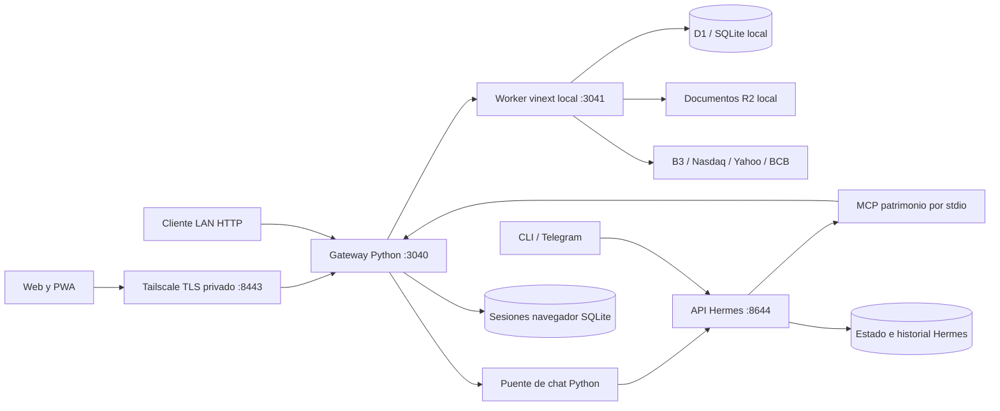
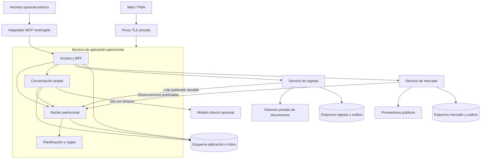

# Juanca — Especificaciones funcionales y técnicas

**Versión:** 1.3 · **Fecha de actualización:** 9 de octubre de 2026  
**Estado:** diagnóstico del sistema actual y propuesta en evolución; la lógica de custodios, fuentes y correcciones se amplía con las definiciones confirmadas por el usuario.  
**Objetivo:** convertir Juanca en una aplicación patrimonial con microservicios y autonomía operativa respecto de Hermes.  
**Ámbito:** perfil `/home/jorge/.hermes/profiles/juanca` y aplicación `workspace/patrimonio-familiar-source`.

## 1. Decisión propuesta

Juanca será el producto: una aplicación web/PWA privada para gestionar el patrimonio de Jorge y Julia. La aplicación ejecutará consultas, importaciones, revisiones, operaciones aprobadas, valoraciones y simulaciones mediante servicios determinísticos. Hermes dejará de ser una dependencia del funcionamiento habitual.

Se propone conservar la interfaz React y los parsers TypeScript y llegar a **tres servicios desplegables**: aplicación patrimonial, ingesta documental y mercado. La aplicación agrupa módulos de acceso/BFF, núcleo patrimonial, conversación, planificación y reglas. La conversación propia forma parte del producto; el uso de un modelo es opcional. Acceso o conversación se separarán en servicios solo si aparece una necesidad demostrada de aislamiento o despliegue independiente. La extracción será gradual, comenzando por módulos en la implementación vigente.

**Meta verificable:** cero llamadas a Hermes para los recorridos patrimoniales habituales y funcionamiento de todos ellos con Hermes apagado. El chat tendrá consultas y entradas determinísticas y podrá utilizar un modelo directamente para interpretación y explicación. Reducir Hermes no exige eliminar la IA ni reemplazar toda conversación libre por formularios. El agente Hermes quedará únicamente como adaptador temporal o herramienta externa solicitada expresamente.

**Dictamen de la revisión:** dirección válida con ajustes; no implementar la versión 1.0 literalmente. Las prioridades son consistencia patrimonial y autonomía de Hermes, seguidas de extracción de servicios. PostgreSQL y la distribución de procesos no son requisitos para conseguir el primer beneficio.

Microservicios añaden operación, contratos y consistencia eventual. Para la escala familiar observada se limita la cantidad de procesos, se conserva en el mismo servicio la aprobación y escritura patrimonial y se evita una plataforma de orquestación compleja. La descomposición es una propuesta arquitectónica, no una conclusión de que la carga actual exija distribuir el sistema.

## 2. Método, evidencia y límites del diagnóstico

Se inspeccionaron código, esquema, configuración pertinente y documentación local. Se comprobó en modo lectura el estado de los dos servicios patrimoniales, los puertos y los recuentos de tablas. No se importaron documentos, aprobaron propuestas, modificaron credenciales ni reiniciaron servicios. No se ejecutaron pruebas funcionales autenticadas ni una nueva batería de tests: los resultados históricos se distinguen de las verificaciones de esta inspección. La revisión 1.1 reevalúa decisiones y relee código de aprobación, costos y chat; no renueva los recuentos ni acredita pruebas de carga o concurrencia.

Etiquetas utilizadas:

- **Observado:** comprobado en código, configuración o estado local durante la inspección.
- **Documentado:** consta en documentos anteriores; no equivale a una comprobación actual de extremo a extremo.
- **Propuesto:** comportamiento futuro sujeto a implementación y validación.
- **Pendiente:** decisión o detalle que necesita confirmarse al implementar.

### 2.1 Fuentes locales principales

Las rutas de esta tabla son relativas a la raíz de la aplicación, salvo las indicadas como perfil.

| Fuente | Qué acredita |
|---|---|
| `integration/README.md` | Despliegue local, migración histórica, chat Hermes, PWA, Tailscale y sesiones |
| `integration/server.py`, `browser_sessions.py` | Gateway, identidad compartida, cookies, control de origen y red |
| `integration/hermes_chat.py` | Sesión web única, bloqueo, API Hermes e historial |
| `integration/mcp_server.py` | Siete herramientas MCP que llaman a la misma API de la web |
| `integration/services/*.service` | Procesos Python y Wrangler, puertos y persistencia |
| `apps/web/package.json`, `worker/index.ts`, `db/index.ts` | React/vinext/Vite, runtime Worker y Drizzle/D1 |
| `apps/web/db/schema.ts`, `drizzle/*.sql` | Modelo persistente actual y migraciones |
| `apps/web/app/api/**/route.ts` | APIs reales de importación, cartera, propuestas, revisiones y mercado |
| `apps/web/lib/*.ts` | Parsers, valoración, costos, consolidación y proyección |
| `apps/web/app/components/TabbedWorkspace.tsx`, `InteractiveWorkspace.tsx` | Navegación, simulador local y recomendaciones estáticas |
| `apps/web/public/sw.js` | Pantalla sin conexión; ausencia de caché patrimonial y reenvío offline |
| `apps/web/tests/*`, `integration/test_browser_sessions.py` | Casos de prueba existentes |
| `docs/ESPECIFICACION_PATRIMONIO_FAMILIAR.md` | Referencia funcional histórica del Site, anterior a la integración local |
| `apps/api/**`, `database/migrations/0001_core.sql`, `compose.yaml` | Prototipo Python/PostgreSQL separado |
| Perfil: `profile.yaml`, `config.yaml`, `skills/patrimonio/SKILL.md` | Propósito de Juanca, canales, herramientas y restricciones del agente |

La especificación histórica del Site y el README general no describen por sí solos la arquitectura desplegada hoy. Esta especificación complementa esas fuentes y prevalece como diagnóstico de la integración local inspeccionada. No incorpora contraseñas, tokens, identificadores de cuentas financieras ni contenido de documentos privados.

### 2.2 Estado local comprobado

| Elemento | Resultado observado |
|---|---|
| `patrimonio-juanca-web` | Activo en systemd de usuario |
| `patrimonio-juanca-worker` | Activo en systemd de usuario |
| Gateway | Escucha en `0.0.0.0:3040` |
| Worker | Escucha en `127.0.0.1:3041` |
| API de Hermes | Puerto `127.0.0.1:8644` escuchando; sin comprobar conversación |
| Acceso privado TLS | Puerto 8443 escuchando en interfaces Tailscale; certificado y login no revalidados ahora |
| Prototipo | No se observaron listeners en 8000 ni 5432; no se considera fuente de verdad |
| Tablas patrimoniales | 19 importaciones, 1.102 registros, 9 decisiones, 0 costos manuales, 45 cotizaciones, 8 mensajes transaccionales y 2 propuestas |

Los recuentos son una fotografía del 9 de octubre, no una validación de sus importes ni de su calidad. El informe de migración del 5 de octubre documenta otra fotografía: 18 importaciones y 17 objetos R2 restaurados. El número actual de objetos no se volvió a contar. Una tabla `cost_basis` vacía no demuestra ausencia de costos calculados: el código también los deriva de operaciones.

## 3. Arquitectura funcional actual

### 3.1 Actores e identidad

- Jorge y Julia son titulares patrimoniales seleccionables, no dos identidades web separadas.
- La cuenta web compartida utiliza una identidad patrimonial estable: `juanca-family`.
- El agente Juanca consulta y actúa mediante MCP desde CLI, Telegram y API de sesiones.
- El titular de un activo y el actor que autoriza una acción son conceptos distintos. Hoy la identidad compartida limita la atribución individual de decisiones.
- No hay ejecución de órdenes en brokers. Una operación registrada representa un hecho comunicado por el usuario o documentado, no una orden enviada al mercado.

### 3.2 Capacidades reales

| Capacidad | Implementación actual | Dependencia de Hermes |
|---|---|---|
| Dashboard y posiciones | B3, Avenue y previsión; consolidación y valoración en handlers/librerías TS | Ninguna al usar la web |
| Importar B3 | XLSX de posiciones o movimientos, propietario y fecha de referencia para posiciones | Ninguna; MCP es otra entrada |
| Importar Avenue | PDF de extracto o confirmación; extracción de texto y parser especializado | Ninguna |
| Importar previsión Santander | PDF; saldo del participante, con exclusión del saldo patronal según parser | Ninguna |
| Resolver revisiones | Clasificación humana y nota; decisión guardada por registro | Ninguna |
| Registrar costo | Costo manual y derivación inicial desde compras/ventas | Ninguna |
| Registrar transacción | Texto/adjunto → propuesta → aprobación/rechazo → importación sintética | Ninguna en el chat transaccional |
| Actualizar mercado | COTAHIST B3, proveedores públicos estadounidenses y PTAX para conversión | Ninguna |
| Proyección por activo | Extrapolación de observaciones históricas de precio a vencimiento | Ninguna |
| Simulación patrimonial | Cálculo nominal/real en navegador; parámetros editables sin persistencia | Ninguna |
| Recomendaciones | Tarjetas fijas de orientación; no motor conectado a la cartera en esta interfaz | Ninguna; no equivale a recomendación calculada |
| Chat general Juanca | Sesión real de Hermes, con herramientas y contexto | Directa y obligatoria hoy |
| PWA y login | Interfaz móvil, instalación y sesiones recordadas | Ninguna, salvo pestaña del chat general |

### 3.3 Recorridos actuales

**Consulta web:** login → gateway → Worker → datos D1 y funciones de consolidación → respuesta. Avenue puede consultar PTAX durante la lectura, por lo que una consulta de cartera depende de una fuente externa además del estado local.

**Importación:** formulario/MCP → validación → parser → hash → detección de duplicado → documento en R2 → cabecera `processing` → filas en lotes → estado `processed`. Los importadores intentan limpiar la escritura incompleta ante fallos. No existe una única transacción que abarque documentos y todas las filas.

**Transacción:** texto o comprobante → parser determinístico, incluido OCR local para imágenes compatibles → interpretación versionada pendiente → campos visibles → revisión y aprobación explícitas → escritura de importación sintética y registro de operación → nueva cartera calculada. El OCR solo propone texto y la imagen original se conserva inmutable.

**Revisión:** consulta de pendientes → decisión `corporate_action`, `custody_transfer`, `position_adjustment` o `ignored` → actualización de decisión → consultas posteriores toman esa clasificación. La etiqueta `position_adjustment` no demuestra un libro completo de ajuste de posiciones.

**Chat Hermes:** web autenticada → `/api/hermes/chat` → puente Python → API de Hermes → agente → MCP → gateway → API patrimonial. El historial general vive en Hermes y el historial transaccional en D1; son dos conversaciones distintas.

### 3.4 Reglas vigentes que deben preservarse

1. Mostrar propietario, activo, cantidad, precio, moneda, fecha y comisiones antes de aprobar una operación.
2. Registrar importaciones, costos y revisiones por instrucción del usuario; no alterar patrimonio por una pregunta informativa.
3. Mantener originales y referencias a hoja/fila o evidencia del parser.
4. Distinguir datos observados, supuestos y resultados calculados.
5. No inventar cotizaciones ni interpretar una base vacía como patrimonio inexistente.
6. No escribir directamente en SQLite para operar: utilizar la API y sus validaciones.
7. Mantener visible la insuficiencia de datos y las revisiones relevantes.

Estas son reglas del producto y de su guía local. Su cumplimiento futuro debe verificarse en los servicios y contratos, sin depender de que un prompt las recuerde.

## 4. Arquitectura técnica actual



### 4.1 Componentes y despliegue

- Frontend React 19, TypeScript, Tailwind y convenciones App Router. La compilación utiliza vinext/Vite y runtime Cloudflare Worker; no es únicamente un servidor Next.js convencional.
- Backend patrimonial integrado en `apps/web/app/api`, con librerías en `lib`. La lógica, HTTP y almacenamiento están parcialmente entremezclados.
- Drizzle utiliza el binding D1; documentos utilizan el binding R2. Wrangler/Miniflare proporciona ambos localmente con persistencia en `integration/state`.
- El gateway usa `ThreadingHTTPServer`; recibe sesiones web o Bearer de máquina, elimina cookies/autorización y cabeceras de identidad entrantes, e inyecta la identidad familiar hacia el Worker.
- El Worker confía en cabeceras `oai-authenticated-*`; varios handlers permiten identidad de desarrollo en localhost. El límite de confianza actual es el gateway más el aislamiento loopback del Worker.
- Dos unidades systemd de usuario arrancan gateway y Worker. La disponibilidad depende del host encendido y del gestor de servicios de usuario.
- La configuración de Hermes habilita herramientas patrimoniales junto con otras capacidades generales: archivo, ejecución, web, memoria y búsqueda de sesiones, entre otras. Esa amplitud no es necesaria para consultas patrimoniales rutinarias.
- El prototipo FastAPI contiene dominio, reconciliación, proyecciones, recomendaciones y PostgreSQL. Puede servir de referencia; no debe activarse como sustitución automática de la implementación local ni suponerse compatible con sus datos.

### 4.2 Persistencia y propiedad de los datos

| Almacén | Contenido | Observaciones |
|---|---|---|
| D1/SQLite local | `imports`, `import_records`, `review_decisions`, `cost_basis`, `market_quotes`, `chat_messages`, `transaction_proposals` | Fuente patrimonial actual |
| R2 local | Documentos y adjuntos originales | Claves conservadas tras migración; `chat://` representa evidencia virtual |
| `browser-sessions.db` | Hashes de tokens, expiración y ámbito de sesión | Almacén propio del gateway |
| `web-chat-session.json` | Referencia a sesión del chat general | No contiene todo el historial |
| Estado del perfil Hermes | Conversaciones y estado del agente | Fuera de la base patrimonial |
| Credenciales y configuración privada | Secretos del acceso y puente | Deben respaldarse privadamente y migrarse sin copiarse a documentación |

El esquema utiliza centavos enteros para varios importes, `REAL` para cantidades/precios y JSON serializado como `payload`. La deduplicación documental actual usa `(user_id, sha256, file_type)`; no incluye titular ni cuenta. Revisiones y costos se actualizan mediante upsert, por lo que no hay historial inmutable de cada cambio en esas tablas. Las cotizaciones guardan principalmente el último valor por mercado/símbolo.

### 4.3 API actual

| Método y ruta | Función |
|---|---|
| POST `/api/login`, `/api/logout` | Abrir y revocar sesión web |
| GET `/api/portfolio/dashboard` | Consolidación, asignación y actividad |
| GET `/api/portfolio/summary` | Cantidad de importaciones y revisiones pendientes |
| GET `/api/portfolio/positions` | Posiciones, valoración y costos |
| GET/POST `/api/portfolio/cost-basis` | Consultar y registrar costo |
| GET `/api/portfolio/fixed-income-projection` | Extrapolación histórica por activo |
| POST `/api/portfolio/reviews/{id}` | Decisión de revisión |
| POST `/api/import/b3`, `/avenue`, `/pension` | Importadores especializados |
| GET/POST `/api/transactions/chat` | Historial transaccional y nuevas propuestas |
| POST `/api/transactions/proposals/{id}` | Aprobar/rechazar |
| POST `/api/market/refresh` | Actualizar cotizaciones |
| GET/POST `/api/hermes/chat` | Historial y conversación general Hermes |

El MCP expone `consultar_patrimonio`, `proponer_transaccion`, `decidir_transaccion`, `importar_documento`, `guardar_costo`, `resolver_revision` y `actualizar_cotizaciones`. Es un adaptador HTTP, no un motor patrimonial independiente.

### 4.4 Seguridad y comportamiento operativo

Sesiones recordadas de 30 días; sin recordar, cookie de sesión con límite servidor de 12 horas. Los tokens se guardan como hashes, cambiar la contraseña invalida sesiones y logout revoca el dispositivo. Cookie HTTPS `Secure`, `HttpOnly`, `SameSite=Strict`; HTTP local usa cookie distinta. El gateway exige origen exacto en mutaciones de navegador y limita intentos de login.

El chat general usa un bloqueo global en memoria, admite un mensaje de hasta 8.000 caracteres y espera hasta 900 segundos por la API Hermes. Devuelve 409 si hay otra atención en curso. El bloqueo no coordina varias réplicas; el historial compartido limita sesiones independientes y un timeout puede dejar incierto si una acción se completó.

La PWA no almacena datos patrimoniales en Cache Storage ni reintenta escrituras sin conexión. HTTPS privado vía Tailscale figura como verificado el 6 de octubre en la documentación operativa; esta inspección solo comprobó el listener.

## 5. Limitaciones y brechas comprobadas

| Hallazgo | Consecuencia | Respuesta propuesta |
|---|---|---|
| Recomendaciones de UI fijas | No prueban concentración ni vencimientos de la cartera real | Reglas con evidencia y versión |
| Valor inicial y fecha lateral fijos en UI | Un valor de ejemplo puede confundirse con dato vigente | Usar snapshot real o marcar escenario manual |
| B3 selecciona última importación por fecha de carga; Avenue/previsión por referencia | Importar un documento antiguo puede cambiar indebidamente la base B3 | Orden temporal explícito y revisión de cambio de base |
| Consolidación repetida en dashboard/positions | Riesgo de resultados diferentes para el mismo patrimonio | Una proyección canónica de cartera |
| Operaciones posteriores al snapshot y límites SQL fijos | Puede perderse cobertura, incluidos eventos del mismo día | Secuencia/corte explícitos, paginación e integridad de cobertura |
| Cantidades negativas recortadas a cero en consolidaciones | Una venta excesiva puede quedar oculta | Incidencia visible y bloqueo de aplicación incoherente |
| Sin PTAX, Avenue convierte a cero BRL | Total puede parecer completo y subestimar exposición | Conversión no disponible como `null`, total parcial |
| Dedupe documental no incluye titular/cuenta | Carga para otro titular puede parecer duplicada | Contexto explícito y revisión de asignación |
| Dedupe de operaciones por campos aproximados y límite 5.000 | Dos operaciones reales iguales o un duplicado tardío pueden clasificarse mal | Identidad de operación/evidencia y decisión para casos ambiguos |
| Aprobación lee `pending` antes del batch, sin transición condicional que verifique afectación | Posible carrera entre aprobaciones concurrentes; no reproducida aquí | Transacción, bloqueo y clave única por propuesta aplicada |
| Vínculo de adjunto por mensaje anterior al timestamp | Evidencia puede asociarse a un mensaje equivocado | Relación directa propuesta → mensaje → documento |
| Importación en lotes con limpieza compensatoria | Caída abrupta puede dejar estados parciales u objetos huérfanos | Jobs durables, publicación final y reconciliación de almacenes |
| Upserts de decisiones y costos | Historial de cambios incompleto | Revisiones versionadas y auditoría inmutable |
| Schema ensure dentro de consultas/handlers | Operación y migración mezcladas | Migraciones explícitas fuera del tráfico |
| Proyección de renta fija extrapola precios observados | No es un motor contractual de cupones/indexadores/impuestos | Conservar método identificado; agregar método contractual después |
| Chat general depende de Hermes y herramientas amplias | Latencia/costo y disponibilidad dependientes del agente | Rutas determinísticas y módulo conversacional acotado |

Son riesgos identificados por lectura de código, no afirmaciones de pérdida de datos o incidentes ya ocurridos. Una migración debe registrar qué discrepancias corrige y qué diferencias conserva deliberadamente.

## 6. Especificación funcional objetivo

### 6.1 Requisitos y criterios verificables

| ID | Requisito propuesto | Criterio de aceptación |
|---|---|---|
| RF-01 | Acceso privado y actor separado del titular; miembros individuales en P1 | P0 conserva cuenta compartida identificada como tal; P1 permite atribución individual sin inventarla en el historial |
| RF-02 | Dashboard reproducible en BRL y moneda original | Misma versión de cartera y mercado produce idénticos totales en todas las vistas |
| RF-03 | Carga B3/Avenue/Santander sin agente | Documento válido termina o informa fallo recuperable con Hermes detenido |
| RF-04 | Idempotencia contextual | Reenviar una carga idéntica no duplica hechos; cambiar titular requiere resolver asignación |
| RF-05 | Trazabilidad | Cada hecho aplicado enlaza original, parser, fila/página o evidencia virtual |
| RF-06 | Revisiones humanas versionadas | Reclasificar conserva versión anterior, actor y razón; recalcula lo afectado |
| RF-07 | Entrada estructurada y conversacional determinística | Formularios y patrones conocidos producen borradores sin LLM |
| RF-08 | Aprobación de propuesta concreta | Aprobar dos veces, incluso concurrentemente, produce como máximo un registro aplicado |
| RF-09 | Validación patrimonial concurrente y según cobertura | Dos ventas concurrentes no exceden saldo conocido; saldo incompleto genera revisión; originales se conservan sin recorte |
| RF-10 | Costos reproducibles | Costo manual y derivado conservan origen; diferencias se explican, no se sobreescriben silenciosamente |
| RF-11 | Mercado persistido con frescura | Lectura no llama a proveedores; caída externa conserva último dato con advertencia de antigüedad |
| RF-12 | Conversión incompleta explícita | Sin cambio disponible, USD permanece visible y BRL es `null`; total marcado parcial |
| RF-13 | Planificación versionada | Escenario identifica parámetros, snapshot inicial, fecha y versión del cálculo |
| RF-14 | Renta fija con metodología visible | Método observado y contractual distinguibles; insuficiencia produce resultado ausente, no estimación inventada |
| RF-15 | Alertas calculadas | Cada alerta identifica regla, evidencia, cobertura y bloqueos; sin evidencia no afirma exposición |
| RF-16 | Conversaciones propias | Historial independiente de Hermes y control familiar en P0; hilos múltiples en P1 |
| RF-17 | IA opcional | Modelo/Hermes caído mantiene dashboard, importaciones, decisiones y simulaciones operativos |
| RF-18 | Experiencia móvil | Consulta, carga, revisión y aprobación disponibles en móvil; sin reenvíos offline |
| RF-19 | Operación recuperable | Jobs muestran estado, error seguro, intento y posibilidad de reanudar sin duplicar |
| RF-20 | Auditoría y exportación | Se puede reconstruir una decisión y exportar hechos/documentos con manifest de hashes |
| RF-21 | Custodia separada de fuente/mercado | Cada posición canónica enlaza titular, institución de custodia, cuenta e instrumento; B3 se representa como fuente de reporte y nunca como custodio |
| RF-22 | Registro inmediato de evidencia manual | Foto o mensaje de movimiento queda archivado con autor y hora aunque el parseo/identidad quede pendiente; confirmar o corregir crea nueva versión auditable |
| RF-23 | B3 concilia y corrige movimientos | Snapshot fechado y movimientos se comparan por cuenta/activo; cargas repetidas o corregidas no duplican eventos, y el historial anterior sigue consultable |

### 6.2 Alcance y prioridades

**P0 — continuidad y confianza:** consultas, las tres fuentes de importación, documentos, propuestas/aprobación, revisiones, costos, mercado persistido, acceso privado existente, backup y autonomía respecto de Hermes. Incluye conversación propia con consultas conocidas y registro de borradores; conservación del simulador y del método observado de renta fija. Las carteras de ambos titulares deben conservarse. Las capacidades nuevas de P1 no bloquean esta entrega.

**P1 — mejoras de producto:** identidades individuales, múltiples conversaciones, escenarios guardados, alertas calculadas de calidad/concentración/vencimiento y ampliación de intenciones. Umbrales de concentración son configuración del producto, no afirmaciones automáticas sobre cobertura legal. La interpretación por modelo puede adelantarse a P0 si se necesita preservar conversación libre, sin depender de Hermes.

**P2 — evolución opcional:** motor contractual de renta fija, OCR, canal Telegram propio, más fuentes o dominios patrimoniales. No son dependencias para completar la separación de Hermes.

**Puerta P0:** RF-02 a RF-12 y RF-17 a RF-20; RF-01 con identidad compartida atribuida correctamente, RF-07 con parser/formulario, RF-14 con método observado y RF-16 con historial propio. Para RF-13 se conserva la simulación actual claramente identificada; persistencia de escenarios y RF-15 quedan en P1. Así se evita convertir cada mejora deseable en condición de la migración.

Fuera de esta transformación: ejecutar órdenes, conectarse a brokers con credenciales, motor fiscal completo, asesoría regulada, contabilidad integral de pasivos o rentabilidad histórica completa. Una futura ampliación requiere su propia especificación.

### 6.3 Recorridos objetivo

**Consultar:** autenticación → cartera publicada → posiciones/totales/fechas/cobertura. El mismo snapshot alimenta dashboard, tabla de posiciones y respuestas conversacionales. Cada respuesta muestra fecha del hecho, fecha del precio y versión de cálculo.

**Importar:** seleccionar titular/cuenta/fuente/tipo/fecha → subir → recibir job → validar y deduplicar → interpretar → revisar incidencias → publicar lote → aplicar al núcleo → mostrar nueva versión de cartera. Confirmaciones documentales válidas pueden conservar el comportamiento de importación directa autorizado por la carga; cambios ambiguos y ajustes requieren revisión. Cargar evidencia desde una conversación nunca implica aprobar automáticamente una propuesta.

**Registrar operación:** formulario o texto → borrador editable → completar campos faltantes → propuesta versionada → usuario confirma resumen concreto → comando de aprobación → resultado de registro → actualización de vista. La IA solo puede preparar el borrador.

**Resolver revisión:** abrir evidencia → escoger clasificación y efectos → ver impacto previsto → confirmar → nueva decisión auditada → reconstrucción de vista. `position_adjustment` exigirá cantidad/diferencia y motivo, no solo una etiqueta.

**Simular:** elegir cartera o capital manual claramente identificado → definir retorno, inflación, horizonte y, cuando se implementen, aportes/retiros → ejecutar cálculo → guardar versión → comparar con otro escenario. No mezclar extrapolación de precios con rendimiento contractual.

**Conversar:** reconocer intención → pedir dato faltante o consultar API → responder con plantilla y evidencia. Si la modalidad asistida está habilitada, interpretar lenguaje libre con un modelo y funciones de consulta permitidas; si está deshabilitada, informar el alcance y ofrecer filtros/formulario. Una respuesta de consulta nunca dispara una escritura patrimonial. Las acciones deben pasar por el mismo flujo de propuestas y permisos que la web.

## 7. Arquitectura de microservicios propuesta



El destino tiene tres servicios propios, además de PostgreSQL y proxy/infraestructura. Un worker separado para tareas lentas de la aplicación puede ejecutar la misma imagen y acceder a sus mismos datos: es otro proceso del mismo servicio, no otro dominio ni microservicio. La extracción se hace por etapas; una fase modular intermedia con menos servicios es válida.

Se propone **una base PostgreSQL con tres esquemas y roles propietarios distintos**: `app`, `ingestion` y `market`. No habrá consultas, escrituras ni claves foráneas entre esquemas de servicios; los módulos dentro de `app` sí pueden usar transacciones y referencias locales. Las referencias entre servicios se validan mediante contrato y reconciliación. Compartir una instancia no aporta alta disponibilidad ni aislamiento frente a fallo del host.

### 7.1 Límites, responsabilidades y tecnología

| Servicio / módulo | Responsabilidad y datos propios | Límite |
|---|---|---|
| Aplicación: acceso/BFF | Sesiones, permisos, fachada HTTP y frontend React | Módulo del mismo despliegue; sin salto de red hacia el núcleo |
| Aplicación: núcleo | Hechos, snapshots, propuestas, revisiones, costos, vistas y auditoría | Único escritor del estado patrimonial |
| Aplicación: conversación | Historial, intenciones, borradores y modelo opcional | Solo puede consultar y preparar propuestas mediante funciones del núcleo |
| Aplicación: planificación/reglas | Simulaciones y alertas con evidencia | Cálculos determinísticos versionados |
| Ingesta | Documentos, hashes, parsers, filas originales, jobs y lotes inmutables | No decide impacto patrimonial ni aplica operaciones |
| Mercado | Observaciones de precios/cambio, calendario, proveedor, frescura y scheduler | No conoce cantidades, costos o autorizaciones del patrimonio |
| MCP externo opcional | Cliente de la API pública | No es una dependencia del arranque ni del backend |

Node/TypeScript reduce la reescritura de funciones vigentes. PostgreSQL se adopta para el destino transaccional; framework y versiones soportadas se fijarán al implementar. La independencia de Hermes se obtiene antes sobre APIs actuales, sin cambiar simultáneamente runtime, frontend, base de datos y dominio.

**Documentos:** primer destino en volumen privado administrado exclusivamente por ingesta, detrás de una interfaz interna `put/get/stat` por ID. Rutas internas opacas, publicación atómica en el mismo volumen y verificación de hash; el cliente no elige una ruta de disco. Ingesta sirve descargas autorizadas. Backend S3 queda como opción posterior: no se necesita desplegar un servidor compatible solo para 17 objetos históricos y nuevas cargas familiares. Volumen y manifests forman parte del backup.

### 7.2 Estructura de código propuesta

```text
apps/web/                       interfaz React
services/application/
  modules/access/               sesiones y BFF
  modules/portfolio/            comandos, conciliación y consultas
  modules/conversation/         historial e interpretación
  modules/planning/             simulaciones y reglas
  workers/                      trabajos de la misma aplicación
services/ingestion/             API y workers documentales
services/market/                API, scheduler y workers de mercado
adapters/mcp/                   cliente opcional de API pública
packages/contracts/            OpenAPI, eventos y clientes generados
packages/domain-types/          identificadores y valores sin persistencia
packages/parsers/               funciones puras B3/Avenue/Santander
infra/                         despliegue, migraciones y observabilidad
docs/                          especificaciones, decisiones y runbooks
```

Monorepo, imágenes independientes por servicio y tests de contrato. Compartir contratos y parsers puros; no compartir ORM o repositorios entre servicios. Conversación accede al núcleo mediante interfaz de aplicación, aunque ambos se desplieguen juntos. El destino vive fuera del perfil Hermes con datos y ciclo de vida propios.

### 7.3 Comunicación y consistencia

- HTTP para comandos y consultas; contratos `/v1`, validación, paginación y errores consistentes. Llamadas entre módulos de la aplicación son locales.
- Jobs durables para parseo, mercado, llamadas de modelo y reconstrucciones. Cargas largas responden 202 con identificador y ubicación del estado.
- Outbox solo en fronteras que necesitan entrega durable: lotes de ingesta y observaciones de mercado hacia aplicación. No crear un bus para cada llamada interna o consulta.
- El productor confirma datos y outbox en la misma transacción. El receptor acepta tras guardar inbox y trabajo durable. Esa respuesta confirma **recepción**, no aplicación patrimonial; el estado del lote se consulta hasta `portfolio_applied` o `portfolio_failed`.
- Dispatcher HTTP con destinatarios fijos y contratos explícitos; usar una cola PostgreSQL mantenida o una implementación mínima revisada. No construir una plataforma genérica de eventos, descubrimiento y suscripciones.
- Entrega al menos una vez e inbox único por `event_id`; clave de negocio permanente por lote/operación. Registros de idempotencia son distintos del historial de intentos de entrega.
- Versiones/orden por lote o agregado, sin orden global. Detectar huecos y enviar a revisión operativa tras agotar intentos. Mercado tolera llegada tardía por fecha de observación; no reemplazar un precio reciente solo por llegar después.
- Propuesta, estado de validación, evento y auditoría se confirman en una transacción del núcleo. Las vistas publicadas pueden ser posteriores; una aprobación valida contra el estado transaccional, nunca contra una vista atrasada.
- Indisponibilidad o saturación del modelo se aísla con jobs, timeout y límites propios. Caída de mercado conserva datos anteriores; caída de ingesta no bloquea consultar carteras publicadas.

El patrón outbox requiere consumidores idempotentes porque una entrega puede repetirse. Referencia: [Transactional outbox](https://microservices.io/patterns/data/transactional-outbox.html).

### 7.4 Trabajos y recuperación

Cada job identifica `job_id`, `status`, `attempt`, `available_at`, `lease_until`, `lease_token`, `last_error` y referencia idempotente. Claim atómico, renovación si corresponde y recuperación al vencer el lease. Un worker antiguo no puede finalizar un job con lease sustituido; la escritura final comprueba token y condición esperada. Confirmar el lease y liberar la transacción antes de hacer red o parsear.

`FOR UPDATE SKIP LOCKED` puede servir para reclamar trabajo de una cola; no se utiliza para validar saldo o autorización, donde omitir una fila bloqueada sería incorrecto. Referencia: [PostgreSQL SELECT — locking clause](https://www.postgresql.org/docs/current/sql-select.html). Los detalles de lease son una decisión de esta propuesta.

Intentos agotados dejan trabajo visible, reanudable con la misma identidad lógica. Un reconciliador consulta lotes publicados no aplicados y manifiestos faltantes; ni retención del outbox ni un HTTP 200 deben borrar la única evidencia necesaria para recuperarlos.

### 7.5 Cuándo separar más servicios

Extraer conversación si su carga o dependencias afectan a las consultas incluso con jobs y límites; extraer identidad si varias aplicaciones comparten autenticación; extraer planificación si requiere recursos o releases independientes. Antes de cada separación, comprobar que hay dueño operativo, despliegue independiente, observabilidad, recuperación y contrato estable.

El costo operativo de más servicios y la necesidad de despliegue/monitorización son criterios descritos por [Martin Fowler, Microservice Prerequisites](https://martinfowler.com/bliki/MicroservicePrerequisites.html). La elección de tres servicios es un juicio específico para Juanca, no una regla universal.

## 8. Modelo de dominio objetivo

| Servicio / módulo propietario | Entidades propuestas |
|---|---|
| Aplicación / acceso | `households`, `users`, `memberships`, `sessions`, `service_clients` |
| Ingesta | `documents`, `document_assignments`, `import_jobs`, `raw_records`, `published_batches`, `outbox` |
| Aplicación / núcleo | `household_state`, `idempotency_keys`, `jobs`, `owners`, `custody_institutions`, `custody_accounts`, `instruments`, `events`, `event_legs`, `source_assertions`, `position_account_resolutions`, `source_links`, `snapshots`, `snapshot_lines`, `proposals`, `proposal_versions`, `review_cases`, `review_versions`, `cost_observations`, `portfolio_versions`, `positions_view`, `market_observations`, `audit_log`, `inbox`, `scenario_versions`, `rule_runs` |
| Mercado | `quote_observations`, `fx_observations`, `provider_runs`, `refresh_jobs`, `outbox` |
| Aplicación / conversación | `conversations`, `messages`, `intent_runs`, `model_runs`, `draft_links` |

El catálogo describe el modelo lógico objetivo, no exige una tabla por concepto ni todos los módulos en P0. `scenario_versions` y `rule_runs` corresponden a P1. Mantener un libro relacional de hechos y revisiones con auditoría; no se requiere event sourcing general, reconstruir identidad desde eventos ni introducir un framework CQRS. Las vistas son proyecciones reconstruibles de hechos/snapshots versionados.

### 8.1 Invariantes

1. `household_id` separa ámbito de acceso; `owner_id` identifica titular; `actor_id` identifica quién registró, confirmó o corrigió.
2. Custodio, cuenta, titular, fuente del dato y mercado/registro son entidades separadas. **B3 es el sistema de reporte consolidado donde las instituciones de custodia reportan activos; no es custodio ni cuenta.** BTG, Itaú u otra entidad es la institución de custodia; Avenue y el proveedor de previsión son custodios/proveedores directos fuera de B3.
3. Una posición se identifica al menos por familia, titular, institución de custodia, cuenta, instrumento y moneda. La fuente (B3, Avenue, previsión, chat o carga manual) describe dónde se obtuvo la evidencia y no sustituye la identidad de la custodia. No agrupar por ticker antes de resolver titular y cuenta.
4. Los hechos brutos y los archivos recibidos son inmutables. Una corrección genera una nueva afirmación/versionado enlazado a la evidencia anterior y, si el hecho económico cambia, una revisión o evento de reversión/ajuste; nunca se reescribe silenciosamente el historial.
5. Evento normalizado identifica fecha efectiva, fecha de carga, custodio/cuenta, evidencia, parser y versión. Separar tiempo económico y tiempo de conocimiento. Una foto siempre queda registrada como evidencia y snapshot con fecha de corte; un movimiento escrito o fotografiado queda registrado como evidencia y afirmación de movimiento aunque necesite revisión.
6. Un snapshot representa el saldo observado de un alcance de cuenta en una fecha. Los movimientos explican entradas/salidas entre snapshots y se concilian contra ellos. No se suman otra vez movimientos ya incluidos en el snapshot de cierre. Eventos del mismo día sin orden/cobertura inequívocos requieren conciliación.
7. Un nuevo reporte B3 puede completar, corregir o sustituir afirmaciones de movimientos históricos. Se conserva el lote previo, se compara por clave económica/evidencia, se marca qué afirmación queda supersedida y se publica una nueva revisión; una coincidencia no duplica el movimiento. El saldo de cierre B3 y el libro de movimientos son vistas relacionadas con funciones distintas.
8. Transferencia de custodia mueve posición entre cuentas; no crea por sí sola flujo de caja ni ganancia. Compra/venta distingue posición, principal, comisiones y caja. La fecha de negociación y la de liquidación son campos diferentes; si no se conoce liquidación, queda ausente. Saldo desconocido genera revisión y nunca se inventa.
9. Cotización, cambio y valoración identifican fecha, proveedor y política de selección. Datos futuros no entran en una consulta histórica. Activos no reportados a B3 —como previsión o inversiones internacionales en Avenue— se incorporan desde su propio custodio/fuente y se consolidan por separado, sin simular que pertenecen a B3.
10. Revisiones abiertas no desaparecen de la cobertura; las reglas dependientes quedan bloqueadas según activo y tipo de incertidumbre. Un mensaje o extracción de IA es evidencia de una afirmación/propuesta, no un hecho patrimonial aplicado automáticamente.

### 8.2 Precisión y fórmulas

Se propone `NUMERIC(28,10)` para cantidades, precios y tipos de cambio y `BIGINT` para importes finales en unidades menores BRL/USD. Confirmar esa escala contra todas las fuentes antes de migrar; rechazar o revisar valores fuera de rango, sin truncado silencioso. Cálculos intermedios usan aritmética decimal de precisión suficiente y se redondean en un límite explícito por concepto; propuesta inicial `half-up` para importes finales, con pruebas para valores negativos y monedas. Serializar tanto decimales como enteros de 64 bits como cadenas JSON para no perder precisión en JavaScript. Conversión del tipo SQLite original queda documentada; no se recuperan dígitos ya perdidos. No usar `Number` para el cálculo monetario canónico.

PostgreSQL documenta `numeric` como decimal exacto frente a tipos de coma flotante inexactos; esto fundamenta la elección para cantidades y precios. [Tipos numéricos de PostgreSQL](https://www.postgresql.org/docs/current/datatype-numeric.html).

- Valor de posición = cantidad × precio, redondeado según moneda y política versionada.
- Conversión BRL = valor USD × PTAX persistida y seleccionada por fecha; si falta, resultado BRL `null`.
- Total consolidado = suma de posiciones valorables + indicador explícito de cobertura. Total parcial nunca se etiqueta como total completo.
- Ganancia no realizada requiere costo y valoración compatibles; ausencia de costo produce `null`.
- Escenario básico: nominal = capital × `(1 + retorno)^años`; real = nominal / `(1 + inflación)^años`. Aportes y retiros requieren convención de periodicidad explícita.
- Método observado de renta fija actual: tasa = `(precio_final / precio_inicial)^(365,25 / días) - 1`; extrapolar al vencimiento. Conservar bajo un nombre/versionado que lo distinga del método contractual. No representa por sí solo cupones, impuestos o retorno garantizado.

### 8.3 Estados y transiciones

**Job documental:** `uploaded → validating → parsing → awaiting_review | ready → publishing → published`; fallos `failed_retryable` o `failed_terminal`. `published` solo después de confirmar evidencia y registros completos. La aplicación patrimonial del lote tiene estado propio, visible como `portfolio_pending`, `portfolio_applied` o `portfolio_failed`.

**Propuesta:** `draft → pending → applied | rejected | duplicate | expired`; corrección crea nueva versión pendiente. La aprobación identifica versión y hash del resumen. Versiones anteriores no pueden aplicarse.

**Revisión:** `open → resolved`; una reclasificación agrega versión y puede abrir incidencias relacionadas. No sobrescribir la evidencia original.

**Vista patrimonial:** `building → published`; un fallo conserva la versión publicada anterior. El front muestra que existe trabajo pendiente.

### 8.4 Temporalidad, identidad y cobertura

Una versión de cartera debe incluir `facts_revision`, `market_revision`, `calculation_version`, `effective_as_of`, `known_at` y `published_at`. `effective_as_of` es la fecha económica; `known_at` limita qué información estaba disponible. Permitir inicialmente consulta actual y snapshots guardados; una reconstrucción histórica solo se ofrece desde el inicio de cobertura demostrable. No presentar una serie reconstruida con información posterior como si hubiera sido conocida entonces.

Dashboard, posiciones y conversación piden el mismo `portfolio_version`; el cursor de paginación fija esa versión para que un refresh no mezcle páginas. Si se necesita conservar la cotización antigua elegida, guardar su ID/versión, no volver a elegirla por la fecha actual.

Los registros sin cuenta o instrumento inequívoco se conservan bajo identidad pendiente, separados por fuente/titular. No unir cuentas desconocidas por ticker ni crear un historial de eventos anterior al primer snapshot. Un snapshot histórico puede ser saldo inicial con procedencia, sin inventar las compras que lo produjeron.

La cobertura informa motivos y cantidades de posiciones sin precio, cambio, costo o conciliación. No calcular un porcentaje del valor total si se desconoce precisamente el valor de los activos excluidos. Una importación tardía y una corrección generan una nueva revisión, manteniendo versiones anteriores consultables.

### 8.5 Reinterpretación de documentos

Reprocesar un documento con un parser nuevo conserva bytes y registros brutos, crea otra versión del lote y muestra diferencias. El núcleo enlaza `supersedes_batch_id` y reemplaza/revierte la aplicación anterior de forma atómica dentro de su alcance; no suma ambos lotes. Si cambian identidad, cantidades o clasificación material, requiere revisión antes de publicar. Reejecutar con el mismo parser y parámetros debe ser idempotente.

## 9. Contratos de API y eventos

### 9.1 API pública propuesta

| Ruta | Contrato esencial | Dueño |
|---|---|---|
| POST `/v1/sessions`; DELETE `/v1/sessions/current` | Login/logout, rotación y revocación | Acceso |
| GET `/v1/portfolio` | Snapshot, totales, cobertura y fechas | Núcleo vía BFF |
| GET `/v1/positions?owner_id=&portfolio_version=&cursor=` | Posiciones paginadas fijadas a versión; fecha económica y fecha de conocimiento en respuesta | Núcleo |
| POST `/v1/imports` | Multipart, fuente, tipo, titular, cuenta y fecha; 202/job | Ingesta |
| GET `/v1/imports/{id}` | Estado de ingesta y aplicación patrimonial | BFF compone ambos servicios |
| GET `/v1/imports/{id}/records?cursor=` | Evidencia y registros según permisos | Ingesta |
| POST `/v1/movements/intake` | Texto y/o foto; guarda evidencia primero y devuelve afirmación/job para extracción y resolución de identidad | Aplicación + ingesta |
| GET `/v1/movements/{id}`; POST `/v1/movements/{id}/decisions` | Consultar extracción, confirmar, corregir o dejar pendiente con versión y motivo | Núcleo |
| POST `/v1/imports/{id}/reconcile` | Comparar snapshot/movimientos con la revisión aplicada y mostrar altas, cambios, bajas y diferencias antes de publicar | Núcleo |
| GET `/v1/reconciliation/b3/candidates` | Comparar snapshots B3, movimientos y cobertura; salida candidata de solo lectura | Núcleo |
| POST `/v1/reconciliation/b3/decisions` | Anotar confirmación/descarte auditado de una diferencia concreta; nunca aplica cantidades | Núcleo |
| POST `/v1/proposals` | Borrador validado; 201/version | Núcleo |
| GET `/v1/proposals/{id}`; PATCH `/v1/proposals/{id}` | Leer resumen/estado; editar borrador con versión esperada e invalidar resumen anterior | Núcleo |
| POST `/v1/proposals/{id}/approve` | `version`, `summary_hash`, `expected_facts_revision`, idempotencia | Núcleo |
| POST `/v1/proposals/{id}/reject` | Versión, motivo y actor | Núcleo |
| GET `/v1/reviews`; POST `/v1/reviews/{id}/decisions` | Evidencia y revisión versionada | Núcleo |
| POST `/v1/cost-observations` | Costo, fecha y evidencia; nueva observación | Núcleo |
| POST `/v1/market/refresh`; GET `/v1/jobs/{id}` | Solicitud asíncrona y estado | Mercado vía BFF |
| POST `/v1/scenarios`; GET `/v1/scenarios/{id}` | Parámetros y resultado reproducible | Núcleo/planificación |
| GET `/v1/fixed-income/projections`; GET `/v1/alerts` | Metodología, versión, cobertura y bloqueos | Núcleo |
| POST `/v1/conversations`; GET `/v1/conversations` | Crear/listar hilos; en P0 puede existir uno familiar | Aplicación / conversación |
| POST `/v1/conversations/{id}/messages` | Intención y respuesta; referencia a borrador si existe | Aplicación / conversación |
| GET `/v1/conversations/{id}/messages?cursor=` | Historial propio y paginado | Aplicación / conversación |

Acceso/BFF, núcleo, planificación y conversación son módulos del servicio de aplicación; las etiquetas de la tabla no implican otros despliegues. El BFF mantiene un registro de jobs externos con su servicio propietario, de modo que `/v1/jobs/{id}` no adivine dónde consultar.

Un mensaje lento responde 202 y se consulta por job, con SSE opcional para progreso; evitar la espera HTTP de 900 segundos. SSE no debe incluir secretos ni representar una confirmación de escritura antes del commit.

Para escrituras, `Idempotency-Key` identifica una operación del actor/familia. Guardar hash del cuerpo normalizado y resultado: misma clave/mismo cuerpo retorna resultado previo; misma clave/distinto cuerpo devuelve 409. Retención inicial propuesta de 30 días; claves patrimoniales de aplicación y lote son permanentes. Los handlers actuales pueden mantenerse como adaptadores mientras se migra la interfaz.

Errores JSON: `code`, `message`, `request_id`, `retryable`, `details` seguros. 401 sin sesión, 403 sin permiso, 404 recurso fuera del ámbito o inexistente, 409 conflicto de versión/idempotencia, 422 validación, 429 límite y 503 dependencia indisponible. Ningún reintento automático de escritura sin clave idempotente.

### 9.2 Ejemplo de aprobación

```json
{
  "proposal_id": "example-proposal",
  "version": 2,
  "expected_facts_revision": 41,
  "summary_hash": "sha256-del-resumen-confirmado"
}
```

El actor se deriva de la sesión, no de un campo editable. En una transacción corta del núcleo: reservar/verificar idempotencia; bloquear la fila de estado patrimonial de la familia; bloquear propuesta y comprobar permisos, versión, estado, hash y revisión de hechos; validar impacto sobre saldos transaccionales; insertar hecho con clave única de propuesta; actualizar estado/revisión, auditoría y resultado idempotente. Todas las mutaciones patrimoniales, incluidas aplicaciones de lotes y revisiones, toman el mismo bloqueo familiar. Con dos usuarios es un compromiso simple; particionar por cuenta solo si la carga lo requiere. Nunca mantener el bloqueo durante una llamada al modelo, proveedor o ingesta.

Bloquear solo la propuesta es insuficiente: con saldo de 10, dos propuestas diferentes de venta de 7 podrían aprobarse a la vez. La serialización del estado compartido permite aplicar como máximo la primera y devuelve conflicto/revisión en la segunda. Una revisión de hechos distinta de `expected_facts_revision` exige recalcular el impacto y confirmar de nuevo; un cambio de precio de mercado aislado no cambia esa revisión.

La validación usa hechos y estado transaccional, no `positions_view` eventualmente atrasada. Si falta cobertura para establecer cantidad disponible, conservar propuesta pendiente de conciliación. En importaciones, conservar el hecho original y abrir revisión; no perder evidencia por rechazar la publicación del saldo.

Misma clave/cuerpo devuelve resultado guardado; clave incompatible devuelve conflicto. Clave distinta para propuesta ya aplicada retorna estado e identificador de aplicación, sin repetir efecto. Bloqueos por fila y su duración transaccional están documentados en [PostgreSQL — Explicit Locking](https://www.postgresql.org/docs/current/explicit-locking.html); el protocolo familiar es una decisión específica de Juanca.

### 9.3 Sobre de evento

```json
{
  "event_id": "example-event-id",
  "event_type": "ImportBatchPublished",
  "schema_version": 1,
  "aggregate_id": "example-batch-id",
  "aggregate_version": 1,
  "household_id": "example-household",
  "occurred_at": "2026-10-09T12:00:00Z",
  "correlation_id": "example-request-id",
  "causation_id": "example-job-id",
  "payload": {
    "batch_id": "example-batch-id",
    "record_count": 120,
    "manifest_hash": "sha256-del-manifest",
    "parser_version": "b3-v1"
  }
}
```

Contratos entre servicios iniciales: `ImportBatchPublished` y `MarketObservationsPublished`. Una carga de documentos puede publicar `SourceAssertionsPublished` como lote/versionado de evidencia; el núcleo decide deduplicación, resolución de custodia y efecto patrimonial. `PortfolioVersionPublished`, `ReviewDecisionRecorded` y `ProposalApplied` son notificaciones/auditoría internas hasta existir un consumidor externo que justifique entregarlas. Para lotes grandes, el núcleo obtiene registros paginados de un contrato interno inmutable y verifica cantidad/hash; documentos no viajan completos en eventos.

### 9.4 Consistencia entre documentos y base

No hay transacción distribuida entre PostgreSQL y el volumen de documentos. Ingesta registra intención durable de carga antes de recibir bytes; escribe archivo temporal, verifica tamaño/hash y publica archivo inmutable de forma atómica en el mismo volumen. Después confirma metadatos, procesa y publica lote/manifest/outbox. La referencia publicada solo existe una vez verificada la durabilidad del archivo. Si hay fallo, conserva estado recuperable; un reconciliador detecta referencias sin objeto y objetos temporales huérfanos. Su eliminación exige plazo de retención y comprobación de ausencia de referencias.

Deduplicación propuesta: mantener hash físico por familia y asignación explícita titular/cuenta/fuente/tipo/fecha. El mismo contenido con asignación distinta genera advertencia y revisión, sin descartar silenciosamente datos de otro titular. La identidad económica de una operación se gestiona aparte de la identidad del documento.

### 8.6 Custodia, fuentes, snapshots y movimientos

El modelo distingue cuatro conceptos que hoy aparecen mezclados en algunos registros:

| Concepto | Ejemplo | Función en el dominio |
|---|---|---|
| Titular | Jorge, Julia | Persona a quien pertenece económicamente el activo |
| Institución de custodia y cuenta | Itaú → cuenta de inversiones; BTG → cuenta de inversiones; Avenue → cuenta internacional | Dónde se custodia el activo y bajo qué cuenta concreta |
| Fuente de evidencia | reporte B3, archivo del custodio, estado Avenue, estado de previsión, chat o foto | Quién/qué produjo la observación recibida y cuándo |
| Registro o mercado | B3, bolsa, mercado estadounidense | Infraestructura de reporte o negociación; no equivale a custodio |

`custody_institutions` mantiene la entidad custodia con tipo y nombre canónico. `custody_accounts` pertenece a un titular y a una institución; conserva referencia externa protegida, moneda/país cuando corresponda y estado de identidad (`known`, `pending`, `needs_review`). `data_sources`/metadatos de importación describe el sistema que produjo el archivo. La relación entre activo y custodia se resuelve por cuenta, no por la institución que aparece como emisor, contraparte o mercado. Un mismo custodio puede tener varias cuentas y un titular puede tener activos en varios custodios.

Para enlazar una fila histórica de proyección con una cuenta confirmada se conserva la decisión en `position_account_resolutions`, sin editar la afirmación ni el snapshot de origen. El enlace automático solo se permite cuando titular, institución, fecha, instrumento y cantidad coinciden exactamente con una fila B3, y la evidencia de usuario establece que hay una única cuenta para esa institución. Las coincidencias ambiguas o sin soporte permanecen pendientes. El cambio de identidad genera una nueva versión de la vista; no puede corregir cantidades, valores ni movimientos por sí solo.

Un lote documental conserva archivo/hash, titular declarado, fuente, tipo, fecha de generación/corte, cobertura (cuenta, conjunto de cuentas o cuenta desconocida), versión del parser y filas originales. Cada fila normalizada mantiene su enlace al lote y a hoja/fila/identificador fuente. Los nombres de archivo no bastan para asignar fecha ni cuenta: se contrastan con metadatos internos y contenido del reporte.

**Reporte de posiciones B3:** cada carga produce un snapshot fechado de los saldos que ese reporte declara para el alcance cubierto. B3 es fuente de reporte; el custodio y su cuenta se leen de la fila/cabecera si están disponibles o quedan pendientes. El snapshot de cierre sirve para conocer el saldo observado en esa fecha. Una foto enviada por el usuario sigue el mismo patrón: se conserva el original, se registra la fecha/alcance declarados y se publica como evidencia pendiente o confirmada según validación.

**Reporte de movimientos B3:** cada carga produce afirmaciones históricas de movimiento con fechas efectivas, activo, cantidad, tipo y referencia/cuenta según la evidencia disponible. El reporte permite explicar entradas y salidas entre cortes, reconstruir trayectoria dentro de su cobertura y contrastar el snapshot actual. Su cobertura temporal y si es acumulativa deben leerse del propio archivo/reporte, no suponerse por el nombre. Una carga posterior puede traer movimientos nuevos o corregir/reexpresar movimientos anteriores. Si el reporte cubre una ventana móvil, la ausencia de un movimiento anterior al inicio de esa ventana nunca significa que se revocó; incluso dentro del solapamiento una omisión es candidato de revisión, no una eliminación automática.

**Conciliación:** por titular + custodio + cuenta + instrumento + moneda, comparar snapshot inicial + movimientos dentro del intervalo con snapshot final. Un movimiento incluido en el saldo final no se vuelve a aplicar sobre ese snapshot. Si el alcance de cuenta o cobertura de fechas no es demostrable, mantener saldos y eventos como evidencia separados y abrir revisión; no fabricar una reconstrucción continua. Ajustes por eventos corporativos, vencimientos, transferencias y diferencias de unidades requieren clase de evento y evidencia explícitas. En B3, `Transferência - Liquidação` es una observación de liquidación que puede respaldar una compra/venta previa; `TRANSFERÊNCIA SEM FINANCEIRO` puede describir traslado de custodia y exige conocer contraparte. No clasificarlas como el mismo tipo de hecho.

**Correcciones de reportes:** cada archivo nuevo crea un lote inmutable. La comparación identifica filas iguales, nuevas, omitidas y modificadas con claves económicas estables y referencias originales. Una modificación no borra la fila anterior: crea una revisión/corrección enlazada, marca el estado previo como supersedido para la proyección vigente y conserva ambas versiones para reconstruir qué se conocía tras cada carga. Los impactos se muestran como diferencias antes de publicar una nueva `facts_revision`. Si la asociación de cuenta, la identidad del activo o el sentido del movimiento es ambiguo, se requiere resolución humana. La idempotencia evita volver a aplicar el mismo lote o movimiento cuando se reenvía el mismo archivo.

**Movimientos manuales:** escribir un movimiento o enviar una foto crea inmediatamente un registro de evidencia inmutable (texto/adjunto, actor, hora de recepción y hash del archivo) y una afirmación estructurada si el parser puede extraerla. Los campos incompletos quedan en borrador/revisión, pero la evidencia nunca desaparece. Al confirmar titular, custodio, cuenta, activo, cantidad, fecha y tipo se registra el movimiento canónico con vínculo a una o varias fuentes. Un reporte B3 posterior puede confirmarlo, enriquecerlo o corregirlo; no crea una segunda operación si refiere al mismo hecho. La corrección conserva el movimiento manual original, anota el motivo/origen de la evidencia superior y emite un nuevo estado versionado.

El núcleo tendrá al menos `source_assertions` (filas recibidas por documento/chat), `source_interpretations` (lecturas sucesivas con versión de parser), `events` (hechos económicos canónicos), `source_links` (uno o más respaldos/correcciones por hecho), `snapshots` y `snapshot_lines`. La carga y el parseo pertenecen a ingesta; deduplicación, vínculo con custodia y conciliación pertenecen al núcleo. Hermes no interviene en estos flujos; un modelo opcional solo puede sugerir campos para una afirmación, nunca decidir custodia, deduplicar definitivamente ni corregir el libro.

## 10. Reducción de Hermes e IA

### 10.1 Matriz objetivo

| Función | Ejecutor | Hermes objetivo | Modelo objetivo |
|---|---|---|---|
| Consultas y explicación básica | API + plantillas con evidencia | 0 llamadas | 0 llamadas |
| Importadores conocidos | Parsers + jobs | 0 | 0 |
| Registro manual y patrones conocidos | Formulario/parser + propuesta | 0 | 0 |
| Revisión y aprobación | Usuario + núcleo | 0 | 0 |
| Mercado y alertas | Scheduler/adaptadores/reglas | 0 | 0 |
| Simulación y renta fija | Motor determinístico | 0 | 0 |
| Texto fuera de patrones | Extracción estructurada opcional | 0 | Llamadas acotadas por presupuesto e intención |
| Explicación extensa solicitada | Datos seleccionados + modelo opcional | 0 | Generación acotada con evidencia del núcleo |
| Investigación externa excepcional | Adaptador externo solicitado | Opcional | Fuera del recorrido habitual |

### 10.2 Enrutamiento conversacional

1. El usuario selecciona consulta, registrar operación, importar o simular; el sistema también reconoce patrones conocidos.
2. Para consultas, usar filtros validados y funciones permitidas. No generar SQL ni dejar al modelo escoger URLs arbitrarias.
3. Para operaciones, extraer campos determinísticamente; si faltan fecha/moneda, solicitar confirmación en lugar de aceptar inferencias como hechos.
4. Si el usuario habilitó la modalidad asistida, enviar el fragmento mínimo al modelo según esa preferencia, sin pedir permiso en cada mensaje. Salida estructurada validada; campos fuera del contrato se rechazan. El modelo puede elegir consultas de un catálogo cerrado, con argumentos validados y autorizados por la aplicación.
5. Mostrar origen de la extracción y campos inferidos. Ninguna confianza numérica autoriza una escritura.
6. El historial y la autorización se gestionan en la aplicación. El modelo no recibe tokens de servicio, acceso a shell, archivos generales ni facultad de aprobación.
7. Presupuesto inicial configurable: hasta dos invocaciones por turno (interpretación y respuesta), deadline total y máximo de consultas/filas. Al superar presupuesto o fallar validación, devolver respuesta parcial o pedir aclaración. No usar un ciclo autónomo abierto.
8. Preguntas libres no son funcionalmente equivalentes a expresiones regulares. Validar con ejemplos reales en español y portugués: preguntas de seguimiento, ambigüedades, comparación por titular y explicación de cambios. La memoria del chat no sustituye consultas de cartera vigente ni autoriza acciones.
9. Texto extraído de documentos y mensajes previos es dato no confiable, nunca instrucciones para cambiar herramientas o permisos. Respuestas numéricas provienen de resultados calculados e identifican versión/evidencia; marcar interpretaciones redactadas por el modelo.

Sin modelo configurado, el usuario puede completar el formulario y seguir. Si se conserva temporalmente Hermes, aislar su adaptador, limitar herramientas y prohibir que su indisponibilidad bloquee el producto. La meta final es cero dependencia de su runtime; no se desinstala ni modifica el perfil durante la fase de especificación.

### 10.3 Métricas de autonomía

- Llamadas Hermes por recorrido P0: **0**.
- Recorridos patrimoniales P0 completables con agente/modelo apagados: **100% de la puerta P0 definida en 6.2**, usando controles estructurados cuando sea necesario. Esto no promete conversación libre equivalente sin modelo.
- Activación de IA: optativa y registrada por intención, sin contenido privado en métricas.
- Medir porcentaje de tareas sin modelo, resolución correcta y satisfacción sobre un conjunto representativo. Se retira la meta arbitraria del 95%: minimizar llamadas no debe degradar la conversación útil ni confundirse con reducir Hermes.
- Registrar latencia, tokens/costo si el proveedor lo informa, timeout y aceptación/corrección de borradores. Presupuesto configurado; al agotarlo se conserva entrada manual.

## 11. Seguridad, operación y requisitos no funcionales

### 11.1 Seguridad propuesta

- Mantener acceso privado vía Tailscale/TLS como primer despliegue. No exponer servicios de datos o administración directamente.
- Mantener acceso privado existente en P0, registrando actor compartido como tal. Migrar a miembros individuales en P1 sin atribuir retrospectivamente decisiones antiguas a una persona. Roles: lector, editor y administrador; editor registra/aprueba en su ámbito, administrador gestiona miembros.
- Sesiones revocables, cookies protegidas y validación de origen/CSRF. Conservar recordar dispositivo como opción, con política explícita de expiración.
- Entre servicios, identidad firmada y verificada mediante biblioteca mantenida, con emisor, audiencia, familia, actor y expiración; credencial de worker separada y permisos limitados. No implementar criptografía o proveedor de identidad propio. El receptor valida familia del lote y emisor autorizado; no confía en `household_id` enviado libremente. Dentro de la aplicación se propaga contexto autorizado por interfaz local.
- Clientes máquina con credenciales específicas y permisos acotados; MCP de lectura por defecto. Aprobación necesita contexto de usuario autorizado y propuesta concreta, no un token general del modelo.
- Secretos fuera del repositorio y de especificaciones; rotación al migrar accesos y eliminación de claves innecesarias del puente.
- Validar tamaño, formato, extensión, páginas, límites de descompresión y tiempo de parseo. Mantener 15 MB por documento como límite inicial y límites de páginas por flujo; pruebas contra archivos inválidos.
- Documentos privados con autorización y URL temporal si se descarga; sin caché offline de datos ni logs de texto/documentos completos.
- Retención de originales y auditoría hasta decisión explícita de política. La duración definitiva y eliminación/exportación requieren acordarse; no introducir borrado automático de patrimonio.

### 11.2 Objetivos operativos propuestos

Estos son objetivos de diseño, no SLA ni mediciones actuales.

| Métrica | Objetivo inicial y condición |
|---|---|
| Consulta de cartera | p95 ≤ 1 s, datos persistidos y 2 usuarios concurrentes |
| Aceptación de comando/job | p95 ≤ 2 s excluyendo transferencia de archivo |
| Publicación tras aprobar | p95 ≤ 5 s con consumidor saludable |
| Importación | p95 ≤ 60 s para documentos válidos de referencia ≤ 15 MB; calibrar benchmark |
| Frescura de mercado | Trabajo diario tras disponibilidad de cierre; marcar antigüedad por calendario y mercado |
| Recuperación | RPO propuesto ≤ 24 h y RTO ≤ 2 h para host único; demostrar mediante restauración |
| Disponibilidad | Sin objetivo 24/7 hasta definir host y energía; medir servicio mientras host disponible |

Jobs reintentan fallos transitorios con backoff y número máximo de intentos; errores de formato no se reintentan automáticamente. Separar timeout de proveedor, timeout de job y deadline de API. Limitar concurrencia de parsers y proveedores para no saturar el host.

### 11.3 Despliegue y observabilidad

Primer destino: un host privado con contenedores/Compose, tres servicios, una instancia PostgreSQL y volumen documental privado con backup externo. El TLS privado existente puede seguir siendo el punto de entrada; no agregar otro proxy salvo necesidad. Publicar solo la aplicación/BFF. Scheduler, consumidores y servicios internos viven en red privada. Es una nueva configuración de despliegue, no el `compose.yaml` del prototipo.

Cada servicio tiene `/health/live` y `/health/ready`; readiness verifica sus dependencias imprescindibles, sin hacer que el fallo del modelo deshabilite el núcleo. Migraciones versionadas se ejecutan por despliegue; no crear tablas desde consultas.

Logs estructurados con `request_id`, job, tipo de acción, estado y duración; auditoría patrimonial separada. Métricas de outbox atrasado, trabajos fallidos, discrepancias de cartera, cobertura y antigüedad de mercado. Propagar contexto de traza entre BFF, servicios y jobs. OpenTelemetry documenta trazas para seguir operaciones entre componentes: [Traces](https://opentelemetry.io/docs/concepts/signals/traces/).

Backups coherentes de PostgreSQL y documentos con manifest, cifrados y en destino distinto del host. En el primer despliegue, usar una breve pausa de mutaciones, drenar workers/publicadores, obtener backup PostgreSQL mediante herramienta soportada y copiar los archivos referenciados; no prometer consistencia de copias tomadas independientemente. En la restauración, validar hashes y desactivar consumidores hasta reconciliar inbox/outbox y estados de lotes. Una entrega repetida tras restaurar no reaplica un lote. Incluir configuración y secretos en copia privada separada. Una copia en el mismo disco no cubre pérdida del equipo. Probar restauración en ambiente aislado y comprobar referencias/hash, no solo que arranca la base.

## 12. Migración gradual

### 12.1 Principios

La aplicación actual permanece fuente de verdad hasta que se valida y conmuta cada frontera. Evitar doble escritura distribuida desde el frontend. Las comparaciones y reconstrucciones se ejecutan sobre copias coherentes; no escribir en SQLite de producción para adaptar el esquema. La lectura técnica usada para inventario no sustituye APIs de operación.

### 12.2 Fases y salidas

| Fase | Trabajo | Salida verificable |
|---|---|---|
| F0 — línea base | Backup coherente, restauración aislada, contratos actuales, identidades y casos dorados | Estado reproducible sin tocar hechos reales |
| F1 — confianza inmediata | Pruebas/correcciones focalizadas de aprobación, evidencia, PTAX ausente y elección temporal; separar parsers/cálculo | Errores críticos corregidos o identificados con resolución explícita; una vista coherente |
| F2 — independencia de Hermes | Conversación/historial propios sobre las APIs actuales; consultas determinísticas, modelo directo opcional | Recorridos habituales funcionan con Hermes detenido, antes de migrar almacenamiento |
| F3 — aplicación autónoma | Extraer módulos de aplicación y persistencia PostgreSQL en sombra; contratos y modelo temporal P0 | Paridad o diferencias explicadas; dominio y migración validados |
| F4 — mercado e ingesta | Primero mercado persistido; después ingesta durable/documentos, cada uno validado en sombra antes de avanzar | Tres servicios con contratos y recuperación preparados; origen sigue siendo único escritor patrimonial |
| F5 — corte P0 | Reconciliación final, migración, UI/API compatibles, backup y reversión | P0 aceptado, despliegue autónomo fuera del perfil Hermes |
| F6 — mejoras P1 | Miembros individuales, escenarios persistentes, alertas y conversación ampliada | Valor añadido medido sin retrasar independencia |

Las fases son paquetes de trabajo, no fechas prometidas. F2 necesita un almacén propio para historial, independiente del estado Hermes, y usa las APIs actuales para el patrimonio. No obtiene acceso privilegiado para modificar la base. El alcance de conversación libre se compara con ejemplos del producto, no solo con un test de que responde.

Cada frontera tiene un único escritor: mercado posee precios/cambio; ingesta posee documentos/registros brutos; aplicación posee decisiones/hechos. Por defecto F3/F4 validan las piezas por separado sobre copias; F5 realiza un corte coordinado de escrituras tras la comparación final. Una conmutación anticipada de una frontera solo procede si su adaptador hacia el sistema vigente está probado, sin doble escritura. No introducir a la vez base, runtime y reglas sin comparaciones separadas. Retirar adaptadores únicamente después de validar el destino.

### 12.3 Mapeo y reconciliación de datos

| Origen actual | Destino | Validación |
|---|---|---|
| Identidad `juanca-family` y titular texto | Familia, miembros, titulares y cuentas | Sin cambiar propietario de documentos/hechos |
| `imports` y documentos R2 | Documentos/asignaciones, jobs históricos y lotes | IDs anteriores mapeados, SHA-256, conteo y fecha |
| `import_records.payload` | Registro bruto + evento/snapshot normalizado | Referencias de origen, parser y consistencia de cantidades |
| `review_decisions` | Versiones iniciales de revisión | Conservar decisión/nota; no inventar revisiones anteriores |
| `cost_basis` | Observaciones manuales | Conservar fecha/origen; reconstrucción derivada comprobada aparte |
| `market_quotes` | Observaciones iniciales de mercado | No inventar series que el origen no conserva |
| `chat_messages` y `transaction_proposals` | Historial transaccional y propuestas | Estado, evidencia y aplicación enlazados |
| `chat://` | Evidencia virtual de mensaje/propuesta | No tratar como objeto faltante |
| Historial Hermes | Exportación privada y conversaciones marcadas como heredadas | Separar mensajes de hechos; no repetir acciones antiguas |
| Sesiones navegador | Nuevas sesiones al conmutar | Reautenticación; no reutilizar automáticamente tokens anteriores |

La importación histórica conserva ID o tabla de correspondencia. Para registros ya aplicados, no volver a ejecutar la aprobación como si fuese nueva. La comparación incluye total, posiciones, cantidades, costos, caja conocida, pendientes y enlaces de evidencia. Cualquier diferencia por corrección de algoritmo debe registrarse antes de habilitar escritura en el destino.

### 12.4 Conmutación y reversión

1. Crear backup coherente usando el procedimiento operativo actual y comprobar restauración.
2. Cargar y validar copia en destino; mantener destino sin escrituras de usuario durante comparación.
3. Abrir ventana breve de bloqueo de mutaciones en origen, esperar operaciones activas y obtener copia/delta final verificado.
4. Aplicar delta una sola vez, comparar y apuntar BFF al destino mediante configuración versionada.
5. Mantener origen en solo lectura y registrar todos los comandos del nuevo sistema.
6. Si falla antes de nuevas escrituras, revertir enrutamiento al origen. Si ya existen nuevas escrituras, bloquearlas y reconciliar/exportar comandos con sus claves; no restaurar una copia antigua y perderlos. Si no hay adaptador inverso probado, corregir destino o permanecer en lectura hasta reconciliar.
7. Retirar almacenamiento/runtime antiguos solo tras aceptación, backup restaurable y plazo de conservación acordado.

## 13. Verificación y aceptación

### 13.1 Evidencia existente

El repositorio contiene 19 casos web sobre parsers B3/Avenue/previsión, transacciones, mercado, proyección y renderizado; seis métodos de prueba de sesiones y cinco casos Python del prototipo. El README de integración documenta pruebas web aprobadas y verificaciones de migración realizadas anteriormente. Esta inspección inventarió esos casos; no volvió a ejecutarlos ni verificó su cobertura efectiva.

### 13.2 Plan de pruebas necesario para implementar

| Grupo | Casos con valor de verificación |
|---|---|
| Parsers | Fixtures sanitizadas de las tres fuentes; formato inválido, límites, pie B3 y fechas |
| Contratos | OpenAPI, compatibilidad de adaptadores y rechazo de campos/permisos inválidos |
| Patrimonio | Snapshot antiguo después del nuevo, misma fecha sin corte, cuenta desconocida, negociación/liquidación, transferencias y cobertura incompleta |
| Idempotencia | Misma propuesta repetida, dos propuestas distintas sobre saldo compartido, lote concurrente, clave distinta para propuesta aplicada y replay tras restaurar |
| Evidencia | Propuesta enlazada al documento correcto; adjuntos iguales/concurrentes |
| Fallos | Archivo antes/después de metadatos, lease vencido y worker antiguo, commit antes del envío, recibido pero no aplicado, evento repetido/fuera de orden |
| Mercado | Sin PTAX, dato antiguo/tardío, parcial, versión fija entre páginas y consulta histórica sin información futura |
| Aritmética | Cantidades fraccionarias, decimales, redondeo, comisiones y monedas |
| Autorización | Recurso ajeno, sesión revocada, identidad interna falsa y origen no permitido |
| Conversación | Español/portugués, seguimiento, ambigüedad, timeout, inyección desde documento, datos estructurados citados y ninguna autoaprobación |
| Migración | Conteos/hashes/vínculos, parser nuevo reemplaza lote sin duplicarlo, snapshots de origen incompleto y diferencias corregidas documentadas |
| Operación | Backup y restauración completa; jobs reanudados sin efectos duplicados |
| Autonomía | Hermes y proveedor de IA detenidos; completar consultas, tres importadores, revisión, costo, propuesta/aprobación y escenarios |
| Móvil | Login, navegación, carga, aprobación, sesión recordada y desconexión sin reenvío |

Los casos de concurrencia y fallo son prioritarios: una suite de funciones puras no demuestra que una aprobación distribuida sea segura ni que la migración conserve datos.

### 13.3 Condiciones de aceptación de la transformación

- RF P0 satisfechos con evidencia reproducible y datos sanitizados para CI.
- Cartera de ambos titulares reconciliada, con diferencias explicadas y aceptadas antes del corte.
- Cero dependencia obligatoria de Hermes en servicios, datos, autenticación y recorridos habituales.
- Aprobaciones idempotentes y auditadas, sin ejecución de órdenes de inversión.
- Mercado ausente/antiguo y datos incompletos visibles; sin totales completos engañosos.
- Servicios desplegables y reiniciables por separado; contratos y runbooks disponibles.
- Restauración y reversión ensayadas; no exigir borrar datos vigentes para volver atrás.

## 14. Decisiones pendientes y recomendación de siguiente trabajo

1. **Host:** conservar el equipo actual o usar uno siempre encendido. Por defecto, conservar acceso privado y host actual durante la migración.
2. **Alcance conversacional:** web primero; Telegram propio queda P2 salvo que sea canal imprescindible.
3. **IA:** proveedor, presupuesto y consentimiento de envío de fragmentos. Por defecto, desactivada; ningún modelo concreto es requisito.
4. **Identidad:** miembros individuales y permisos; diferenciar permisos del actor y titular patrimonial.
5. **Cuentas y temporalidad:** completar claves de custodia y reglas de corte para no duplicar movimientos ya incluidos en snapshots.
6. **Datos/retención:** política de conservación, destino de backup y tratamiento de historial Hermes heredado.
7. **Objetos y versiones:** backend privado de documentos, versiones soportadas de runtime/framework/PostgreSQL y recursos del host.
8. **Reglas de producto:** umbrales de concentración, antigüedad aceptable por mercado y prioridad de métodos de valoración. No trasladar textos estáticos como reglas financieras validadas.

El siguiente paquete recomendado es F0/F1, seguido de F2: restauración aislada, pruebas de invariantes y correcciones críticas, y conversación propia sobre las APIs actuales. Después se migra persistencia y se extraen servicios. La independencia de Hermes tiene una entrega verificable anterior al final de la transformación.

## 15. Registro de decisiones de esta propuesta

| ID | Decisión | Motivo |
|---|---|---|
| ADR-01 | Juanca es aplicación; Hermes es adaptador opcional | Autonomía y menor dependencia del agente |
| ADR-02 | Conservar React y parsers TS | Reutilizar comportamiento real y reducir reescritura |
| ADR-03, revisada | Tres servicios; acceso/conversación/planificación dentro de aplicación | Menos fronteras y operación; extracción adicional solo con evidencia |
| ADR-04 | Aprobación y libro en el núcleo | Atomicidad del cambio patrimonial |
| ADR-05, precisada | Una base PostgreSQL, tres esquemas/roles; adopción posterior a independencia Hermes | Propiedad por servicio y menos cambios simultáneos |
| ADR-06, acotada | Outbox/inbox solo en ingesta/mercado; jobs con leases y destinos fijos | Entrega durable sin crear una plataforma de eventos |
| ADR-07 | Vistas patrimoniales únicas y versionadas | Consistencia entre dashboard, posiciones y chat |
| ADR-08 | Mercado persistido, lecturas sin proveedores externos | Consultas reproducibles y tolerancia a fallos |
| ADR-09, precisada | Modelo directo opcional para lenguaje libre y explicación, con consultas permitidas | Reducir Hermes preservando calidad conversacional |
| ADR-10, revisada | Independencia Hermes antes de migrar base/extracción completa | Obtener beneficio temprano con cortes verificables |
| ADR-11 | Serializar mutaciones patrimoniales por familia en P0 | Evitar carreras entre propuestas distintas y lotes |
| ADR-12 | Libro relacional y vistas versionadas; sin event sourcing general | Trazabilidad suficiente sin exigir historia inexistente |
| ADR-13 | Volumen privado de archivos inicial; S3 opcional | Menos infraestructura para el volumen actual |
| ADR-14 | P0 preserva producto; nuevas capacidades en P1/P2 | Evitar que mejoras secundarias bloqueen la migración |

Estas decisiones documentan la propuesta y sus motivos. No constituyen un despliegue realizado ni autorización implícita para conmutar los datos actuales.


## 16. Resultado de la segunda evaluación — versión 1.1

**Veredicto:** la separación del agente y el núcleo determinístico son correctos. La versión 1.0 tenía más servicios y más alcance simultáneo del necesario, y dejaba invariantes distribuidas sin especificación suficiente. Se recomienda implementar la versión revisada.

| Prioridad | Ajuste de revisión | Razón y efecto |
|---|---|---|
| Alta | Tres servicios en lugar de cuatro más conversación separada | Conserva fronteras útiles: archivos, mercado y patrimonio; reduce despliegues/contratos |
| Alta | Independencia Hermes en F2, antes de PostgreSQL y extracción completa | Entrega el objetivo principal temprano |
| Alta | Bloqueo del estado familiar, además de propuesta/idempotencia | Evita dos ventas incompatibles desde propuestas diferentes |
| Alta | Snapshot con revisiones de hechos/mercado y cobertura temporal | Mantiene coherencia entre vistas sin inventar historia |
| Alta | Reprocesamiento versionado reemplaza lote anterior | Evita duplicar patrimonio al mejorar parsers |
| Alta | Jobs con lease e inbox/outbox con estados de recepción/aplicación | Define recuperación real después de caídas |
| Media | Identidades individuales y nuevas reglas/escenarios en P1 | Mantiene P0 alcanzable sin perder controles existentes |
| Media | Modelo directo opcional y evaluación conversacional | Minimizar agente no significa eliminar comprensión de lenguaje libre |
| Media | Volumen privado inicial y libro relacional | Reduce infraestructura y complejidad de persistencia |

**Se mantienen:** reutilización de React/TypeScript, parsers determinísticos, evidencia original, autorización explícita, transacciones en el núcleo, precios persistidos, decimales, despliegue privado, migración con único escritor y restauración probada.

**Pendiente de demostrar al implementar:** rendimiento y recursos del host, paridad de importadores, carreras y recuperación, calidad conversacional y exactitud de la migración. Esta revisión valida y mejora el diseño documental; no certifica una implementación todavía inexistente.


## 19. Seguimiento de implementación — 9 de octubre de 2026

Se activó el primer hito de la propuesta revisada por F0/F1/F2 en la aplicación vigente, con los límites registrados en el informe de implementación. Los cambios, pruebas, límites y operación se registran en [IMPLEMENTACION_JUANCA_F0_F2.md](IMPLEMENTACION_JUANCA_F0_F2.md). El diagnóstico anterior describe la fotografía previa; no debe interpretarse como estado posterior a la activación. F3 se inició en sombra (sección siguiente); F4–F6 continúan pendientes. La conversación guiada propia permite retirar Hermes del recorrido web habitual; la conversación libre con modelo directo aún requiere implementación y evaluación.


## 20. Primer incremento F3 — PostgreSQL y aplicación en sombra

El 9 de octubre de 2026 se desplegó una aplicación Node/TypeScript independiente en `/home/jorge/juanca`, con PostgreSQL privado fuera del perfil Hermes. El alcance y las pruebas están en [IMPLEMENTACION_JUANCA_F3_SOMBRA.md](IMPLEMENTACION_JUANCA_F3_SOMBRA.md). No se da por completado F3 ni se ha hecho el corte de F5.

- Se migró una copia verificable de las fuentes, manteniendo evidencia, historial compartido con atribución desconocida y roles/esquemas separados.
- La API `/v1` de sombra sirve consultas autenticadas, importes exactos como cadenas, posiciones paginadas por versión y conversación guiada propia con historial PostgreSQL. Solo el chat admite escrituras HTTP; D1 continúa siendo el único escritor financiero activo. La web actual todavía usa su chat F2.
- El módulo de aprobación se validó sobre PostgreSQL real con datos sintéticos: bloqueo familiar, idempotencia, caja/posición, partidas y auditoría atómicas. No se habilitó para la cartera real.
- En la primera fotografía F3 se preservan las 199 posiciones. La venta SMAL11 del 05/10/2026 quedó vinculada en sombra a la cuenta B3 correspondiente tras confirmación de Jorge. También se resolvió el alias de cuenta Avenue de Jorge para tres confirmaciones y Jorge confirmó que la compra BAC del 28/08/2026, atribuida por su fuente a Julia, es suya. Las tres decisiones tienen trazabilidad y no alteran la evidencia original. En revisión de hechos 3, cantidades, valores por posición y total concilian exactamente; hay cero diferencias y cero incidencias. Esa proyección inicial todavía muestra 148 posiciones B3 sin cuenta (127 de Jorge y 21 de Julia) y una posición de previsión sin cuenta. La evidencia B3 posterior de Jorge y su confirmación de una cuenta por institución se registraron aparte (sección 23), sin aplicar todavía una nueva proyección.
- La precisión lógica 28/10 se implementa mediante un dominio NUMERIC sin coerción y CHECK de escala/rango; `NUMERIC(28,10)` por sí solo puede redondear al insertar. Se mantiene la política half-up y la serialización de BIGINT/decimales como cadenas.
- En ese primer corte pasaron 19 pruebas, TypeScript y la restauración aislada de 22 tablas de aplicación. La verificación posterior, tras registrar B3, se describe en la sección 23.

Siguientes pasos F3: conciliar y aplicar en sombra la nueva evidencia B3 de Jorge usando cuentas reales por custodio, resolver las 21 posiciones B3 de Julia y la cuenta de previsión de Jorge, completar persistencia normalizada y comandos, trasladar acceso/BFF y adaptar la web en sombra. Las cuentas Avenue revisadas ya concilian. F4 mantiene la extracción posterior de ingesta y mercado; F5 exige conciliación final y un único escritor. La conversación libre con modelo directo continúa pendiente.

### Modelo patrimonial ampliado — 9 de octubre de 2026

Jorge aclaró que B3 es el sistema de reporte consolidado donde custodios como BTG e Itaú informan posiciones, no un custodio. La institución custodia y mantiene la cuenta; B3 es la fuente del reporte. Previsión y Avenue pueden contener activos fuera del universo B3 y se incorporan desde sus propias fuentes/custodios.

El archivo de posiciones registra el snapshot de la fecha de corte; el archivo de movimientos contiene hechos históricos que explican altas y bajas y permiten reconstruir la posición dentro de su cobertura. Se concilian por titular, custodio, cuenta, activo y moneda. El movimiento histórico no se vuelve a sumar encima del snapshot final que ya lo incorpora. Una carga futura puede completar/corregir movimientos; cada archivo y fila permanece versionado y la nueva revisión marca altas, cambios, bajas y correcciones sin duplicar ni borrar evidencia anterior.

Toda foto, archivo o movimiento escrito se conserva como evidencia al recibirse. Una foto de cartera genera un snapshot; un movimiento en texto/foto genera una afirmación de evento aunque falte parseo o cuenta. Cuando una operación se confirma, el evento canónico enlaza la captura manual y los reportes que la confirmen o corrijan. Los reportes `movimentacao-2026-10-09-19-28-45.xlsx` y `posicao-2026-10-09-19-28-14.xlsx` ya se leyeron y registraron en sombra; su análisis está en la sección 23.

La sombra F3 conserva temporalmente claves de cálculo por ámbito de fuente/registro para no mezclar evidencia ambigua. Esas claves no son el modelo canónico de custodio/cuenta. Antes del corte, cada posición debe resolverse al custodio y cuenta reales, con conciliación de snapshots y movimientos; la paridad de cantidades por sí sola no basta.

## 21. Preparación F4 — servicio de mercado

Se agregó al repositorio independiente un primer servicio `services/market` y contrato OpenAPI propio. Su límite es deliberadamente acotado: recibe listas de símbolos desde un cliente autorizado, persiste observaciones B3, estadounidenses y PTAX en el esquema `market`, y no consulta posiciones ni aprueba hechos patrimoniales. Los trabajos usan claves idempotentes, leases, reintentos acotados y outbox; las lecturas de cotización consultan valores persistidos.

La migración `005_market.sql`, API, worker y unidades systemd están preparados, pero todavía no se aplicó la migración ni se activaron procesos. No existe aún consumidor del outbox en el núcleo; la cartera sigue usando las cotizaciones de la fotografía F3. El próximo paso es desplegar en sombra, conectar inbox de aplicación con entrega idempotente, comparar fechas/proveedores/frescura y conciliar versiones de cartera. F5 continúa bloqueado hasta resolver cobertura e identidades de cuentas.

## 22. Preparación F4 — ingesta documental

Se añadió una API interna para registrar intención durable de carga antes de aceptar bytes. La carga usa una segunda solicitud con tamaño/contenido declarados, límite de 30 MB y cálculo de SHA-256 mientras se transmite a un temporal con permisos privados. El objeto final usa una ruta derivada del hash y publicación atómica en el mismo volumen; el cliente nunca elige rutas de disco. Después de confirmar el objeto, una transacción guarda documento/asignación, encola el trabajo de parser y escribe el evento `DocumentStored` en el outbox. Repetir la carga verifica los bytes y devuelve el mismo resultado; la asignación de titular/cuenta/fuente se conserva aparte del objeto físico.

La migración `006_ingestion.sql`, API, contrato y unidad systemd están preparados, pero no desplegados. No se migraron objetos R2, el parser/worker no está implementado, los lotes publicados aún no se producen y no hay consumidor del outbox en el núcleo. La aplicación debe autorizar la familia/titular/cuenta antes de llamar al servicio; ingesta entrega bytes solo ante una referencia de familia asignada. El servicio no requiere Hermes. El volumen de objetos necesita reconciliación de huérfanos y copia/restauración comprobada antes de activarse.

El código agregado para F4 pasó la comprobación TypeScript posterior, pero todavía no se probó ni activó en ejecución. Las pruebas de aplicación registradas corresponden a F3.

## 23. Reportes B3 del 9 de octubre — evidencia y conciliación candidata

Jorge confirmó que ambos archivos pertenecen a su patrimonio y que, en las instituciones que figuran en este reporte, tiene una sola cuenta de custodia por institución. Se conservaron los XLSX originales por hash en el archivo privado de la sombra y se registraron 558 filas en PostgreSQL: 146 posiciones con fecha de corte declarada 09/10/2026 y 412 movimientos fechados entre 08/10/2025 y 08/10/2026. El nombre del archivo aporta la fecha de corte porque Jorge la confirmó; la ventana de movimientos se obtuvo de las fechas de las filas. Su inicio no demuestra que no existieran movimientos anteriores.

| Custodio identificado en las filas | Posiciones | Movimientos | Identidad de la cuenta en esta evidencia |
|---|---:|---:|---|
| Itaú Corretora de Valores (incluye alias `Itaú CV`) | 94 | 253 | Una referencia externa observada en acciones, BDR y fondos; las filas de renta fija/Tesouro se vinculan a la misma cuenta por confirmación de Jorge |
| BTG Pactual (variantes de nombre unificadas) | 48 | 128 | Cuenta interna identificada por titular + institución y confirmación de unicidad; el XLSX no trae número externo |
| Itaú Unibanco | 4 | 30 | Cuenta interna identificada por titular + institución y confirmación de unicidad; se mantiene separada de Itaú Corretora |
| XP Investimentos | 0 | 1 | Movimiento histórico pendiente de identidad de cuenta |

La hoja de posiciones contiene `Conta` para acciones, BDR y fondos; renta fija y Tesouro Direto no la incluyen. Movimientos tiene ocho columnas y tampoco incluye `Conta`. `Instituição` es el custodio reportado, mientras `Emissor` y `Contraparte` cumplen otros papeles. La asignación por custodio permite estructurar las 146 posiciones de Jorge en este nuevo snapshot sin inventar números de cuenta para BTG o Itaú Unibanco. No resuelve las posiciones de Julia ni la cuenta de previsión.

Frente al snapshot B3 anterior de Jorge, del 19/09/2026, la comparación normalizada encuentra 149 → 146 posiciones: una alta de renta fija, cuatro ausencias (incluido SMAL11) y un cambio de cantidad en una acción. Hay 17 movimientos desde el 20/09 hasta el 08/10; seis son candidatos a explicar esos cambios, pero la coincidencia de código por sí sola no confirma el vínculo económico. En particular, la venta manual SMAL11 informada con fecha de negociación 05/10 y el débito B3 `Transferência - Liquidação` del 07/10 tienen la misma cantidad: se conservan como dos evidencias candidatas del ciclo negociación/liquidación, sin contabilizarlas dos veces ni convertir el débito en traslado de custodia. Otras dos ausencias son CDB con rescates B3 fechados el 18/09, antes del snapshot del 19/09 que aún los incluía. Quedan como discrepancias temporales: hay que verificar corte efectivo, posible retraso de actualización o alcance del reporte, sin inventar un movimiento posterior al snapshot.

La interpretación determinística versionada `b3-v3-2026-10-09` identifica códigos de renta fija del segundo segmento de `Produto` y relaciona nombres de Tesouro con el ISIN único del snapshot. De 558 filas, 83 quedan marcadas para revisión de significado o identidad: 46 observaciones de traslado sin contraparte, 36 tipos de evento que requieren clasificación y un movimiento histórico XP sin cuenta. Las filas originales y las interpretaciones previas se conservan. Este lote permanece como **evidencia en sombra**; la cartera publicada y la aplicación financiera vigente no cambiaron. El informe privado de candidatos está en `~/.local/share/juanca-shadow/migration/b3-2026-10-09-candidate-comparison.json`.

La próxima aplicación patrimonial debe comparar por cuenta e intervalo cubierto, enlazar eventos manuales con liquidaciones documentadas, resolver los candidatos restantes y publicar una nueva revisión de hechos junto con sus diferencias. La futura entrada de foto/texto necesita endpoint y UI propios; las tablas de evidencia ya admiten esos tipos, pero ese recorrido todavía no está conectado a la web. Tras este registro pasaron las 19 pruebas de aplicación y TypeScript; una restauración aislada comprobó las 30 tablas `app` y los dos XLSX por SHA-256. El respaldo aún excluye los documentos R2 históricos y no tiene copia fuera del host.

## 24. Entrada manual y fotos en la sombra — 10 de octubre de 2026

Se activó el registro de evidencia manual en la API privada de sombra. Un texto recibido por `POST /v1/evidence/text` se guarda íntegro, con titular, fecha declarada opcional, hora de recepción y clave idempotente. Una operación escrita en la conversación guiada también genera una entrada manual vinculable si se conoce el titular; si falta, el mensaje original permanece en el historial para atribuirlo después. Ninguna de estas entradas aplica un evento ni modifica la revisión de hechos. El estado inicial es `awaiting_review`.

Una foto usa dos pasos: `POST /v1/evidence/photos` registra intención, titular, tipo, tamaño y SHA-256; `PUT /v1/evidence/photos/{id}/content` deposita los bytes por medio del BFF en ingesta. Ingesta comprueba longitud/hash, guarda el objeto privado por contenido y registra documento, asignación, trabajo y outbox; `GET /v1/evidence/photos/{id}` expone el estado. La aplicación solo permite el titular que existe en la familia configurada y construye ella misma la referencia de familia. Se aceptan JPEG, PNG, WebP y HEIC hasta 20 MB en este recorrido. El worker aplica OCR local a JPEG, PNG y WebP; HEIC permanece almacenado y pendiente de OCR. La foto es evidencia `manual_evidence`, no una posición ni un movimiento interpretado automáticamente; el reconocimiento de texto no aprueba ni aplica hechos.

La migración `009_manual_intake.sql` y el esquema de ingesta están aplicados. Los servicios aplicación e ingesta funcionan por localhost, con tokens privados distintos. La prueba aislada de ingesta verificó una imagen sintética completa, el SHA-256, la asignación familiar y la denegación de otra familia; no agregó evidencia ficticia al patrimonio. La prueba de texto y la de chat usaron PostgreSQL temporal. El respaldo local restaurado comprobó 31 tablas `app`, 8 `ingestion` y los dos XLSX B3. Los futuros objetos de ingesta se incluyen y verifican por hash en ese respaldo. El enlace posterior con la web y el parser B3 se describen en la sección 25. Tampoco hay aún copia fuera del host ni migración de R2 histórico.

## 25. Entrada desde la web, parser B3 y puente de evidencia — 10 de octubre de 2026

El gateway local autenticado expone únicamente las rutas de evidencia permitidas hacia la API de aplicación en sombra; guarda los tokens de servicio fuera del navegador. El formulario de Transacciones registra el texto y las fotos antes de enviarlos a la aplicación financiera vigente. Si la nueva evidencia no queda almacenada, el formulario no continúa con ese envío; una repetición conserva la clave idempotente. La web existente sigue siendo la autoridad financiera y mantiene su aprobación actual. Los PDFs y TXT/CSV enviados solo como anexo de transacción siguen en R2; esta primera conexión adicional cubre texto y fotos.

Los formularios de importación B3, Avenue y previsión registran cada XLSX/PDF en ingesta antes de llamar a los importadores vigentes. La fecha del reporte de posiciones B3 se extrae del nombre cuando está disponible y se muestra para corrección; se envía igual al registro de evidencia y al importador vigente. En ingesta, el documento queda vinculado a familia/titular/fuente y sus bytes se verifican por SHA-256. Esta doble recepción todavía no implica doble aplicación económica: ingesta solo archiva, parsea B3 y ofrece filas para conciliación; D1 sigue siendo el único escritor de cartera publicado.

El worker B3 independiente reclama trabajos con lease, lee el objeto verificado y registra filas originales por documento, hoja y número de fila. La migración `007_ingestion_raw_sheet.sql` corrige la identidad de fila para hojas múltiples; `008_ingestion_reference_date_correction.sql` deja trazada una corrección de metadatos de fecha sin modificar las filas originales. El núcleo obtiene lotes parseados mediante API de ingesta y su worker los copia de forma idempotente a `app.source_documents`, `app.source_assertions` e interpretaciones versionadas; no consulta el esquema `ingestion` directamente. `010_ingestion_bridge.sql` registra cada lote recibido. El estado patrimonial publicado no cambia con esa recepción.

La resolución de cuenta de filas de snapshots históricos se registra aparte en `app.position_account_resolutions` (`015_b3_position_account_resolutions.sql`). La vista de sombra puede adoptar ese vínculo conservando cantidades y valoraciones del snapshot; cualquier operación se aplica solo si su vínculo con la cuenta está resuelto por evidencia propia. En la base revisada el 11/10/2026, las 149 filas B3 de Jorge del 19/09 se vincularon de forma única con las cuentas de BTG, Itaú Corretora e Itaú Unibanco; esto incluyó 127 posiciones antes no identificadas y 22 que ya tenían referencia. Julia y previsión permanecen pendientes. No se alteró la fuente financiera vigente ni se incorporó el snapshot del 09/10 como corrección aplicada.

Se pasaron por este recorrido los dos XLSX B3 de Jorge ya autorizados. Ingesta guardó y parseó 412 movimientos y 146 posiciones. Las 558 filas coinciden exactamente por hoja, número de fila y JSON original con la evidencia registrada antes; el puente no duplicó filas (`new_rows=0`). La nueva interpretación dejó 83 entradas para revisión, igual que la interpretación v3 anterior. La revisión de hechos permanece en 3. El respaldo local restaurado comprobó 32 tablas `app`, 8 `ingestion`, los dos XLSX del archivo anterior y los dos objetos de ingesta por hash. No se migró R2 histórico, no existe aún conciliador que aplique correcciones ni copia fuera del host. Fotos y documentos nuevos enviados directamente al agente Hermes, fuera de la web, no pasan automáticamente por esta API.

## 26. Estado de F4 — servicio de mercado en sombra (10 de octubre de 2026)

La captura de mercado y su transporte a la aplicación ya están activados en sombra. `services/market` mantiene su esquema y outbox; el worker de aplicación consume el outbox por API autenticada, registra inbox y observaciones con hash e idempotencia y avanza el cursor de forma transaccional. La unidad `juanca-shadow-application-market-worker` está habilitada y activa. Se recibieron 6 eventos, 227 precios y 6 observaciones USD/BRL. No hay consultas directas entre esquemas.

La actualización amplia solicitó 26 símbolos B3 y 24 estadounidenses; obtuvo 22 y 23. Las capturas parciales se reintentaron hasta cinco veces, por lo que cinco eventos posteriores contienen los mismos 45 resultados disponibles más FX; faltan cuatro símbolos B3 y uno estadounidense. El diseño debe cambiar a reintentos acotados únicamente para faltantes y conservar estado de cobertura/frescura por símbolo para no confundir ausencia con cotización vigente. Se corrigió el parseo de fechas del archivo diario COTAHIST: la fecha en el nombre es `ddmmyyyy`, mientras las filas usan `yyyymmdd`.

La última disponibilidad observada fue B3 y PTAX del 09/10/2026 y Nasdaq del 08/10/2026. La integración demuestra adquisición/transporte, no que las observaciones puedan valorizar activos. En particular, no está calificada la continuidad/licencia del endpoint público de Nasdaq. Las cotizaciones aún no alimentan la cartera: no cambian `facts_revision`, posiciones ni versiones publicadas. Las cinco versiones previas siguen intactas. La autoridad publicada continúa siendo la web/Worker/D1 actual.

Antes de valorar se requiere política de frescura y cobertura, selección/validación de proveedor por mercado, normalización de instrumentos y monedas, y cálculo versionado con tratamiento explícito de precios faltantes. El puente se comprobó operativamente mediante servicio activo y contadores PostgreSQL; no se ejecutaron pruebas nuevas en este incremento. El respaldo descrito en la sección 27 ya incluye la migración y los eventos recibidos, con restauración y comparación completas por esquema. Sigue pendiente la copia fuera del host y una estrategia de snapshot atómica entre esquemas.


## 27. Respaldo y restauración de aplicación, ingesta y mercado — 10 de octubre de 2026

Se generó la copia privada `/home/jorge/.local/share/juanca-shadow/backups/full-shadow-after-market-20261010`. La herramienta restauró y comparó 36 tablas `app`, 8 `ingestion` y 6 `market`, además de verificar por SHA-256 los dos archivos XLSX B3 y los dos objetos binarios registrados en ingesta. La operación terminó correctamente.

El respaldo permanece en el mismo host, no incluye documentos R2 históricos ni protege ante pérdida del equipo. Las exportaciones de esquemas se hacen secuencialmente y la restauración compara cada esquema por separado; esto no garantiza una vista distribuida atómica si los workers modifican varios esquemas concurrentemente. Antes de ampliar el uso patrimonial hay que añadir copia cifrada fuera del host y acordar una estrategia coherente de snapshots y reconciliación de outbox/cursor.

## 28. Baseline B3 y generación de conciliaciones candidatas — 10 de octubre de 2026

Se recuperó del archivo histórico el snapshot B3 de Jorge con fecha de corte 19/09/2026 y su archivo de movimientos. Se registraron ambos por su contenido y filas originales (149 posiciones y 28 movimientos), preservando hash, hoja, número de fila y cuenta de custodia existente. La copia quedó vinculada como evidencia anterior al snapshot del 09/10; no se suman sus movimientos al saldo ni se publicó una nueva posición.

La comparación contra el snapshot de 09/10 identifica seis diferencias. Dos variaciones de renta fija tienen rollforward exacto por aplicaciones y rescates. Las variaciones relacionadas con actualización corporativa o liquidación no admiten un cálculo confiable de unidades y quedan para revisión. Dos CDB retirados del snapshot no tienen un movimiento posterior al snapshot anterior. La cobertura de movimientos acaba el 08/10 y el estado de posiciones es al 09/10, por lo que la ventana queda incompleta. No se autoriza aplicación automática por este resultado.

Después de cada ciclo de puente B3, el worker genera o actualiza informes privados por pares cronológicos de snapshots. Incluye candidatos, movimientos relacionados, variación observada y razones de incertidumbre. La aritmética de unidades está limitada a crédito por adquisición y débito por rescate; transferencias, negociación, liquidación y acción corporativa quedan inconclusas. Los informes son derivados, de acceso local y aún no están expuestos en UI ni cuentan con comandos de aprobación.

La copia privada `backups/full-shadow-b3-reconciliation-20261010` restauró y comparó 36 tablas `app`, 8 `ingestion` y 6 `market`, además de los cuatro XLSX B3 y dos objetos de ingesta. Los artefactos de conciliación se pueden regenerar desde evidencia; la copia no incluye R2 histórico ni está fuera del host. El siguiente tramo es presentar estas diferencias en una bandeja de revisión con decisiones auditadas, cerrar cobertura de movimientos/corte y mantener la regla de no publicar sin aprobación explícita.

## 29. Consulta de conciliaciones candidatas por API — 10 de octubre de 2026

La API de sombra incorpora `GET /v1/reconciliation/b3/candidates?limit=50`, requiere bearer token y limita `limit` a 1–100. La ruta devuelve informes de la familia configurada, de más reciente a más antiguo; declara `mode=shadow`, `authoritative=false` y `apply_enabled=false`. El POST de decisiones registra una anotación humana versionada e idempotente por diferencia y pareja de documentos. Si cambia la huella de la diferencia, la anotación anterior queda obsoleta y una decisión nueva genera otra revisión. Ninguna decisión modifica hechos patrimoniales.

## 30. Bandeja B3 de solo lectura en la interfaz — 10 de octubre de 2026

La pestaña «Revisiones» compara snapshots B3 y permite confirmar o descartar la diferencia como anotación auditada. El gateway autentica al actor y agrega las credenciales de servicio; el navegador no recibe esos secretos. La UI muestra fechas/cobertura, diferencias, cálculo de unidades y razones de incertidumbre, además del estado de revisión y sus obsolescencias. No permite corregir cantidades ni publicar y advierte que la cartera vigente no cambia. La bandeja complementa el flujo de revisiones actual, todavía basado en D1.

## 31. Reintento de cotizaciones limitado a faltantes — 10 de octubre de 2026

Un refresco parcial ahora guarda la lista exacta de símbolos que faltaron por proveedor. El siguiente intento pide solo esos símbolos; PTAX se repite únicamente si falló. Los intentos siguen limitados a cinco con backoff. Cada evento outbox contiene solo las observaciones nuevas de ese intento y el resultado consultable del trabajo acumula los éxitos anteriores, además de mostrar `pending_symbols` y `pending_fx`. Así se conservan las observaciones sin volver a emitir todos los símbolos correctos en cada intento.

Los seis eventos históricos existentes no se modificaron. Al desplegar no había trabajos en cola; no se lanzó otra captura a proveedores. El worker se reinició y está activo, y el contrato OpenAPI de mercado subió a 0.2.0. La cobertura, frescura y confiabilidad de proveedores todavía deben validarse antes de usar precios en valoraciones.

## 32. Interpretación local de movimientos escritos — 10 de octubre de 2026

El registro de texto conserva íntegra la evidencia y genera en la misma transacción una interpretación local versionada (`manual-trade-v1`). Sin invocar Hermes, reconoce expresiones explícitas con tipo de operación, ticker, cantidad, precio y moneda y fecha. El resultado permanece `parsed_review` incluso cuando los campos están completos; faltantes o formatos ambiguos (por ejemplo, separadores de miles sin coma) quedan en `needs_manual_review`, y textos que no expresan una operación se marcan `not_detected`. Toda interpretación incluye campos y razones revisables, sin crear eventos contables ni cambiar posiciones, efectivo o `facts_revision`.

La migración `012_manual_trade_interpretations.sql` vincula cada interpretación con su evidencia original. `POST /v1/evidence/text` devuelve la interpretación junto con el acuse de recibo idempotente; `GET /v1/evidence/text/{id}` expone su estado y los campos leídos; `GET /v1/evidence/text?limit=50` ofrece una lista reciente para revisión. La pestaña «Revisiones» muestra texto, titular, interpretación y faltantes desde esta bandeja persistente. La cuenta de custodia, el enlace con liquidaciones y la decisión de incorporar un movimiento siguen requiriendo revisión humana. La interfaz no aplica decisiones y la ruta no publica hechos patrimoniales.

La aplicación de sombra reinició con la migración aplicada. En la web, después de registrar el texto, se muestran los campos identificados y las razones pendientes; la propuesta financiera vigente conserva su revisión actual. El contrato OpenAPI subió a 0.9.0. El respaldo local `backups/full-shadow-written-intake-20261010` restauró y comparó 37 tablas `app`, 8 `ingestion`, 6 `market`, cuatro reportes B3 y dos objetos de ingesta. No se ejecutaron pruebas funcionales en este incremento.

## 33. Sugerencias entre operaciones escritas y filas B3 — 10 de octubre de 2026

`GET /v1/reconciliation/manual-b3/candidates` propone relaciones únicamente cuando coinciden titular, instrumento y cantidad decimal exacta, y las fechas distan como máximo siete días. Busca filas de negociación, liquidación o transferencia B3 y presenta cada una con fecha, custodio, tipo de evento y dirección de crédito/débito. La dirección no se interpreta como compra o venta, porque depende de la semántica de cada tipo de fila. La salida agrupa coincidencias por evidencia escrita e indica si hay múltiples filas.

La bandeja web «Coincidencias escritas ↔ B3» es de solo lectura. No registra relaciones aceptadas, no deduplica automáticamente y no aplica operaciones; una negociación y su liquidación podrían ser dos filas de la misma operación. La revisión humana debe confirmar identidad económica y custodia antes de crear un enlace persistente. El contrato OpenAPI subió a 0.10.0. No se ejecutaron pruebas funcionales en este incremento.

## 34. Decisiones auditadas sobre correspondencia de evidencia — 10 de octubre de 2026

Cada sugerencia individual puede marcarse `related` o `not_related` desde la web autenticada. La API confirma primero que la fila aún califica como candidata y autoriza únicamente a membresías `reviewer`, `owner` o `approver`. La identidad se transmite del gateway sin aceptar un actor arbitrario del navegador. La cuenta web se registró con privilegio `reviewer`; esto permite decidir enlaces de evidencia, no aprobar operaciones financieras.

La tabla append-only `app.manual_b3_link_decisions` guarda las revisiones, actor, clave idempotente, marca temporal y referencia a una decisión anterior. Una corrección crea una revisión nueva y no borra el historial. El listado muestra la decisión más reciente. `related` significa solo que la persona considera vinculadas las evidencias; no declara que se deba contar ambas filas ni que sean un único evento contable. No se alteran posiciones, efectivo ni `facts_revision`. El contrato OpenAPI pasa a 0.11.0; la migración se respalda y restaura en copia privada local.

## 35. Bandeja persistente de fotografías y vista del original — 10 de octubre de 2026

La API de ingesta ofrece `GET /v1/manual-evidence/photos?limit=50` con token de servicio y ámbito obligatorio de familia. La aplicación consulta esa ruta y combina los metadatos con los titulares de su propio esquema; no existe acceso directo entre esquemas. La interfaz «Comprobantes recibidos» vuelve a mostrar archivos ya enviados, titular, fecha, tamaño y estado, y permite abrir la imagen desde el gateway autenticado.

La descarga se limita a uploads `manual_evidence` de la familia configurada que ya estén almacenados. El servicio de aplicación recupera los bytes por la API de ingesta y comprueba MIME, tamaño y SHA-256 antes de responder. La original permanece inmutable. El texto de una operación escrita se interpreta localmente y queda pendiente de revisión; las fotografías reciben OCR local en imágenes compatibles y siguen el mismo principio de revisión humana. Ninguna interpretación se aplica por sí sola. Los contratos pasan a aplicación 0.14.0 e ingesta 0.3.0.

## 36. OCR local de fotografías recibidas — 10 de octubre de 2026

La ingesta ejecuta Tesseract local en un worker dedicado para evidencia `manual_evidence`. La distribución instalada es Tesseract 5.3.4 con los modelos portugués (`por`) e inglés (`eng`), extraídos en el perfil de usuario para no requerir privilegios de sistema. No usa Hermes, red ni servicios de OCR externos. JPEG, PNG y WebP se procesan; HEIC queda almacenado y marcado como formato aún no compatible con OCR.

Cada salida se guarda junto a su versión de parser y hash; el objeto fotográfico no se modifica. La aplicación aplica `manual-trade-v1` al texto OCR y persiste en una tabla append-only una lectura candidata de lado, instrumento, cantidad, precio, moneda y fecha cuando los reconoce. La identidad incluye familia, upload, hash OCR y versión de parser; el worker la entrega idempotentemente desde la API de ingesta. La bandeja presenta foto, texto reconocido y campos candidatos, con faltantes para revisión; todo debe cotejarse contra el original. La salida no crea hechos, no cambia patrimonio ni dispara operaciones. El worker de ingesta conserva el estado `awaiting_review` y la lectura no pasa a publicación B3 ni a aplicación financiera. Los contratos de aplicación e ingesta pasan a 0.16.0 y 0.5.0.

## 37. Persistencia idempotente de lecturas OCR — 10 de octubre de 2026

La interpretación de la foto no se calcula al abrir la bandeja. El worker de aplicación recorre la bandeja de ingesta por páginas, aplica la versión determinística `manual-trade-v1` al texto OCR terminado y registra los campos en `app.manual_photo_trade_interpretations`. La clave incluye familia, ID del upload, hash del texto OCR y parser; repetir la lectura no duplica ni modifica filas. Un trigger impide actualizar o borrar esas interpretaciones; una versión nueva del OCR o parser produce otra fila.

La bandeja combina la lectura persistida con la foto y el texto original reconocido. Solo presenta lado, instrumento, cantidad, precio, moneda, fecha y razones faltantes para revisión. No presenta un botón de aplicar, no asigna cuenta de custodia y no cambia hechos. La migración `014_manual_photo_trade_interpretations.sql` se respaldó y aplicó; contrato de aplicación 0.16.0 e ingesta 0.6.0.
