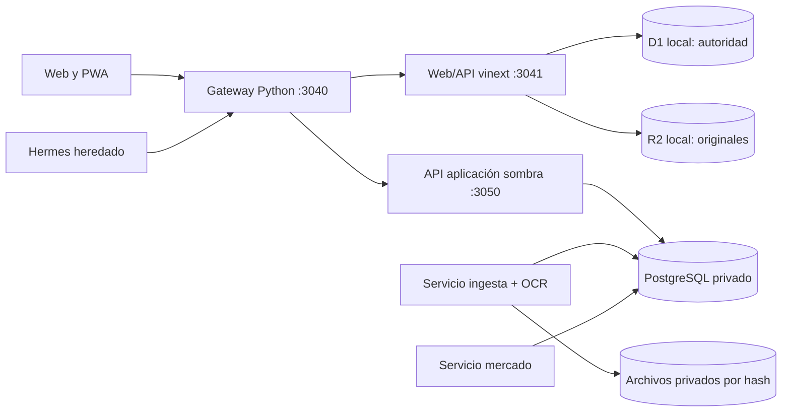

# Juanca — especificación técnica

**Estado de referencia:** 21 de octubre de 2026. Este documento distingue el **origen autoritativo actual** de los servicios **desplegados en sombra** y del **diseño objetivo**. La lógica de negocio se describe en la [especificación funcional](ESPECIFICACION_FUNCIONAL.md); el comportamiento visible, en la [especificación UX](ESPECIFICACION_UX.md).

## 1. Componentes y autoridad



El gateway autenticado recibe la web local y el acceso TLS privado de Tailscale. El Worker escucha solo en loopback y usa los bindings D1/R2 de Wrangler/Miniflare persistidos bajo `workspace/integration/state` en el despliegue local. **D1 y R2 siguen siendo la fuente financiera autoritativa.** El esquema `app` de PostgreSQL publica copias y decisiones de sombra con `mode=shadow` y `authoritative=false`; `ingestion` y `market` tienen migraciones, roles, APIs y workers propios. Estar activos no significa que el corte de escritura F5 se haya realizado.

El código canónico está en este repositorio. El despliegue local de la web mantiene una copia de trabajo en el perfil Juanca; los datos, archivos privados, claves y respaldos permanecen fuera de Git. El prototipo `workspace/apps/api` y `workspace/compose.yaml` son históricos y no forman parte del runtime patrimonial vigente.

| Frontera | Ubicación | Responsabilidad actual |
|---|---|---|
| Web/API vigente | `workspace/apps/web/app`, `lib`, `db` | UI React, importadores y parsers, propuestas, valoración, proyección, lectura/escritura D1/R2 |
| Gateway y compatibilidad | `workspace/integration` | Login/sesiones, origen permitido, identidad hacia Worker, chat guiado y rutas de sombra |
| Aplicación sombra | `services/application` | Modelo familiar, vistas versionadas, chat propio, evidencia, conciliaciones candidatas |
| Ingesta sombra | `services/ingestion` | Recepción por hash, documentos, jobs, parser B3, OCR local |
| Mercado sombra | `services/market` | Captura persistida de precios y FX, jobs y eventos de observación |
| Migraciones y respaldo | `infra` | Esquemas PostgreSQL, exportación D1, comparación y restauración verificable |
| Contratos | `packages/contracts` | OpenAPI y JSON Schema de las APIs/versiones |

## 2. Datos y modelo temporal

El modelo distingue familia, actor, titular, custodio, cuenta, instrumento, emisor, documento, fila bruta, interpretación, movimiento, snapshot, cotización y proyección. B3 es `source=b3`, nunca `custodian=b3`. Una cuenta no identificada conserva ámbito de titular/fuente/institución y estado pendiente; no representa una cuenta real confirmada. Se conserva por separado la fecha económica de la fecha de recepción/conocimiento.

### Origen vigente

- D1 guarda `imports`, `import_records`, decisiones, propuestas, costos, mensajes y cotizaciones; muchos registros normalizados contienen un `payload` JSON y referencia al original.
- R2 local contiene originales y adjuntos. Las referencias `chat://` representan evidencia virtual, no un objeto R2 perdido.
- El gateway conserva hashes de sesión y conversaciones guiadas en SQLite separado. El historial general de Hermes es heredado.
- D1 usa centavos enteros para numerosos importes y `REAL` para algunos precios/cantidades; la precisión disponible de una fuente antigua no puede recuperarse al migrarla.

### Sombra y destino

PostgreSQL separa los esquemas `app`, `ingestion` y `market`, con migraciones y roles propios. `app` conserva evidencia recibida, titular/cuentas, eventos, versiones de cartera y auditoría; `ingestion` es propietario de documentos y trabajos; `market` de observaciones y trabajos de precio/FX. La aplicación consume contratos de los otros servicios, sin leer directamente sus tablas. Los decimales se manejan con `decimal.js` y `NUMERIC` validado; las respuestas financieras exactas se serializan como cadenas decimales. Outbox/inbox y claves idempotentes protegen reintentos entre fronteras. El módulo de aprobación atómico existe y se prueba con datos sintéticos, pero la API financiera de sombra permanece en solo lectura para la familia.

Cada publicación de cartera lleva revisión de hechos, revisión de mercado, fecha económica, límite de conocimiento, versión/fingerprint del cálculo y cobertura. Una consulta paginada fija la versión; una publicación histórica no reemplaza automáticamente el puntero actual. Las decisiones sobre evidencia son append-only y por sí solas no aplican operaciones.

### Evidencia y reconciliación

Una importación guarda hash y bytes originales. Las filas normalizadas conservan documento, hoja/fila o página, fecha, parser y valores observados. Reinterpretar un archivo crea otra lectura trazable, sin borrar el bruto. Los snapshots B3 se comparan con movimientos por titular, custodio, cuenta e instrumento; una liquidación o transferencia no se convierte automáticamente en compra/venta. Fotos y mensajes se archivan de inmediato; OCR o parser produce una interpretación pendiente de revisión. El puente de sombra genera candidatos y decisiones auditadas, sin escribir la cartera vigente.

## 3. Cálculos vigentes de renta fija

`workspace/apps/web/lib/fixed-income-projection.ts` calcula la tasa anualizada a partir del primer y último precio positivo en fechas diferentes:

```text
r = (P1 / P0)^(365,25 / días_observados) - 1
P(t) = P1 × (1 + r)^(días_desde_P1_hasta_t / 365,25)
V(t) = valor_total_del_snapshot × (1 + r)^(días_desde_referencia_hasta_t / 365,25)
```

La matriz mensual/anual y el resumen de vencimiento parten del valor total reportado por el snapshot y aplican el mismo factor de crecimiento. La tasa histórica se estima con precios unitarios; así ambas vistas conservan el total oficial de referencia aunque el precio unitario multiplicado por la cantidad difiera por redondeos.

Una compra B3 del historial puede actuar como observación inicial solo si el conjunto importado no llegó al límite de lectura, hay una única fecha de compra para esa posición, las filas tienen fecha/cantidad/precio positivos y no requieren revisión, no hay ventas ni otros cambios de principal, y la suma comprada coincide con la cantidad del último snapshot. Compras del mismo día se consolidan con promedio ponderado por cantidad; se omiten si hay snapshot ese día. La asociación compara titular, institución, instrumento y cuenta; el campo de cuenta debe coincidir exactamente, incluida su ausencia en ambos registros. Así, una compra que informa cuenta no se atribuye a una posición cuyo snapshot no la informa, ni al revés. Una observación de costo de otra fuente puede actuar como `P0` solo si su procedencia está verificada; los costos con fuente de hoja pendiente de mapeo se excluyen. Se rechazan vencimiento ausente, datos insuficientes o rentabilidad no finita, menor o igual a −95 % o superior a 200 % anual. La confianza es alta con al menos 180 días y cuatro precios, media con al menos 90 días y tres, y baja en los demás casos con tasa calculable. La ruta `GET /api/portfolio/fixed-income-projection` selecciona el snapshot vigente por **titular y tipo de fuente**: un extracto de previsión posterior no oculta B3. Los grupos de instrumentos obsoletos se excluyen de la respuesta actual.

Auditoría agregada del 21/10/2026: los tres extractos B3 de movimientos procesados contienen 91 eventos; un análisis inicial por titular, institución e instrumento asoció 10 con cuatro posiciones vigentes, pero ninguno era una compra elegible. La API presentaba 147 títulos: 140 con tasa calculable de confianza baja y una ventana observada de 30–89 días; los siete restantes solo tenían una observación. Desde el cambio de asociación por cuenta, los movimientos solo se incorporan cuando coincide el dato de cuenta (incluida ausencia simultánea); esos conteos son la línea base anterior a ese filtro.

Auditoría de la hoja de inversión del 21/10/2026: se inspeccionó únicamente la fila de encabezados de sus 19 pestañas. Ninguna tiene encabezados explícitos para fecha y precio de adquisición. En «Renda Fixa», G es «Data de Emissão» y L es «Preço Atualizado MTM»; en «Renda Fixa Julia», L es «Motivo». La revisión más antigua consultada, del 25/02/2026, conserva las etiquetas de emisión y MTM. Las referencias históricas a G/L permanecen sin verificar hasta identificar la pestaña/versión correcta; no se corrigen por posición de columna.

Entrega incremental del 21/10/2026: las cuatro bandejas de revisión cargan datos después de iniciar la solicitud, la detección de instalación/red del PWA usa suscripciones externas y el parser Cotahist omite el campo interno de selección de mercado en su salida. Build aislado aprobado; lint global con cero errores y ocho advertencias; página y cuatro rutas de bandejas respondieron HTTP 200. No se ejecutaron pruebas automatizadas.

La matriz de la UI genera cortes anuales y, al expandir un año, cortes mensuales hasta el último vencimiento. Para cada título y período `(inicio, fin]`, el cálculo presenta `V(fin)` como saldo si el título sigue vigente después del fin, o `V(vencimiento)` como vencimiento del período. Un título vencido deja de aportar al saldo de períodos posteriores. Los emisores se agregan dentro de cada titular; custodio y emisor no se intercambian. Los títulos sin proyección válida aparecen sin importe calculado. El cálculo es nominal, anterior a impuestos y sin flujos contractuales intermedios.

## 4. Interfaces y contratos

| API vigente | Uso |
|---|---|
| `GET /api/portfolio/dashboard`, `/summary`, `/positions` | Cartera y calidad de datos |
| `GET/POST /api/portfolio/cost-basis` | Consulta y registro de costos |
| `GET /api/portfolio/fixed-income-projection` | Tasas observadas, valores a vencimiento y emisor |
| `POST /api/import/b3`, `/avenue`, `/pension` | Carga de documentos |
| `GET/POST /api/transactions/chat`, `POST /api/transactions/proposals/{id}` | Propuestas y decisión explícita |
| `POST /api/portfolio/reviews/{id}`, `POST /api/market/refresh` | Revisión y actualización |
| Gateway: `/api/juanca/chat`, `/api/shadow/*` | Conversación propia y puente autenticado a sombra |

La aplicación de sombra sirve `/v1/portfolio`, `/v1/positions`, `/v1/owners`, `/v1/conversations/family/messages`, `/v1/evidence/*` y consultas/decisiones de conciliación. Ingesta sirve `/v1/uploads`, `/v1/import-jobs`, `/v1/documents`; mercado sirve `/v1/quotes`, `/v1/fx/USD-BRL`, `/v1/refresh`, `/v1/events`. Los detalles de cuerpos, errores y versiones están en los contratos OpenAPI del repositorio. Rutas de salud/readiness son internas. No usar las rutas de sombra como prueba de que PostgreSQL sea el libro autoritativo.

## 5. Seguridad y operación

El gateway valida sesión o token de máquina, origen en mutaciones y límites de acceso, elimina cabeceras de identidad entrantes y añade contexto autenticado hacia el Worker. Las cookies de navegador son `HttpOnly`; en TLS privado son `Secure` y `SameSite=Strict`. El Worker interno no debe exponerse directamente fuera de loopback. Los servicios de sombra usan credenciales propias y sockets/puertos privados. Ningún secreto, documento personal o valor de una cuenta debe entrar en Git, logs generales o ejemplos de prueba.

Los servicios locales se ejecutan mediante systemd de usuario. Para observarlos:

```bash
systemctl --user status patrimonio-juanca-web patrimonio-juanca-worker
systemctl --user status juanca-shadow-application juanca-shadow-ingestion juanca-shadow-market-api
```

La web local usa `vinext build` y Wrangler `dev --local` con el directorio de persistencia explícito. **Tras recompilar una web mientras Wrangler está activo hay que reiniciar `patrimonio-juanca-worker`**: el proceso puede conservar referencias HTML a chunks que el build reemplazó y devolver 404 para CSS/JS. La verificación de despliegue comprueba página, API y recursos `_next/static` a través del gateway. La actualización de código no debe borrar `integration/state`.

Para comprobar código sin datos familiares:

```bash
npm ci --ignore-scripts
npm test
npm run typecheck
cd workspace/apps/web
npm ci
npm test
npm run lint
```

Las pruebas de aplicación usan bases sintéticas y validan, entre otros casos, concurrencia e idempotencia. El 21/10/2026 se ejecutó `infra/backup/verify_restore.ts` contra la base sombra: restauró y comparó 45 tablas de aplicación, 8 de ingesta y 6 de mercado; comprobó siete referencias a evidencia B3 y seis objetos de ingesta. La verificación independiente del manifest confirmó los hashes de los 17 archivos de la copia. La base temporal se eliminó al terminar y los servicios sombra continuaron activos. Desde ese día, `juanca-shadow-backup.timer` ejecuta diariamente el mismo ciclo con copias privadas, sin purga automática.

`juanca-authority-backup.timer` quedó habilitado para respaldar diariamente la autoridad D1, R2 y el estado Hermes a las 04:15, con hasta 30 minutos de demora aleatoria. Para obtener una copia coherente, el servicio detiene web y Worker durante la captura y los reinicia al finalizar; `ExecStopPost` proporciona una segunda garantía de inicio aun ante fallo o terminación anormal del proceso. La captura valida después el backup y una restauración aislada. El verificador exige el conjunto exacto de archivos del manifest, rechaza rutas absolutas o con traversal, enlaces simbólicos y archivos añadidos, y valida integridad SQLite. Si una captura queda incompleta, no tiene manifest válido y el chequeo diario la reporta como fallo. La primera ejecución real está programada para el 22/10/2026; hasta entonces, el wrapper solo se ha probado con fixtures sintéticos. Si el equipo está apagado durante la ventana, el timer espera al día siguiente y evita una interrupción inesperada al iniciar el equipo. Las copias permanecen en el equipo y no tienen purga automática.

`juanca-backup-health.timer` corre a las 05:45, después de la ventana de captura y su demora máxima. Selecciona el backup más reciente por nombre de ejecución, exige que el flujo haya registrado una restauración aislada exitosa, valida su manifest e integridad y requiere una antigüedad menor a 32 horas para la autoridad y la base sombra. El runner D1 agrega la marca solo después de terminar la restauración y la verificación posterior; un fallo previo deja la copia sin marca. La unidad es de solo lectura, no interviene con web/Worker y deja fallos consultables mediante `systemctl --user status juanca-backup-health.service` y `journalctl --user -u juanca-backup-health.service`.

El ensayo PostgreSQL valida el snapshot sombra y los originales registrados en el host. El respaldo D1 programado cubre la autoridad vigente y los objetos R2 presentes en el estado local, con una breve interrupción diaria; su primera ejecución real sigue pendiente. Los originales R2 históricos que no estén en esta instalación y una copia cifrada fuera del host requieren una estrategia integral. Ninguno de estos respaldos habilita el corte de escritura ni sustituye la comprobación de reversión e idempotencia de jobs durante el cambio de autoridad.

## 6. Transformación y pendientes técnicos

La secuencia de diseño es: confianza del origen y backup → conversación propia sin Hermes → aplicación PostgreSQL en sombra → ingesta y mercado en sombra → conciliación final y corte único de escritura. Las primeras fronteras están implementadas parcialmente; **el corte no ocurrió**. El destino es una aplicación/BFF patrimonial, un servicio de ingesta y uno de mercado, con PostgreSQL de esquemas separados y originales privados. No se separa un servicio adicional para cada módulo de conversación o planificación sin una necesidad demostrada.

Para conmutar se necesita cerrar cuentas e identidades pendientes, completar la transferencia de originales, comparar cantidades/valores y revisiones para ambos titulares, ensayar backup/restauración del conjunto, habilitar comandos con saldos verificados y probar reversión. La nueva autoridad debe mantener un solo escritor; una repetición de lote o propuesta no puede duplicar un hecho. La dependencia de Hermes en los recorridos habituales debe ser cero. Estas son condiciones de aceptación, no afirmaciones del despliegue actual.

## 7. Diseño P0 y brechas verificadas

Esta sección registra cambios entregados y pendientes. Los contratos siguientes son conceptuales y requieren migraciones/adaptadores antes de utilizarse con datos reales.

| Requisito | Situación observada | Implementación requerida |
|---|---|---|
| P0-01 | La proyección agrupa por titular, custodio, cuenta declarada e instrumento. El esquema de costos legado no incluye cuenta | Migraciones 017/018 aplicadas en sombra; 170 identidades ligadas a cuenta. Julia confirmó una cuenta por institución y se crearon tres cuentas, con 21 resoluciones auditadas; sus assertions permanecen `needs_review`. Falta conciliar snapshots futuros y reflejar identidad persistida en la proyección |
| P0-02 | Las tres especificaciones resumen capacidades de D1 y sombra | Mantener la matriz funcional con evidencia por versión; no promover disponibilidad a validación por tener un proceso activo |
| P0-03 | Ajustes manuales nuevos se registran en `cost_basis_history`; la proyección expone fechas/fuentes, marca mezcla MTM/curva y advierte cuando la referencia de hoja no concuerda con el encabezado actual. `cost_basis` conserva un promedio agregado | Migraciones 017/019 y API shadow admiten lotes con comisiones desconocidas (`NULL`) y correcciones inmutables. De 9 lotes en 5 posiciones, 4 cantidades brutas compradas coinciden con el snapshot del 19/10; una posición mantiene 464,14 unidades de diferencia entre snapshot (523,39) y compras registradas (59,25). `GET /v1/position-identities/acquisition-reconciliation` ofrece la vista familiar en una llamada y distingue identidades sin lotes. La pestaña Revisiones muestra esta conciliación como diagnóstico, sin inferir saldo de apertura ni modificar cartera; el endpoint por posición ofrece el mismo detalle. Falta establecer cobertura, cerrar ventas/rescates e integrar lotes al motor. Conservar costos agregados ambiguos |
| P0-04 | Series y matriz comparten el motor por período; vencimiento en el cierre es flujo con saldo cero | Implementado; pruebas de límite, año bisiesto y conciliación anual/mensual |
| P0-05 | Calendario desde la primera referencia, estados por posición y totales parciales | Implementado en proyección; pendiente la aceptación integral de ingesta temporal |
| P0-06 | Importaciones B3 solapadas conservan evidencia y cuentan el hecho económico una sola vez | `GET /v1/reconciliation/b3/duplicate-movements` lista coincidencias exactas como `candidate_only` (28 en la superposición archivada), informa estado por pares y ofrece `preview_event_count` solo cuando las decisiones están completas y son consistentes. `POST /v1/reconciliation/b3/duplicate-movement-decisions` registra `same_event` o `distinct_events` en una tabla append-only, con revisión, actor, idempotencia y auditoría. Ninguna de las 28 coincidencias archivadas está decidida; la vista previa no fusiona assertions ni cambia/publica cartera |

### Contratos y migración

Las migraciones 017/018 crean identidad de posición, resolución append-only de cuenta, lotes versionados y vínculo al assertion que introdujo la identidad; 019 permite representar comisión ausente con `NULL`. La migración 020 permite una resolución histórica `user_confirmed_institution_uniqueness` sin assertion cuando el origen no fue archivado. `GET /v1/position-identities` devuelve la referencia exacta (documento, hoja, fila y fecha de corte), la cantidad fuente y distingue `source_assertion_status` (estado guardado al importar), `parser_status`/`parser_review_reasons` (interpretación más reciente), y `identity_status`/`custody_identity_resolved` (estado efectivo de la identidad) e `identity_resolution_decision` (decisión append-only cuando existe). Las identidades canónicas preexistentes con estado `resolved` también devuelven `custody_identity_resolved=true`, aunque no tengan una resolución append-only. Estos estados son independientes: resolver la cuenta no reescribe el assertion ni certifica los valores financieros. `GET /v1/position-identities/{position_id}/account-candidates` lista cuentas del mismo titular e institución; `POST /v1/position-identities/{position_id}/resolutions` guarda la selección con actor, evidencia, revisión y clave idempotente. `GET /v1/position-identities/acquisition-reconciliation` resume el estado de lotes para todas las identidades en una llamada. `GET/POST /v1/position-identities/{position_id}/acquisitions` consulta y registra lotes versionados. El GET separa el historial completo del conjunto de revisiones vigentes y compara las compras brutas no anuladas con la cantidad del assertion B3 de snapshot vinculado. Esa diferencia es diagnóstica, no saldo de apertura: ventas, rescates y transferencias no están neteados; si hay adquisiciones posteriores al corte no se calcula una diferencia comparable. Escrituras requieren membresía de revisión/propietario/aprobación y no actualizan la cartera publicada ni su revisión de hechos. El servicio valida coincidencia de moneda, titular, institución, cuenta, fecha, cantidad, precio y la última interpretación `parsed` para adquisiciones B3; los triggers comprueban correspondencia de cuenta con titular/institución y existencia de evidencia B3/evento. La carga inicial tomó el último snapshot B3 por titular: 149 filas observadas con cuenta para Jorge y 21 filas `needs_review` inicialmente sin cuenta para Julia. Tras la confirmación de Julia de una cuenta por institución, el script `infra/migration/register_julia_b3_accounts.ts` creó tres cuentas con identidad `user_confirmed_unique` y registró 21 resoluciones auditadas, conservando el estado original de importación. La comprobación del snapshot de Julia del 2026-10-19 encontró que las 21 interpretaciones tienen código de instrumento y que su única razón `custody_account_pending` quedó obsoleta al confirmarse la cuenta; el endpoint muestra ahora la interpretación y resolución vigentes por separado, preservando la trazabilidad y sin cambiar posiciones. La moneda BRL se asigna por ser reportes de posiciones B3 y esas filas no contienen columna de moneda. `infra/migration/import_verified_b3_acquisitions.ts` guardó 9 compras/aplicaciones para cinco posiciones actuales de Jorge; las comisiones son `NULL`, pues no existen en el archivo. La conciliación de cantidad contra el snapshot del 2026-10-19 coincide en cuatro de las cinco posiciones; en la restante, la cantidad permanece igual en los snapshots del 19/09, 09/10 y 19/10, mientras que las compras verificadas cubren solo parte del saldo. Como no hay un snapshot anterior archivado que acredite el saldo de apertura, puede tratarse de tenencia previa a la cobertura de movimientos o de un evento ausente; no hay evidencia para escoger entre ambas explicaciones. Los lotes siguen fuera del cálculo hasta resolver esa diferencia, confirmar saldo de lotes y validar la valoración histórica. La revisión de identidades no altera hechos publicados. La UI de conciliación familiar ya está integrada en Revisiones; aún faltan conciliación automática con snapshots futuros, cobertura completa de movimientos y lectura de lotes aprobados en la proyección. La agrupación de UI usa emisor/titular después de calcular las posiciones.

La comparación de los snapshots de Jorge del 09/10 y 19/10 devolvió seis diferencias: cuatro añadidas, una retirada y una con cantidad distinta. No hay movimientos candidatos en el intervalo; la cobertura del extracto B3 registrado termina el 08/10. Tampoco hay eventos de cartera ni movimientos ingresados por chat posteriores al 08/10. `infra/migration/compare_b3_snapshots.ts` produjo un informe `candidate_only` en el directorio privado de sombra; `movement_interval_complete=false` y `portfolio_published=false`. No se aplicaron diferencias a cantidades ni a hechos publicados. Para Julia, se comparó el B3 del 19/10 contra sus 21 filas del snapshot legado del 29/08: 18 claves de cuenta/instrumento coinciden, con seis diferencias (tres añadidas y tres retiradas). El snapshot anterior no tiene assertions B3 archivadas. El archivo `movimentacao-2026-10-21-16-50-02.xlsx` se registró como evidencia B3 de Julia: 66 movimientos observados entre el 23/04 y el 20/10, 65 con cuenta resuelta y una retirada de custodia XP pendiente de cuenta/contraparte. La comparación en la ventana 29/08–19/10 concuerda exactamente para tres cambios (CDB326C3F18, CDB9266Y62Z y CDB92685F8M); BTGL52 tiene un crédito de operación a término de 45 unidades que coincide en cantidad, pero queda como candidato sin contabilizar. CDB826DDEHV presenta 950.024 unidades en rescates frente a una caída de 1.000.000, y CDB323TLJXC no tiene movimiento coincidente. Dos filas más conservan semántica de evento genérico pendiente. El rango de cobertura procede de las fechas observadas y no certifica exhaustividad del extracto. El informe detallado de esta revisión queda en el directorio privado `reports/julia-2026-08-29-to-10-19-with-movements-2026-10-21.json`; `portfolio_published=false`. No se aplicó ninguna diferencia a la cartera.

Los extractos de movimientos de Jorge del 19/09 y 09/10 tienen una ventana común entre el 18/08 y el 17/09. En el archivo se encontraron 28 pares de filas fuente idénticas en esa superposición. Se preservan ambas referencias documentales; hasta registrar si representan el mismo hecho económico, no deben sumarse como eventos independientes. La migración 021 y el endpoint de decisión crean una relación append-only auditable por par, pero aún no se registró ninguna decisión: las 28 siguen `needs_review`. La respuesta expone una vista previa del número de eventos solo cuando todos los pares están revisados; contradicciones transitivas devuelven `event_count_status=conflict` y conteo `null`. Esta vista nunca se consume como libro financiero, no elimina assertions ni afecta la cartera publicada.

El snapshot legado de posiciones de Julia del 29/08 contiene 21 filas sin assertion B3 original en la base de evidencia. El usuario confirmó una cuenta por institución; `infra/migration/resolve_julia_legacy_position_accounts.ts` registró 21 resoluciones en `position_account_resolutions`, con actor, snapshot y UUID de custodia. La decisión `user_confirmed_institution_uniqueness` admite `assertion_id=NULL` para expresar que la fuente B3 de ese corte no está archivada. `buildPortfolio` aplica esas identidades canónicas al preparar la vista. La versión sombra resultante conserva 199 posiciones, clasifica las 21 de Julia como `known` y mantiene su valor agregado en 183.868.625 centavos de BRL (R$ 1.838.686,25), igual a la versión anterior. La fecha económica de la versión sigue siendo 09/10; esto no reemplaza el snapshot de origen ni crea evidencia B3 para el 29/08. Las 21 assertions del snapshot Julia del 19/10 continúan `needs_review`, aunque sus identidades de custodia estén resueltas por separado.

Una observación de precio incluye fecha económica, recepción, método, moneda, unidad y fuente. Las revisiones de costo enlazan registro anterior y decisión. No se reparte automáticamente un costo legado entre cuentas: primero se generan candidatos, se comprueba evidencia y se publica la resolución. Una migración requiere respaldo, comparación de cantidades/importes por identidad y conservación de originales. La cifra agregada anterior permanece trazable.

Las respuestas de proyección deben incluir identidad de posición, versión de cálculo, revisión de datos, método, fecha de referencia y estado por celda: `projected`, `maturity`, `matured`, `insufficient_data`, `outside_coverage` o `conflict`. Un grupo puede incluir saldo y flujo a la vez. Importes desconocidos usan `null`; cero conocido usa cero. Cobertura indica cantidades de posiciones incluidas/excluidas y causas; si falta una base monetaria comparable, no se inventa un porcentaje.

El calendario usa fechas civiles ISO y cortes inclusivos al final del período. Cada flujo pertenece a `(inicio, fin]` una sola vez; para el saldo se exige vencimiento posterior al cierre. Los movimientos con orden intradía desconocido quedan en revisión. La fecha de recepción no resuelve por sí sola el orden económico.

### Verificación exigida antes de declarar P0 completo

- Dos cuentas con el mismo instrumento, monedas distintas y varias adquisiciones conservan sus identidades; no hay sobrescritura por ticker.
- La revisión de costo es reproducible y conserva procedencia; cambiar método de precio genera una advertencia o exclusión justificada.
- El saldo anual coincide con el cierre mensual correspondiente y el flujo anual con la suma de los flujos mensuales, bajo la misma versión y política de redondeo.
- Vencimientos en fin de mes/año, febrero bisiesto y último período parcial se asignan exactamente una vez.
- Referencias diferentes por titular, importaciones fuera de orden, cuenta sin cobertura y movimiento del mismo día sin secuencia producen resultados o bloqueos explícitos.
- Web, API y agregados usan el mismo motor; los ejemplos de aceptación son sintéticos y no escriben datos familiares.

Orden de entrega: registrar disponibilidad y casos de aceptación (P0-02); resolver identidad y procedencia (P0-01/P0-03); unificar motor temporal y agregaciones (P0-04/P0-05); validar interfaz y migración antes de desplegar escrituras.

Entrega incremental del 21/10/2026: `fixedIncomePeriodValue` y `summarizeFixedIncomePeriod` distinguen importe desconocido (`null`), cero, conflicto y cobertura parcial. La UI expone fecha de referencia, corte y motivo. En la proyección, la clave incorpora titular, institución, cuenta declarada e instrumento; un costo legado se incorpora solo si existe un único candidato. Si es ambiguo se excluye y la posición muestra el motivo. Para filas B3 sin `Conta`, la institución limita provisionalmente la agrupación, pero no equivale a una cuenta confirmada. La persistencia/versionado de adquisiciones sigue pendiente. Validación de esta entrega: build aislado y lint aprobados; sin ejecución de pruebas automatizadas. La página, sus seis recursos y la API respondieron tras el despliegue. El build se prepara en directorio aislado, se activa con el worker detenido y se conserva el dist anterior para reversión.

En la entrega de trazabilidad, `cost_basis_history` registra cada nuevo ajuste con clave idempotente, titular, instrumento, moneda, cantidad, precio medio, fecha base, fuente y referencias declaradas de institución/cuenta. La API devuelve las últimas 50 entradas para la posición seleccionada. Las posiciones duplicadas por titular/instrumento/moneda rechazan el cambio del promedio agregado y la cartera omite ese costo legado en el P&L hasta resolver la cuenta. Esto no reconstruye compras históricas ni crea lotes reales; el costo vigente sigue en la tabla legado.

La respuesta de proyección resume las fuentes observadas por título y marca series que combinan `b3_mtm` con `b3_curve`; la UI muestra fechas inicial/final, número de observaciones y fuentes. Esto permite revisar el método usado, pero no resuelve por sí solo cambios de método ni confirma que un costo promedio sea precio de compra.

Las fuentes `google_sheet:<id>:<pestaña>!<celdas>` se presentan sin el ID del archivo y mantienen la referencia de pestaña/celda. Un costo cuyo origen sea una de estas referencias no se incorpora a la serie de cálculo mientras el mapeo permanezca sin verificar; la API devuelve su fuente en `excluded_observation_sources` y la UI lo distingue de las fuentes usadas. Los registros persistidos no se sobreescriben ni se eliminan.
