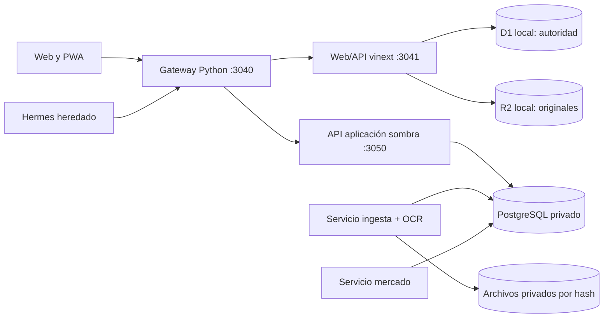

# Juanca — especificación técnica

**Estado de referencia:** 22 de octubre de 2026. Este documento distingue el **origen autoritativo actual** de los servicios **desplegados en sombra** y del **diseño objetivo**. La lógica de negocio se describe en la [especificación funcional](ESPECIFICACION_FUNCIONAL.md); el comportamiento visible, en la [especificación UX](ESPECIFICACION_UX.md).

## 1. Componentes y autoridad



El gateway autenticado recibe la web local y el acceso TLS privado de Tailscale. El Worker escucha solo en loopback y usa los bindings D1/R2 de Wrangler/Miniflare persistidos bajo `workspace/integration/state` en el despliegue local. **D1 y R2 siguen siendo la fuente financiera autoritativa.** El esquema `app` de PostgreSQL publica copias y decisiones de sombra con `mode=shadow` y `authoritative=false`; `ingestion` y `market` tienen migraciones, roles, APIs y workers propios. Estar activos no significa que el corte de escritura F5 se haya realizado.

El código canónico está en este repositorio. El despliegue local de la web mantiene una copia de trabajo en el perfil Juanca; los datos, archivos privados, claves y respaldos permanecen fuera de Git. El prototipo `workspace/apps/api` y `workspace/compose.yaml` son históricos y no forman parte del runtime patrimonial vigente.

El cierre de escritores D1/R2 tiene un inventario verificable por ruta y servicio en [POSTGRES_CUTOVER_RUNBOOK.md](POSTGRES_CUTOVER_RUNBOOK.md#inventario-concreto-de-escritores-legacy-22102026). Incluye cargas y revisiones B3/Avenue/previsión, costos, chat y propuestas, confirmaciones, mercado y lecturas. La marca `legacy_financial_writers_still_active` permanece bloqueada hasta sustituir el circuito UI/API/lectura completo; desplegar módulos PostgreSQL o tener paridad de una fotografía no satisface el gate.

La API de lotes de adquisición expone `GET/POST /v1/position-identities/{position_id}/acquisitions` y la conciliación agregada `GET /v1/position-identities/acquisition-reconciliation`. El panel de Revisiones permite abrir el historial por posición y registrar lotes manuales `legacy_review` con fecha, cantidad, precio y referencia de evidencia; solo habilita el alta cuando existe una cuenta de custodia concreta; la API también rechaza llamadas directas sin ella. Las correcciones se guardan como revisiones append-only enlazadas a la anterior; también se puede anular una revisión sin borrar el historial. El gateway limita el acceso a UUID de posición, autentica las rutas y deriva el actor del servidor para las escrituras; el navegador no puede elegirlo. Los lotes son append-only/versionados, idempotentes y con evidencia. La proyección PostgreSQL puede usarlos como observaciones de compra solo si la cuenta está resuelta y existe una única posición vigente compatible para ese titular, institución, instrumento, moneda y referencia de cuenta; de lo contrario los excluye para evitar cruces entre cuentas. Si se usan, desplazan el costo legacy sin cuenta para ese titular/ticker. El resultado sigue en `mode=shadow`, `authoritative=false`; no reemplaza el costo base ni la proyección oficial de D1.

La migración 030 añade publicaciones append-only de posiciones Avenue y previsión. `GET /v1/reconciliation/external/snapshots` lista documentos de posición ya procesados por ingesta; `POST /v1/reconciliation/external/snapshots/{document_id}/publish` requiere idempotency key, hash y actor `owner`/`approver`. La transacción valida cuenta y fecha, crea/actualiza únicamente los saldos invertidos de las cuentas del documento, conserva las filas fuente, genera una versión de cartera y escribe auditoría. Los eventos de movimientos quedan sin aplicar y se excluye caja. La UI activa expone ambos endpoints a través del gateway autenticado en la pestaña Revisiones. Su gate de validación real se mantiene bloqueado hasta publicar un snapshot con aprobación explícita. La fecha económica del documento se valida por ámbito `(household, owner, source_system, report_kind)`: solo el último documento puede publicarse, y se rechaza uno anterior a una publicación ya realizada en ese ámbito. `source_as_of` se mantiene en assertions/posiciones; el rebuild usa `max(source_as_of, current_portfolio_effective_as_of)` como `effective_as_of` global. Las listas B3/externa devuelven `latest` y `portfolio_effective_as_of`; la UI usa esos datos para deshabilitar documentos sustituidos y explicar la fecha del extracto frente al corte reconstruido. La guarda `POST_SNAPSHOT_APPLIED_EVENT_PRESENT` evita sobrescribir una cuenta si hay eventos aplicados posteriores a su fuente.

| Frontera | Ubicación | Responsabilidad actual |
|---|---|---|
| Web/API vigente | `workspace/apps/web/app`, `lib`, `db` | UI React, importadores y parsers, propuestas, valoración, proyección, lectura/escritura D1/R2 |
| Gateway y compatibilidad | `workspace/integration` | Login/sesiones, origen permitido, identidad hacia Worker, chat guiado y rutas de sombra |
| Aplicación sombra | `services/application` | Modelo familiar, vistas versionadas, chat propio, evidencia, conciliaciones candidatas |
| Ingesta sombra | `services/ingestion` | Recepción por hash, documentos, jobs, parsers B3/Avenue, OCR local |
| Mercado sombra | `services/market` | Captura persistida de precios y FX, jobs y eventos de observación |
| Migraciones y respaldo | `infra` | Esquemas PostgreSQL, exportación D1, comparación y restauración verificable |
| Contratos | `packages/contracts` | OpenAPI y JSON Schema de las APIs/versiones |

## 2. Datos y modelo temporal

El modelo distingue familia, actor, titular, custodio, cuenta, instrumento, emisor, documento, fila bruta, interpretación, movimiento, snapshot, cotización y proyección. B3 es `source=b3`, nunca `custodian=b3`. Una cuenta no identificada conserva ámbito de titular/fuente/institución y estado pendiente; no representa una cuenta real confirmada. Se conserva por separado la fecha económica de la fecha de recepción/conocimiento.

### Origen vigente

- D1 guarda `imports`, `import_records`, decisiones, propuestas, costos, mensajes y cotizaciones; muchos registros normalizados contienen un `payload` JSON y referencia al original.
- R2 local contiene originales y adjuntos. Las referencias `chat://` representan evidencia virtual, no un objeto R2 perdido.
- El gateway conserva hashes de sesión y conversaciones guiadas en SQLite separado. El historial general de Hermes es heredado.
- D1 usa centavos enteros para numerosos importes y `REAL` para algunos precios/cantidades; la precisión disponible de una fuente antigua no puede recuperarse al migrarla.

### Sombra y destino

PostgreSQL separa los esquemas `app`, `ingestion` y `market`, con migraciones y roles propios. `app` conserva evidencia recibida, titular/cuentas, eventos, versiones de cartera y auditoría; `ingestion` es propietario de documentos y trabajos; `market` de observaciones y trabajos de precio/FX. La aplicación consume contratos de los otros servicios, sin leer directamente sus tablas. Los decimales se manejan con `decimal.js` y `NUMERIC` validado; las respuestas financieras exactas se serializan como cadenas decimales. Outbox/inbox y claves idempotentes protegen reintentos entre fronteras. La API de aplicación incluye consulta, creación, aprobación y rechazo idempotentes de propuestas; exige un actor autorizado y una cuenta conocida que pertenezca al titular. Aprobar una propuesta escribe evento, partidas, holdings y auditoría y reconstruye/publica la siguiente cartera inmutable dentro de la misma transacción. Si falta una ejecución de origen verificable, rechaza con `PORTFOLIO_REBUILD_REQUIRED`. Esta ruta se cubre con datos sintéticos; el código sigue operando en sombra y no implica conmutación de la interfaz ni de la autoridad.

Cada publicación de cartera lleva revisión de hechos, revisión de mercado, fecha económica, límite de conocimiento, versión/fingerprint del cálculo y cobertura. Una consulta paginada fija la versión; una publicación histórica no reemplaza automáticamente el puntero actual. Las decisiones sobre evidencia son append-only y por sí solas no aplican operaciones.

### Evidencia y reconciliación

Una importación guarda hash y bytes originales. B3 y Avenue generan filas brutas versionadas con vínculo a documento, hoja/fila, fecha y valores observados; Avenue usa el parser compartido con la interfaz anterior y excluye saldos de efectivo. El puente registra las posiciones Avenue como afirmaciones observadas asociadas a `avenue-securities` y a la cuenta cuyo número aparece en el extracto. También registra confirmaciones Avenue como observaciones de movimientos, sin aplicarlas al patrimonio. Los extractos de previsión Zurich se interpretan como saldo de cotas y aportes por segmento; las dos líneas de saldo final idénticas se colapsan para evitar duplicar el patrimonio y los aportes permanecen como observaciones históricas. Los cortes 15/08 y 21/10 se archivaron como evidencia; el duplicado de 21/10 comparte el mismo documento y no crea filas adicionales. Ningún movimiento se aplicó. La migración 025 añade `source_attribution_decisions`, una capa append-only que conserva dueño fuente y permite documentar una atribución corregida sin modificar el documento o assertion original. El 22/10 se confirmó que la compra de BAC del 28/08 atribuida inicialmente a Julia corresponde a Jorge; se guardó la corrección hacia la cuenta Avenue de Jorge y su auditoría. Esta decisión de evidencia no actualiza holdings ni publica cartera. Tras confirmar el commit de las afirmaciones en `app`, el puente cambia el job de ingesta a `published`; este estado significa entregado al servicio de aplicación, no cartera financiera publicada. El acuse es idempotente y evita volver a recorrer jobs ya registrados. Reinterpretar un archivo crea otra lectura trazable, sin borrar el bruto. Los snapshots B3 se comparan con movimientos por titular, custodio, cuenta e instrumento; una liquidación o transferencia no se convierte automáticamente en compra/venta. Fotos y mensajes se archivan de inmediato; OCR o parser produce una interpretación pendiente de revisión. El puente de sombra genera candidatos y decisiones auditadas, sin escribir la cartera vigente.

## 3. Cálculos vigentes de renta fija

`workspace/apps/web/lib/fixed-income-projection.ts` calcula la tasa anualizada a partir del primer y último precio positivo en fechas diferentes:

```text
r = (P1 / P0)^(365,25 / días_observados) - 1
P(t) = P1 × (1 + r)^(días_desde_P1_hasta_t / 365,25)
V(t) = valor_total_del_snapshot × (1 + r)^(días_desde_referencia_hasta_t / 365,25)
```

La matriz mensual/anual y el resumen de vencimiento parten del valor total reportado por el snapshot y aplican el mismo factor de crecimiento. La tasa histórica se estima con precios unitarios; así ambas vistas conservan el total oficial de referencia aunque el precio unitario multiplicado por la cantidad difiera por redondeos.

Una compra B3 del historial puede actuar como observación inicial solo si el conjunto importado no llegó al límite de lectura, hay una única fecha de compra para esa posición, las filas tienen fecha/cantidad/precio positivos y no requieren revisión, no hay ventas ni otros cambios de principal, y la suma comprada coincide con la cantidad del último snapshot. Compras del mismo día se consolidan con promedio ponderado por cantidad; se omiten si hay snapshot ese día. La asociación compara titular, institución, instrumento y cuenta; el campo de cuenta debe coincidir exactamente, incluida su ausencia en ambos registros. Así, una compra que informa cuenta no se atribuye a una posición cuyo snapshot no la informa, ni al revés. Una observación de costo de otra fuente puede actuar como `P0` solo si su procedencia está verificada; los costos con fuente de hoja pendiente de mapeo se excluyen. Se rechazan vencimiento ausente, datos insuficientes o rentabilidad no finita, menor o igual a −95 % o superior a 200 % anual. La confianza es alta con al menos 180 días y cuatro precios, media con al menos 90 días y tres, y baja en los demás casos con tasa calculable. La ruta `GET /api/portfolio/fixed-income-projection` selecciona el snapshot vigente por **titular y tipo de fuente**: un extracto de previsión posterior no oculta B3. Los grupos de instrumentos obsoletos se excluyen de la respuesta actual.

Auditoría agregada del 21/10/2026: los tres extractos B3 de movimientos procesados contienen 91 eventos; un análisis inicial por titular, institución e instrumento asoció 10 con cuatro posiciones vigentes, pero ninguno era una compra elegible. La API presentaba 147 títulos: 140 con tasa calculable de confianza baja y una ventana observada de 30–89 días; los siete restantes solo tenían una observación. Desde el cambio de asociación por cuenta, los movimientos solo se incorporan cuando coincide el dato de cuenta (incluida ausencia simultánea); esos conteos son la línea base anterior a ese filtro.

Auditoría de la hoja de inversión del 21/10/2026: se inspeccionó únicamente la fila de encabezados de sus 19 pestañas. Ninguna tiene encabezados explícitos para fecha y precio de adquisición. En «Renda Fixa», G es «Data de Emissão» y L es «Preço Atualizado MTM»; en «Renda Fixa Julia», L es «Motivo». La revisión más antigua consultada, del 25/02/2026, conserva las etiquetas de emisión y MTM. Las referencias históricas a G/L permanecen sin verificar hasta identificar la pestaña/versión correcta; no se corrigen por posición de columna.

Entrega incremental del 21/10/2026: las cuatro bandejas de revisión cargan datos después de iniciar la solicitud, la detección de instalación/red del PWA usa suscripciones externas y el parser Cotahist omite el campo interno de selección de mercado en su salida. Build aislado aprobado; lint global con cero errores y ocho advertencias; página y cuatro rutas de bandejas respondieron HTTP 200. No se ejecutaron pruebas automatizadas.

La matriz de la UI genera cortes anuales y, al expandir un año, cortes mensuales hasta el último vencimiento. Para cada título y período `(inicio, fin]`, el cálculo presenta `V(fin)` como saldo si el título sigue vigente después del fin, o `V(vencimiento)` como vencimiento del período. Un título vencido deja de aportar al saldo de períodos posteriores. Los emisores se agregan dentro de cada titular; custodio y emisor no se intercambian. Los títulos sin proyección válida aparecen sin importe calculado. El cálculo es nominal, anterior a impuestos y sin flujos contractuales intermedios.

## 4. Interfaces y contratos

| API vigente | Uso |
|---|---|
| `GET /api/portfolio/dashboard`, `/summary`, `/positions` | Cartera y calidad de datos |
| `GET/POST /api/portfolio/cost-basis` | Consulta y registro de costos |
| `GET /api/portfolio/fixed-income-projection` | Tasas observadas, valores a vencimiento y emisor |
| `POST /api/import/b3`, `/avenue`, `/pension` | Carga de documentos |
| `GET/POST /api/transactions/chat`, `POST /api/transactions/proposals/{id}` | Propuestas y decisión explícita |
| `POST /api/portfolio/reviews/{id}`, `POST /api/market/refresh` | Revisión y actualización |
| Gateway: `/api/juanca/chat`, `/api/shadow/*` | Conversación propia y puente autenticado a sombra |

La aplicación de sombra sirve `/v1/portfolio`, `/v1/positions`, `/v1/owners`, `/v1/accounts`, `/v1/conversations/family/messages`, `/v1/evidence/*`, consultas/decisiones de conciliación y `GET /v1/authority/readiness`. La API de propuestas expone `GET/POST /v1/proposals` y `POST /v1/proposals/{id}/approve|reject`; las escrituras requieren `x-juanca-actor` e `Idempotency-Key`; reviewer/owner/approver pueden crear borradores y solo owner/approver pueden aprobar o rechazar. La migración 026 agregó evidencia escrita y la 027 admite evidencia fotográfica: cada borrador nuevo requiere un texto o foto pendiente del mismo titular, bloquea su reutilización y conserva su referencia en el evento aplicado. `app.manual_photo_evidence` registra titular, hash y estado de cada carga para asociarla con seguridad, mientras el objeto binario sigue siendo propiedad de ingesta. El gateway mapea estas rutas a `/api/shadow/proposals` y `/api/shadow/proposals/{id}/approve|reject`, `/api/shadow/accounts` y `/api/shadow/owners`, e inyecta el actor autenticado en lugar de aceptar ese valor desde el navegador. El miembro configurado `juanca-family` tiene rol `approver` por autorización explícita del usuario; cada operación sigue requiriendo una acción explícita y se audita. La creación también exige `owner_id` y `account_id` explícitos, cuenta conocida y pertenencia de esa cuenta al titular. La aprobación solo acepta una cartera con ejecución de origen verificable y la reconstruye en la misma transacción. La pestaña de sombra está disponible en la interfaz local; el dashboard y los flujos financieros existentes siguen en D1/R2. La cobertura sintética no reemplaza el corte/reversión operativos. `/v1/authority/readiness` resume cobertura de cuentas y posiciones iniciales invertidas, consulta membresías owner/approver, enumera gates pendientes y siempre declara `authoritative=false` hasta el corte coordinado; es una lectura operativa, no una habilitación. Las identidades de previsión privada (`private_pension`) se muestran, pero no bloquean el modelo de cuentas operativas ni se mezclan con las cuentas de custodia. Ingesta sirve `/v1/uploads`, `/v1/import-jobs`, `/v1/documents`; mercado sirve `/v1/quotes`, `/v1/fx/USD-BRL`, `/v1/refresh`, `/v1/events`. Los detalles de cuerpos, errores y versiones están en los contratos OpenAPI del repositorio. Rutas de salud/readiness son internas. No usar las rutas de sombra como prueba de que PostgreSQL sea el libro autoritativo.

## 5. Seguridad y operación

El gateway valida sesión o token de máquina, origen en mutaciones y límites de acceso, elimina cabeceras de identidad entrantes y añade contexto autenticado hacia el Worker. Las cookies de navegador son `HttpOnly`; en TLS privado son `Secure` y `SameSite=Strict`. El Worker interno no debe exponerse directamente fuera de loopback. Los servicios de sombra usan credenciales propias y sockets/puertos privados. Ningún secreto, documento personal o valor de una cuenta debe entrar en Git, logs generales o ejemplos de prueba.

Los servicios locales se ejecutan mediante systemd de usuario. Para observarlos:

```bash
systemctl --user status patrimonio-juanca-web patrimonio-juanca-worker
systemctl --user status juanca-shadow-application juanca-shadow-ingestion juanca-shadow-market-api
```

La web local usa `vinext build` y Wrangler `dev --local` con el directorio de persistencia explícito. **Tras recompilar una web mientras Wrangler está activo hay que reiniciar `patrimonio-juanca-worker`**: el proceso puede conservar referencias HTML a chunks que el build reemplazó y devolver 404 para CSS/JS. La verificación de despliegue comprueba página, API y recursos `_next/static` a través del gateway. La actualización de código no debe borrar `integration/state`.

Para comprobar código sin datos familiares:

```bash
npm ci --ignore-scripts
npm test
npm run typecheck
cd workspace/apps/web
npm ci
npm test
npm run lint
```

Las pruebas de aplicación usan bases sintéticas y validan, entre otros casos, concurrencia e idempotencia. El 21/10/2026 se ejecutó `infra/backup/verify_restore.ts` contra la base sombra: restauró y comparó 45 tablas de aplicación, 8 de ingesta y 6 de mercado; comprobó siete referencias a evidencia B3 y seis objetos de ingesta. La verificación independiente del manifest confirmó los hashes de los 17 archivos de la copia. La base temporal se eliminó al terminar y los servicios sombra continuaron activos. Desde ese día, `juanca-shadow-backup.timer` ejecuta diariamente el mismo ciclo con copias privadas, sin purga automática.

`juanca-authority-backup.timer` respalda diariamente la autoridad D1, R2 y el estado Hermes a las 04:15, con hasta 30 minutos de demora aleatoria. Para obtener una copia coherente, el servicio detiene web y Worker durante la captura y los reinicia al finalizar; `ExecStopPost` proporciona una segunda garantía de inicio aun ante fallo o terminación anormal del proceso. La captura valida después el backup y una restauración aislada. El verificador exige el conjunto exacto de archivos del manifest, rechaza rutas absolutas o con traversal, enlaces simbólicos y archivos añadidos, y valida integridad SQLite. La primera copia real se verificó el 22/10/2026 a las 09:05 UTC: 322 archivos, siete tablas SQLite, manifest válido y restauración aislada completada. La primera captura había fallado porque la comprobación SQLite creaba archivos `-wal`/`-shm` después de cerrar el manifest; se cambió la lectura a modo inmutable y una nueva captura pasó. Si una captura queda incompleta, no tiene manifest válido y el chequeo diario la reporta como fallo. Si el equipo está apagado durante la ventana, el timer espera al día siguiente y evita una interrupción inesperada al iniciar el equipo. Las copias locales no tienen purga automática.

`juanca-backup-health.timer` corre a las 05:45, después de la ventana de captura y su demora máxima. Selecciona el backup más reciente por nombre de ejecución, exige que el flujo haya registrado una restauración aislada exitosa, valida su manifest e integridad, requiere una antigüedad menor a 32 horas para autoridad y base sombra y al menos 5 GiB libres en cada filesystem de respaldo. El umbral es configurable con `JUANCA_BACKUP_MIN_FREE_BYTES`. El runner D1 agrega la marca solo después de terminar la restauración y la verificación posterior; un fallo previo deja la copia sin marca. La unidad es de solo lectura, no interviene con web/Worker y deja fallos consultables mediante `systemctl --user status juanca-backup-health.service` y `journalctl --user -u juanca-backup-health.service`.

El 22/10/2026 se importó una exportación coherente de la D1 activa a `app.received_sources` como una nueva corrida inmutable, sin publicar una cartera ni ejecutar comandos. Incluye 23 importaciones, 1.303 filas normalizadas, 19 decisiones de revisión, 116 costos, 45 cotizaciones, 8 mensajes, 2 propuestas y 5 observaciones FX; se archivaron además cuatro mensajes del gateway. La exportación anterior en PostgreSQL era del 09/10 y no incluía los últimos cuatro documentos/importaciones ni las 116 filas de costo. `infra/migration/import_current_envelope.ts` importa una exportación validada por hash y conserva el puntero de cartera existente.

También se transfirieron las 21 referencias de objeto R2 histórico a la ingesta sombra (1.626.855 bytes verificados, 21 SHA-256 distintos); los dos `chat://` permanecen como referencias virtuales, no archivos ausentes. Un objeto R2 se encontraba indexado con cero bytes y un SHA distinto del contenido vacío: se recuperó desde una copia de ingesta preexistente cuyo tamaño y hash coinciden con la evidencia D1. Los originales R2 no se borraron. Se verificaron los 24 objetos actuales en disco y sus hashes; hay 21 asignaciones idempotentes, 17 documentos B3 recibidos por la aplicación y dos reintentos de parser duplicados se cerraron porque ya existía una interpretación completa del mismo archivo. La transferencia usa `infra/migration/transfer_legacy_r2.py`; sin `--apply` solo inventaría, con `--apply` preserva dueño, fuente, tipo y fecha declarados, y no modifica saldos.

El 22/10/2026 se comparó una restauración aislada de la sombra con la exportación vigente y la implementación D1: 199 posiciones, cantidades, valores y total coinciden; ninguna diferencia económica. La publicación sombra usa el run de D1 del 22/10 y mantiene B3 al 19/10, Avenue al 31/08 y previsión al 21/10 según la fecha de cada fuente. Se aplicaron al run actual las confirmaciones existentes de una cuenta por institución para las 21 posiciones de Julia y se enlazaron 149 posiciones de Jorge por titular, institución, fecha, instrumento, cantidad y evidencia B3 exacta. Quedan 198 identidades conocidas y una posición de previsión de Jorge sin cuenta, conservada aparte según la instrucción del usuario. No se alteraron cantidades, revisión del parser ni eventos; la comparación aislada dejó el mismo resultado. Los informes de valores completos están en el directorio privado de sombra.

El ensayo PostgreSQL valida el snapshot sombra y los originales registrados en el host. `infra/backup/restore_existing.ts` permite repetir la restauración de una copia histórica en una base PostgreSQL efímera con nombre aleatorio; al terminar la verificación elimina solo esa base. Las pruebas locales del 21 y el 22/10/2026 restauraron copias previas y eliminaron sus bases temporales. `juanca-offsite-backup.timer` espera el resultado satisfactorio de `juanca-backup-health.service` y luego cifra con la llave pública GPG y copia a `pcloud:Backups/Juanca`; el 22/10/2026 se subieron copias de autoridad y el snapshot sombra, con hashes verificados contra lectura remota. La última recuperación integral desde PCloud se repitió el 22/10/2026: lectura de ambos cifrados, descifrado y extracción segura en temporal, validación del manifest de autoridad (322 archivos, siete tablas SQLite), restauración aislada de autoridad y restauración PostgreSQL temporal (46 tablas de aplicación, 8 de ingesta, 6 de mercado y 28 objetos de evidencia). El resultado fue `restore_verified=true`; se eliminó la base efímera tras verificar. El comando reproducible es `npm run backup:offsite:restore-check`; no inicia ni modifica servicios productivos. La llave privada de recuperación reside en Google Drive, en una carpeta sin compartir, y conserva también una copia local. No tiene frase de paso; quien obtenga acceso a esa cuenta podría descifrar las copias de pCloud. No hay purga automática en local ni en pCloud. Los originales R2 históricos que no estén en esta instalación requieren recuperación desde su fuente. Estos respaldos no habilitan el corte de escritura ni sustituyen la comprobación de reversión e idempotencia de jobs durante el cambio de autoridad.

## 6. Transformación y pendientes técnicos

La secuencia de diseño es: confianza del origen y backup → conversación propia sin Hermes → aplicación PostgreSQL en sombra → ingesta y mercado en sombra → conciliación final y corte único de escritura. Las primeras fronteras están implementadas parcialmente; **el corte no ocurrió**. El destino es una aplicación/BFF patrimonial, un servicio de ingesta y uno de mercado, con PostgreSQL de esquemas separados y originales privados. No se separa un servicio adicional para cada módulo de conversación o planificación sin una necesidad demostrada.

El corte de autoridad sigue pendiente y D1/R2 continúa como único escritor productivo; la web y el Worker siguen activos y PostgreSQL permanece en sombra. La proyección sombra recalculada al 22/10 contiene 198 posiciones invertidas (27 de Avenue, 170 B3 y una posición de previsión) y excluye efectivo; esta publicación de sombra no habilitó escritura. Las conciliaciones de movimientos siguen diferidas: hay 245 assertions B3 de movimiento y 21 de posición con interpretación `needs_review`, cuyos estados se preservaron. Las identidades de cuenta de comandos se normalizan con resoluciones append-only a cuentas canónicas de custodia: 14 alias B3 (posición y movimiento, por titular/institución) y un alias de confirmación Avenue de Jorge se enlazaron usando las confirmaciones explícitas previas. Esto no reescribe los registros originales ni adjudica movimientos. La aplicación reconoce diez cuentas canónicas de operación; quedan dos alias de chat históricos sin referencia, sin propuesta pendiente ni evento aplicado, y por eso se reportan aparte y no bloquean la selección de cuenta en los comandos futuros. La posición de previsión permanece separada del universo operativo y con identidad de cuenta pendiente. Los saldos de caja, tanto BRL como USD, se excluyen del alcance funcional; no se solicitan extractos de efectivo ni se crean posiciones `*_CASH`. `app.holdings` conserva ahora 198 cantidades iniciales verificadas con vínculo documental: 170 B3 al 19/10, 27 Avenue al 31/08 y una posición de previsión al 21/10. Las fechas económicas son distintas, por lo que estos saldos se presentan con cobertura por fuente y no como fotografía familiar de un único día. Por decisión del usuario, la caja queda fuera del producto, bajo su control, y no bloquea la apertura ni las aprobaciones. La valoración de sombra permanece parcial por cuatro operaciones Avenue sin base temporal comparable; la posición de previsión mantiene su identidad aislada. La API declara `mode=shadow, authoritative=false`, rechaza escrituras arbitrarias y la interfaz actual sigue usando D1. Antes del corte falta acordar un corte económico común, completar las resoluciones de identidad necesarias, procesar movimientos posteriores al 19/10 cuando se retome la conciliación y ensayar el cambio único de escritor con rollback. Las operaciones conservan cantidad, precio, principal y comisiones como datos históricos del movimiento; esos importes no actualizan un activo de caja ni pretenden representar el saldo bancario.

En la revisión del 22/10/2026 de la hoja Google Drive `Investimentos` (última actualización observada el 20/10), el resumen de Avenue se calcula a partir de las pestañas de acciones y fondos, aplica conversión cambiaria y no incluye caja ni fecha de referencia por posición. Por ello sirve como referencia auxiliar, no como extracto con fecha de corte ni evidencia para sembrar saldos de apertura. No se importaron esos valores al ledger sombra ni se modificó el patrimonio publicado. Para incorporar las posiciones invertidas de Avenue a una apertura comparable se necesita evidencia con fecha de corte; el efectivo no forma parte del alcance del patrimonio registrado.

El 22/10/2026 se abrió en la sombra el corte B3 del 19/10: 170 posiciones (149 Jorge, 21 Julia) de dos extractos, enlazadas una a una con sus afirmaciones fuente y agrupadas en seis cuentas de custodia a partir de las identidades confirmadas. `app.holdings` conserva fecha y evidencia; la migración 023 impide verificar una posición sin uno de esos vínculos. En la misma fecha se incorporaron 27 posiciones Avenue con el extracto de Jorge del 31/08 y una posición de previsión del 21/10, cada una enlazada al PDF original recibido por ingesta. El efectivo Avenue se excluyó. Los valores y cantidades proceden de la importación procesada del documento; no se reconstruyeron ni aplicaron movimientos. La API confirma 198/198 saldos invertidos iniciales verificados, cero posiciones de caja y `authoritative=false`. El script idempotente `npm run migration:seed-b3-opening` y el nuevo `npm run migration:seed-non-b3-opening` ofrecen revisión en seco antes de `-- --apply`. No se aplicaron movimientos ni se cambió D1/R2 como escritor.

## 7. Diseño P0 y brechas verificadas

Esta sección registra cambios entregados y pendientes. Los contratos siguientes son conceptuales y requieren migraciones/adaptadores antes de utilizarse con datos reales.

| Requisito | Situación observada | Implementación requerida |
|---|---|---|
| P0-01 | La proyección agrupa por titular, custodio, cuenta declarada e instrumento. El esquema de costos legado no incluye cuenta | Migraciones 017/018 aplicadas en sombra; 170 identidades ligadas a cuenta. Julia confirmó una cuenta por institución y se crearon tres cuentas, con 21 resoluciones auditadas; sus assertions permanecen `needs_review`. Falta conciliar snapshots futuros y reflejar identidad persistida en la proyección |
| P0-02 | Las tres especificaciones resumen capacidades de D1 y sombra | Mantener la matriz funcional con evidencia por versión; no promover disponibilidad a validación por tener un proceso activo |
| P0-03 | Ajustes manuales nuevos se registran en `cost_basis_history`; la proyección expone fechas/fuentes, marca mezcla MTM/curva y advierte cuando la referencia de hoja no concuerda con el encabezado actual. `cost_basis` conserva un promedio agregado | Migraciones 017/019 y API shadow admiten lotes con comisiones desconocidas (`NULL`) y correcciones inmutables. De 9 lotes en 5 posiciones, 4 cantidades brutas compradas coinciden con el snapshot del 19/10; una posición mantiene 464,14 unidades de diferencia entre snapshot (523,39) y compras registradas (59,25). `GET /v1/position-identities/acquisition-reconciliation` ofrece la vista familiar en una llamada y distingue identidades sin lotes. La pestaña Revisiones muestra esta conciliación como diagnóstico, sin inferir saldo de apertura ni modificar cartera; el endpoint por posición ofrece el mismo detalle. Falta establecer cobertura, cerrar ventas/rescates e integrar lotes al motor. Conservar costos agregados ambiguos |
| P0-04 | Series y matriz comparten el motor por período; vencimiento en el cierre es flujo con saldo cero | Implementado; pruebas de límite, año bisiesto y conciliación anual/mensual |
| P0-05 | Calendario desde la primera referencia, estados por posición y totales parciales | `npm run test:foundation` pasó nueve escenarios HTTP sintéticos. Verifica que una importación antigua recibida después no reemplace el snapshot vigente, que el vencimiento de Jorge siga visible entre su fecha de referencia y la posterior de Julia y que una compra sin orden temporal del día del snapshot no agregue una segunda observación. Incluye falta de FX y los flujos de carga/revisión; el motor de matriz conserva pruebas de límites mensuales y anuales |
| P0-06 | Importaciones B3 solapadas conservan evidencia y cuentan el hecho económico una sola vez | `GET /v1/reconciliation/b3/duplicate-movements` lista coincidencias exactas como `candidate_only` (28 en la superposición archivada), informa estado por pares y ofrece `preview_event_count` solo cuando las decisiones están completas y son consistentes. `POST /v1/reconciliation/b3/duplicate-movement-decisions` registra `same_event` o `distinct_events` en una tabla append-only, con revisión, actor, idempotencia y auditoría. Ninguna de las 28 coincidencias archivadas está decidida; la vista previa no fusiona assertions ni cambia/publica cartera |

### Contratos y migración

Las migraciones 017/018 crean identidad de posición, resolución append-only de cuenta, lotes versionados y vínculo al assertion que introdujo la identidad; 019 permite representar comisión ausente con `NULL`. La migración 020 permite una resolución histórica `user_confirmed_institution_uniqueness` sin assertion cuando el origen no fue archivado. `GET /v1/position-identities` devuelve la referencia exacta (documento, hoja, fila y fecha de corte), la cantidad fuente y distingue `source_assertion_status` (estado guardado al importar), `parser_status`/`parser_review_reasons` (interpretación más reciente), y `identity_status`/`custody_identity_resolved` (estado efectivo de la identidad) e `identity_resolution_decision` (decisión append-only cuando existe). Las identidades canónicas preexistentes con estado `resolved` también devuelven `custody_identity_resolved=true`, aunque no tengan una resolución append-only. Estos estados son independientes: resolver la cuenta no reescribe el assertion ni certifica los valores financieros. `GET /v1/position-identities/{position_id}/account-candidates` lista cuentas del mismo titular e institución; `POST /v1/position-identities/{position_id}/resolutions` guarda la selección con actor, evidencia, revisión y clave idempotente. `GET /v1/position-identities/acquisition-reconciliation` resume el estado de lotes para todas las identidades en una llamada. `GET/POST /v1/position-identities/{position_id}/acquisitions` consulta y registra lotes versionados. El GET separa el historial completo del conjunto de revisiones vigentes y compara las compras brutas no anuladas con la cantidad del assertion B3 de snapshot vinculado. Esa diferencia es diagnóstica, no saldo de apertura: ventas, rescates y transferencias no están neteados; si hay adquisiciones posteriores al corte no se calcula una diferencia comparable. Escrituras requieren membresía de revisión/propietario/aprobación y no actualizan la cartera publicada ni su revisión de hechos. El servicio valida coincidencia de moneda, titular, institución, cuenta, fecha, cantidad, precio y la última interpretación `parsed` para adquisiciones B3; los triggers comprueban correspondencia de cuenta con titular/institución y existencia de evidencia B3/evento. La carga inicial tomó el último snapshot B3 por titular: 149 filas observadas con cuenta para Jorge y 21 filas `needs_review` inicialmente sin cuenta para Julia. Tras la confirmación de Julia de una cuenta por institución, el script `infra/migration/register_julia_b3_accounts.ts` creó tres cuentas con identidad `user_confirmed_unique` y registró 21 resoluciones auditadas, conservando el estado original de importación. La comprobación del snapshot de Julia del 2026-10-19 encontró que las 21 interpretaciones tienen código de instrumento y que su única razón `custody_account_pending` quedó obsoleta al confirmarse la cuenta; el endpoint muestra ahora la interpretación y resolución vigentes por separado, preservando la trazabilidad y sin cambiar posiciones. La moneda BRL se asigna por ser reportes de posiciones B3 y esas filas no contienen columna de moneda. `infra/migration/import_verified_b3_acquisitions.ts` guardó 9 compras/aplicaciones para cinco posiciones actuales de Jorge; las comisiones son `NULL`, pues no existen en el archivo. La conciliación de cantidad contra el snapshot del 2026-10-19 coincide en cuatro de las cinco posiciones; en la restante, la cantidad permanece igual en los snapshots del 19/09, 09/10 y 19/10, mientras que las compras verificadas cubren solo parte del saldo. Como no hay un snapshot anterior archivado que acredite el saldo de apertura, puede tratarse de tenencia previa a la cobertura de movimientos o de un evento ausente; no hay evidencia para escoger entre ambas explicaciones. Los lotes siguen fuera del cálculo hasta resolver esa diferencia, confirmar saldo de lotes y validar la valoración histórica. La revisión de identidades no altera hechos publicados. La UI de conciliación familiar ya está integrada en Revisiones; aún faltan conciliación automática con snapshots futuros, cobertura completa de movimientos y lectura de lotes aprobados en la proyección. La agrupación de UI usa emisor/titular después de calcular las posiciones.

La comparación de los snapshots de Jorge del 09/10 y 19/10 devolvió seis diferencias: cuatro añadidas, una retirada y una con cantidad distinta. No hay movimientos candidatos en el intervalo; la cobertura del extracto B3 registrado termina el 08/10. Tampoco hay eventos de cartera ni movimientos ingresados por chat posteriores al 08/10. `infra/migration/compare_b3_snapshots.ts` produjo un informe `candidate_only` en el directorio privado de sombra; `movement_interval_complete=false` y `portfolio_published=false`. No se aplicaron diferencias a cantidades ni a hechos publicados. Para Julia, se comparó el B3 del 19/10 contra sus 21 filas del snapshot legado del 29/08: 18 claves de cuenta/instrumento coinciden, con seis diferencias (tres añadidas y tres retiradas). El snapshot anterior no tiene assertions B3 archivadas. El archivo `movimentacao-2026-10-21-16-50-02.xlsx` se registró como evidencia B3 de Julia: 66 movimientos observados entre el 23/04 y el 20/10, 65 con cuenta resuelta y una retirada de custodia XP pendiente de cuenta/contraparte. La comparación en la ventana 29/08–19/10 concuerda exactamente para tres cambios (CDB326C3F18, CDB9266Y62Z y CDB92685F8M); BTGL52 tiene un crédito de operación a término de 45 unidades que coincide en cantidad, pero queda como candidato sin contabilizar. CDB826DDEHV presenta 950.024 unidades en rescates frente a una caída de 1.000.000, y CDB323TLJXC no tiene movimiento coincidente. Dos filas más conservan semántica de evento genérico pendiente. El rango de cobertura procede de las fechas observadas y no certifica exhaustividad del extracto. El informe detallado de esta revisión queda en el directorio privado `reports/julia-2026-08-29-to-10-19-with-movements-2026-10-21.json`; `portfolio_published=false`. No se aplicó ninguna diferencia a la cartera.

Los extractos de movimientos de Jorge del 19/09 y 09/10 tienen una ventana común entre el 18/08 y el 17/09. En el archivo se encontraron 28 pares de filas fuente idénticas en esa superposición. Se preservan ambas referencias documentales; hasta registrar si representan el mismo hecho económico, no deben sumarse como eventos independientes. La migración 021 y el endpoint de decisión crean una relación append-only auditable por par, pero aún no se registró ninguna decisión: las 28 siguen `needs_review`. La respuesta expone una vista previa del número de eventos solo cuando todos los pares están revisados; contradicciones transitivas devuelven `event_count_status=conflict` y conteo `null`. Esta vista nunca se consume como libro financiero, no elimina assertions ni afecta la cartera publicada.

El snapshot legado de posiciones de Julia del 29/08 contiene 21 filas sin assertion B3 original en la base de evidencia. El usuario confirmó una cuenta por institución; `infra/migration/resolve_julia_legacy_position_accounts.ts` registró 21 resoluciones en `position_account_resolutions`, con actor, snapshot y UUID de custodia. La decisión `user_confirmed_institution_uniqueness` admite `assertion_id=NULL` para expresar que la fuente B3 de ese corte no está archivada. `buildPortfolio` aplica esas identidades canónicas al preparar la vista. La versión sombra resultante conserva 199 posiciones, clasifica las 21 de Julia como `known` y mantiene su valor agregado en 183.868.625 centavos de BRL (R$ 1.838.686,25), igual a la versión anterior. La fecha económica de la versión sigue siendo 09/10; esto no reemplaza el snapshot de origen ni crea evidencia B3 para el 29/08. Las 21 assertions del snapshot Julia del 19/10 continúan `needs_review`, aunque sus identidades de custodia estén resueltas por separado.

Una observación de precio incluye fecha económica, recepción, método, moneda, unidad y fuente. Las revisiones de costo enlazan registro anterior y decisión. No se reparte automáticamente un costo legado entre cuentas: primero se generan candidatos, se comprueba evidencia y se publica la resolución. Una migración requiere respaldo, comparación de cantidades/importes por identidad y conservación de originales. La cifra agregada anterior permanece trazable.

Las respuestas de proyección deben incluir identidad de posición, versión de cálculo, revisión de datos, método, fecha de referencia y estado por celda: `projected`, `maturity`, `matured`, `insufficient_data`, `outside_coverage` o `conflict`. Un grupo puede incluir saldo y flujo a la vez. Importes desconocidos usan `null`; cero conocido usa cero. Cobertura indica cantidades de posiciones incluidas/excluidas y causas; si falta una base monetaria comparable, no se inventa un porcentaje.

El calendario usa fechas civiles ISO y cortes inclusivos al final del período. Cada flujo pertenece a `(inicio, fin]` una sola vez; para el saldo se exige vencimiento posterior al cierre. Los movimientos con orden intradía desconocido quedan en revisión. La fecha de recepción no resuelve por sí sola el orden económico.

### Verificación exigida antes de declarar P0 completo

- Dos cuentas con el mismo instrumento, monedas distintas y varias adquisiciones conservan sus identidades; no hay sobrescritura por ticker.
- La revisión de costo es reproducible y conserva procedencia; cambiar método de precio genera una advertencia o exclusión justificada.
- El saldo anual coincide con el cierre mensual correspondiente y el flujo anual con la suma de los flujos mensuales, bajo la misma versión y política de redondeo.
- Vencimientos en fin de mes/año, febrero bisiesto y último período parcial se asignan exactamente una vez.
- Referencias diferentes por titular, importaciones fuera de orden, cuenta sin cobertura y movimiento del mismo día sin secuencia producen resultados o bloqueos explícitos.
- Web, API y agregados usan el mismo motor; los ejemplos de aceptación son sintéticos y no escriben datos familiares.

Orden de entrega: registrar disponibilidad y casos de aceptación (P0-02); resolver identidad y procedencia (P0-01/P0-03); unificar motor temporal y agregaciones (P0-04/P0-05); validar interfaz y migración antes de desplegar escrituras.

Entrega incremental del 21/10/2026: `fixedIncomePeriodValue` y `summarizeFixedIncomePeriod` distinguen importe desconocido (`null`), cero, conflicto y cobertura parcial. La UI expone fecha de referencia, corte y motivo. En la proyección, la clave incorpora titular, institución, cuenta declarada e instrumento; un costo legado se incorpora solo si existe un único candidato. Si es ambiguo se excluye y la posición muestra el motivo. Para filas B3 sin `Conta`, la institución limita provisionalmente la agrupación, pero no equivale a una cuenta confirmada. La persistencia/versionado de adquisiciones sigue pendiente. Validación de esta entrega: build aislado y lint aprobados; sin ejecución de pruebas automatizadas. La página, sus seis recursos y la API respondieron tras el despliegue. El build se prepara en directorio aislado, se activa con el worker detenido y se conserva el dist anterior para reversión.

En la entrega de trazabilidad, `cost_basis_history` registra cada nuevo ajuste con clave idempotente, titular, instrumento, moneda, cantidad, precio medio, fecha base, fuente y referencias declaradas de institución/cuenta. La API devuelve las últimas 50 entradas para la posición seleccionada. Las posiciones duplicadas por titular/instrumento/moneda rechazan el cambio del promedio agregado y la cartera omite ese costo legado en el P&L hasta resolver la cuenta. Esto no reconstruye compras históricas ni crea lotes reales; el costo vigente sigue en la tabla legado.

La respuesta de proyección resume las fuentes observadas por título y marca series que combinan `b3_mtm` con `b3_curve`; la UI muestra fechas inicial/final, número de observaciones y fuentes. Esto permite revisar el método usado, pero no resuelve por sí solo cambios de método ni confirma que un costo promedio sea precio de compra.

Las fuentes `google_sheet:<id>:<pestaña>!<celdas>` se presentan sin el ID del archivo y mantienen la referencia de pestaña/celda. Un costo cuyo origen sea una de estas referencias no se incorpora a la serie de cálculo mientras el mapeo permanezca sin verificar; la API devuelve su fuente en `excluded_observation_sources` y la UI lo distingue de las fuentes usadas. Los registros persistidos no se sobreescriben ni se eliminan.

### Apertura de posiciones por compra aprobada

La migración 028 extiende la evidencia de apertura de `holdings`: además de assertion o documento origen, una posición verificada puede referenciar el evento aplicado que la abrió (`opening_event_id`), manteniendo exactamente una fuente y una fecha de apertura. `approve` acepta una compra con cuenta conocida y evidencia manual cuando no existe posición; crea evento, legs, posición verificada y publicación dentro de una transacción. Un evento de compra aprobado puede ser la base para una cuenta sin snapshots; el motor lo reconoce como `application_event`. Una venta desconocida o saldo no verificado continúa bloqueada. La prueba PostgreSQL valida la creación y proyección de un título en una cuenta sin snapshot.

La aprobación también compara la fecha efectiva con la última fecha base publicada en la cuenta/moneda. Si el movimiento cae en la misma fecha o antes del snapshot, se rechaza con `EVENT_AT_OR_BEFORE_SNAPSHOT`: el snapshot puede ya incluirlo y no hay evidencia suficiente para netearlo de forma automática. El movimiento permanece pendiente para conciliación y no crea evento, modifica holdings ni incrementa revisión de hechos. Esta regla evita que el ledger de comando avance mientras la proyección omite la transacción retroactiva.

### Publicación aprobada de snapshot de posiciones B3

La migración 029 añade `app.b3_snapshot_publications`, un registro append-only de aprobación explícita y resultado de publicar una foto B3. `GET /v1/reconciliation/b3/snapshots` lista archivos de posiciones archivados, su fecha/hash y filas incompletas. `POST /v1/reconciliation/b3/snapshots/{document_id}/publish` requiere rol `owner` o `approver`, clave idempotente y SHA-256 observado. La llamada confirma la publicación completa del titular y constituye la aprobación humana del corte; la interfaz pide una segunda confirmación antes de enviarla.

La transacción verifica fecha no histórica, hash, instrumento/cantidad/valor, duplicados y cuenta de custodia. Acepta una referencia de cuenta observada que coincide con la institución o la unicidad de cuenta previamente confirmada por el usuario; no deriva identidad solo del titular o ticker. Registra las resoluciones de cuenta por fila, agrega un import normalizado al archivo recibido y reconstruye una nueva versión de cartera. Actualiza el saldo invertido y su evidencia de apertura para las instituciones representadas en el archivo. Una posición ausente en una institución incluida se marca en cero con evidencia del propio snapshot; instituciones no representadas no se modifican. No crea eventos ni aplica movimientos B3, no incorpora caja y no cambia la autoridad de D1/R2. Cada resultado queda asociado al documento, hash, actor, revisión de hechos y versión de cartera.

Los gates `reviewed_b3_snapshot_publication_not_verified` y `reviewed_external_snapshot_publication_not_verified` se liberan por separado cuando existe al menos una publicación real auditada de cada familia de fuente; el desarrollo aislado y sus pruebas no los liberan. Los cortes anteriores a la fecha vigente requieren un flujo separado de corrección y no se publican con estos comandos.

### Proyección de renta fija en PostgreSQL sombra

`GET /v1/fixed-income-projection` recompone la proyección desde las filas archivadas de imports, import_records y cost_basis, seleccionando todos los títulos del último snapshot por titular/tipo y conservando snapshots anteriores para la serie histórica. También incorpora la regla existente de compras B3 únicamente cuando la ventana de movimientos no contiene semántica insegura y su cantidad concuerda con la posición. La API retorna `mode=shadow` y `authoritative=false`. El gateway la expone en `/api/shadow/fixed-income-projection`, y la pestaña PostgreSQL muestra la misma matriz mensual/anual por emisor y titular que la vista D1.

La validación de paridad activa comparó 147 títulos: claves, resumen agregado, valores actuales y valores proyectados en centavos coincidieron con D1. La fuente y tasas de coma flotante pueden diferir en la última precisión binaria (máximo observado: 2.91e-11 en precio unitario proyectado); no cambia el redondeo monetario. Se agregó una prueba de selección que verifica que se conservan todas las filas del último archivo, no solo una por importación. Los snapshots y costos fuente se mantienen como evidencia original, no se copian a nuevas escrituras financieras.

El objeto `acquisition_lot_diagnostics` desglosa por qué las revisiones de lotes no participan en el cálculo. `used_lots` cuenta los lotes aceptados como observaciones; los demás contadores distinguen lote anulado, identidad de cuenta sin resolver, ausencia de posición vigente, ambigüedad e inválido/fuera del período histórico. La UI solo lo expone en modo sombra. Los nombres de institución se comparan después de normalizar acentos, puntuación y sufijos legales al final (`SA`, `S A`, `LTDA`, `EIRELI`); la asociación aún exige coincidencia de titular, código de instrumento, moneda, clase fija y cuenta resuelta sin ambigüedad. Validación operativa del 23/10/2026: 147 títulos; los 9 lotes activos se usan, sin casos ausentes, ambiguos, sin cuenta o inválidos. La suite es 54/54 en la aplicación (con PostgreSQL real); los servicios responden 200 y `authoritative=false`. Solo se modifica la serie histórica y la proyección sombra, nunca la cartera publicada.

En desarrollo local, `authenticatedUserId` conserva prioridad para `oai-authenticated-user-id`. Si la petición llega por `localhost` o `127.0.0.1` sin esa cabecera, usa la variable Wrangler `JUANCA_LOCAL_USER_ID`; si no está configurada mantiene `local-development`. Para cualquier otro hostname devuelve ausencia de identidad. El servicio systemd local fija `JUANCA_LOCAL_USER_ID=juanca-family` y escucha exclusivamente en loopback. Esta configuración permite que los endpoints legacy D1/R2 carguen el mismo hogar local que PostgreSQL sin añadir identidad elegible desde una petición remota. La comparación completa del 23/10/2026 encontró 147 claves iguales, 147 valores actuales iguales y 5 valores proyectados distintos explicados por los lotes nuevos; la cobertura fue 140/147 en ambos sistemas.

La comparación visual shadow se alimenta de `GET /api/shadow/portfolio` y `GET /api/shadow/positions?limit=200`, mapeados por el gateway autenticado a `GET /v1/portfolio` y `GET /v1/positions`. La UI consulta además las posiciones D1, excluye `USD_CASH` a ambos lados y agrega titular/instrumento/moneda solo para medir diferencias. La ruta de posiciones limita a 200 y soporta cursor firmado si el conjunto crece; la página actual tiene 198 posiciones invertidas.
