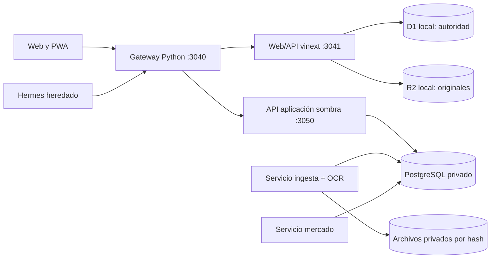

# Juanca — especificación técnica

**Estado de referencia:** 21 de octubre de 2026. Este documento distingue el **origen autoritativo actual** de los servicios **desplegados en sombra** y del **diseño objetivo**. La lógica de negocio se describe en la [especificación funcional](ESPECIFICACION_FUNCIONAL.md); el comportamiento visible, en la [especificación UX](ESPECIFICACION_UX.md).

## 1. Componentes y autoridad



El gateway autenticado recibe la web local y el acceso TLS privado de Tailscale. El Worker escucha solo en loopback y usa los bindings D1/R2 de Wrangler/Miniflare persistidos bajo `workspace/integration/state` en el despliegue local. **D1 y R2 siguen siendo la fuente financiera autoritativa.** El esquema `app` de PostgreSQL publica copias y decisiones de sombra con `mode=shadow` y `authoritative=false`; `ingestion` y `market` tienen migraciones, roles, APIs y workers propios. Estar activos no significa que el corte de escritura F5 se haya realizado.

El código canónico está en este repositorio. El despliegue local de la web mantiene una copia de trabajo en el perfil Juanca; los datos, archivos privados, claves y respaldos permanecen fuera de Git. El prototipo `workspace/apps/api` y `workspace/compose.yaml` son históricos y no forman parte del runtime patrimonial vigente.

| Frontera | Ubicación | Responsabilidad actual |
|---|---|---|
| Web/API vigente | `workspace/apps/web/app`, `lib`, `db` | UI React, importadores y parsers, propuestas, valoración, proyección, lectura/escritura D1/R2 |
| Gateway y compatibilidad | `workspace/integration` | Login/sesiones, origen permitido, identidad hacia Worker, chat guiado y rutas de sombra |
| Aplicación sombra | `services/application` | Modelo familiar, vistas versionadas, chat propio, evidencia, conciliaciones candidatas |
| Ingesta sombra | `services/ingestion` | Recepción por hash, documentos, jobs, parser B3, OCR local |
| Mercado sombra | `services/market` | Captura persistida de precios y FX, jobs y eventos de observación |
| Migraciones y respaldo | `infra` | Esquemas PostgreSQL, exportación D1, comparación y restauración verificable |
| Contratos | `packages/contracts` | OpenAPI y JSON Schema de las APIs/versiones |

## 2. Datos y modelo temporal

El modelo distingue familia, actor, titular, custodio, cuenta, instrumento, emisor, documento, fila bruta, interpretación, movimiento, snapshot, cotización y proyección. B3 es `source=b3`, nunca `custodian=b3`. Una cuenta no identificada conserva ámbito de titular/fuente/institución y estado pendiente; no representa una cuenta real confirmada. Se conserva por separado la fecha económica de la fecha de recepción/conocimiento.

### Origen vigente

- D1 guarda `imports`, `import_records`, decisiones, propuestas, costos, mensajes y cotizaciones; muchos registros normalizados contienen un `payload` JSON y referencia al original.
- R2 local contiene originales y adjuntos. Las referencias `chat://` representan evidencia virtual, no un objeto R2 perdido.
- El gateway conserva hashes de sesión y conversaciones guiadas en SQLite separado. El historial general de Hermes es heredado.
- D1 usa centavos enteros para numerosos importes y `REAL` para algunos precios/cantidades; la precisión disponible de una fuente antigua no puede recuperarse al migrarla.

### Sombra y destino

PostgreSQL separa los esquemas `app`, `ingestion` y `market`, con migraciones y roles propios. `app` conserva evidencia recibida, titular/cuentas, eventos, versiones de cartera y auditoría; `ingestion` es propietario de documentos y trabajos; `market` de observaciones y trabajos de precio/FX. La aplicación consume contratos de los otros servicios, sin leer directamente sus tablas. Los decimales se manejan con `decimal.js` y `NUMERIC` validado; las respuestas financieras exactas se serializan como cadenas decimales. Outbox/inbox y claves idempotentes protegen reintentos entre fronteras. El módulo de aprobación atómico existe y se prueba con datos sintéticos, pero la API financiera de sombra permanece en solo lectura para la familia.

Cada publicación de cartera lleva revisión de hechos, revisión de mercado, fecha económica, límite de conocimiento, versión/fingerprint del cálculo y cobertura. Una consulta paginada fija la versión; una publicación histórica no reemplaza automáticamente el puntero actual. Las decisiones sobre evidencia son append-only y por sí solas no aplican operaciones.

### Evidencia y reconciliación

Una importación guarda hash y bytes originales. Las filas normalizadas conservan documento, hoja/fila o página, fecha, parser y valores observados. Reinterpretar un archivo crea otra lectura trazable, sin borrar el bruto. Los snapshots B3 se comparan con movimientos por titular, custodio, cuenta e instrumento; una liquidación o transferencia no se convierte automáticamente en compra/venta. Fotos y mensajes se archivan de inmediato; OCR o parser produce una interpretación pendiente de revisión. El puente de sombra genera candidatos y decisiones auditadas, sin escribir la cartera vigente.

## 3. Cálculos vigentes de renta fija

`workspace/apps/web/lib/fixed-income-projection.ts` calcula la tasa anualizada a partir del primer y último precio positivo en fechas diferentes:

```text
r = (P1 / P0)^(365,25 / días_observados) - 1
P(t) = P1 × (1 + r)^(días_desde_P1_hasta_t / 365,25)
V(t) = P(t) × cantidad
```

Una observación de costo de adquisición anterior al último snapshot puede actuar como `P0`. Se rechazan vencimiento ausente, datos insuficientes o rentabilidad no finita, menor o igual a −95 % o superior a 200 % anual. La confianza depende de duración y número de observaciones. La ruta `GET /api/portfolio/fixed-income-projection` selecciona el snapshot vigente por **titular y tipo de fuente**: un extracto de previsión posterior no oculta B3. Los grupos de instrumentos obsoletos se excluyen de la respuesta actual.

La matriz de la UI genera cortes anuales y, al expandir un año, cortes mensuales hasta el último vencimiento. Para cada título y período `(inicio, fin]`, el cálculo presenta `V(fin)` como saldo si el título sigue vigente después del fin, o `V(vencimiento)` como vencimiento del período. Un título vencido deja de aportar al saldo de períodos posteriores. Los emisores se agregan dentro de cada titular; custodio y emisor no se intercambian. Los títulos sin proyección válida aparecen sin importe calculado. El cálculo es nominal, anterior a impuestos y sin flujos contractuales intermedios.

## 4. Interfaces y contratos

| API vigente | Uso |
|---|---|
| `GET /api/portfolio/dashboard`, `/summary`, `/positions` | Cartera y calidad de datos |
| `GET/POST /api/portfolio/cost-basis` | Consulta y registro de costos |
| `GET /api/portfolio/fixed-income-projection` | Tasas observadas, valores a vencimiento y emisor |
| `POST /api/import/b3`, `/avenue`, `/pension` | Carga de documentos |
| `GET/POST /api/transactions/chat`, `POST /api/transactions/proposals/{id}` | Propuestas y decisión explícita |
| `POST /api/portfolio/reviews/{id}`, `POST /api/market/refresh` | Revisión y actualización |
| Gateway: `/api/juanca/chat`, `/api/shadow/*` | Conversación propia y puente autenticado a sombra |

La aplicación de sombra sirve `/v1/portfolio`, `/v1/positions`, `/v1/owners`, `/v1/conversations/family/messages`, `/v1/evidence/*` y consultas/decisiones de conciliación. Ingesta sirve `/v1/uploads`, `/v1/import-jobs`, `/v1/documents`; mercado sirve `/v1/quotes`, `/v1/fx/USD-BRL`, `/v1/refresh`, `/v1/events`. Los detalles de cuerpos, errores y versiones están en los contratos OpenAPI del repositorio. Rutas de salud/readiness son internas. No usar las rutas de sombra como prueba de que PostgreSQL sea el libro autoritativo.

## 5. Seguridad y operación

El gateway valida sesión o token de máquina, origen en mutaciones y límites de acceso, elimina cabeceras de identidad entrantes y añade contexto autenticado hacia el Worker. Las cookies de navegador son `HttpOnly`; en TLS privado son `Secure` y `SameSite=Strict`. El Worker interno no debe exponerse directamente fuera de loopback. Los servicios de sombra usan credenciales propias y sockets/puertos privados. Ningún secreto, documento personal o valor de una cuenta debe entrar en Git, logs generales o ejemplos de prueba.

Los servicios locales se ejecutan mediante systemd de usuario. Para observarlos:

```bash
systemctl --user status patrimonio-juanca-web patrimonio-juanca-worker
systemctl --user status juanca-shadow-application juanca-shadow-ingestion juanca-shadow-market-api
```

La web local usa `vinext build` y Wrangler `dev --local` con el directorio de persistencia explícito. **Tras recompilar una web mientras Wrangler está activo hay que reiniciar `patrimonio-juanca-worker`**: el proceso puede conservar referencias HTML a chunks que el build reemplazó y devolver 404 para CSS/JS. La verificación de despliegue comprueba página, API y recursos `_next/static` a través del gateway. La actualización de código no debe borrar `integration/state`.

Para comprobar código sin datos familiares:

```bash
npm ci --ignore-scripts
npm test
npm run typecheck
cd workspace/apps/web
npm ci
npm test
npm run lint
```

Las pruebas de aplicación usan bases sintéticas y validan, entre otros casos, concurrencia e idempotencia. `infra/backup/verify_restore.ts` prueba restauración de los esquemas y evidencia local cubierta por su manifest; los originales R2 históricos y una copia cifrada fuera del host aún requieren una estrategia integral. La restauración debe verificar hashes, referencias y reanudación idempotente de jobs antes de habilitar escritura.

## 6. Transformación y pendientes técnicos

La secuencia de diseño es: confianza del origen y backup → conversación propia sin Hermes → aplicación PostgreSQL en sombra → ingesta y mercado en sombra → conciliación final y corte único de escritura. Las primeras fronteras están implementadas parcialmente; **el corte no ocurrió**. El destino es una aplicación/BFF patrimonial, un servicio de ingesta y uno de mercado, con PostgreSQL de esquemas separados y originales privados. No se separa un servicio adicional para cada módulo de conversación o planificación sin una necesidad demostrada.

Para conmutar se necesita cerrar cuentas e identidades pendientes, completar la transferencia de originales, comparar cantidades/valores y revisiones para ambos titulares, ensayar backup/restauración del conjunto, habilitar comandos con saldos verificados y probar reversión. La nueva autoridad debe mantener un solo escritor; una repetición de lote o propuesta no puede duplicar un hecho. La dependencia de Hermes en los recorridos habituales debe ser cero. Estas son condiciones de aceptación, no afirmaciones del despliegue actual.

## 7. Diseño P0 y brechas verificadas

Esta sección especifica cambios pendientes. Los contratos siguientes son conceptuales y requieren migraciones/adaptadores antes de utilizarse con datos reales.

| Requisito | Situación observada | Implementación requerida |
|---|---|---|
| P0-01 | La ruta de renta fija agrupa por `owner + instrument_code`; `cost_basis` identifica titular/instrumento/moneda | Introducir `position_id` y cuenta resuelta; agrupar filas económicas de la misma posición explícitamente, conservando las distintas cuentas |
| P0-02 | Las tres especificaciones resumen capacidades de D1 y sombra | Mantener la matriz funcional con evidencia por versión; no promover disponibilidad a validación por tener un proceso activo |
| P0-03 | El costo vigente se actualiza por identidad agregada y la proyección puede usarlo como observación | Versionar adquisiciones y correcciones; conservar cantidad, unidad, moneda, fechas, método y origen |
| P0-04 | Existen dos funciones de series; `buildFixedIncomeSchedule` incluye saldo cuando vencimiento coincide con cierre y `fixedIncomePeriodValue` lo excluye | Unificar semántica y motor; probar el límite del día de vencimiento y la conciliación anual/mensual |
| P0-05 | `buildFixedIncomeMatrixYears` toma la referencia máxima del conjunto | Generar calendario desde la primera cobertura y estados por posición/período; no recortar eventos por otra referencia más reciente |

### Contratos y migración

La posición resuelta referencia `household_id`, `owner_id`, `custodian_id`, `account_id`, `instrument_id` y `currency`. Su ID permanece estable; una resolución de identidad registra el vínculo y su revisión. Cada adquisición conserva `acquisition_id`, fecha, cantidad, precio unitario, comisiones, moneda y evidencia. Una fila sin cuenta se mantiene provisional, sin construir una clave compartida con `null` que fusione registros ajenos. La agrupación de UI usa emisor/titular después de calcular las posiciones.

Una observación de precio incluye fecha económica, recepción, método, moneda, unidad y fuente. Las revisiones de costo enlazan registro anterior y decisión. No se reparte automáticamente un costo legado entre cuentas: primero se generan candidatos, se comprueba evidencia y se publica la resolución. Una migración requiere respaldo, comparación de cantidades/importes por identidad y conservación de originales. La cifra agregada anterior permanece trazable.

Las respuestas de proyección deben incluir identidad de posición, versión de cálculo, revisión de datos, método, fecha de referencia y estado por celda: `projected`, `maturity`, `matured`, `insufficient_data`, `outside_coverage` o `conflict`. Un grupo puede incluir saldo y flujo a la vez. Importes desconocidos usan `null`; cero conocido usa cero. Cobertura indica cantidades de posiciones incluidas/excluidas y causas; si falta una base monetaria comparable, no se inventa un porcentaje.

El calendario usa fechas civiles ISO y cortes inclusivos al final del período. Cada flujo pertenece a `(inicio, fin]` una sola vez; para el saldo se exige vencimiento posterior al cierre. Los movimientos con orden intradía desconocido quedan en revisión. La fecha de recepción no resuelve por sí sola el orden económico.

### Verificación exigida antes de declarar P0 completo

- Dos cuentas con el mismo instrumento, monedas distintas y varias adquisiciones conservan sus identidades; no hay sobrescritura por ticker.
- La revisión de costo es reproducible y conserva procedencia; cambiar método de precio genera una advertencia o exclusión justificada.
- El saldo anual coincide con el cierre mensual correspondiente y el flujo anual con la suma de los flujos mensuales, bajo la misma versión y política de redondeo.
- Vencimientos en fin de mes/año, febrero bisiesto y último período parcial se asignan exactamente una vez.
- Referencias diferentes por titular, importaciones fuera de orden, cuenta sin cobertura y movimiento del mismo día sin secuencia producen resultados o bloqueos explícitos.
- Web, API y agregados usan el mismo motor; los ejemplos de aceptación son sintéticos y no escriben datos familiares.

Orden de entrega: registrar disponibilidad y casos de aceptación (P0-02); resolver identidad y procedencia (P0-01/P0-03); unificar motor temporal y agregaciones (P0-04/P0-05); validar interfaz y migración antes de desplegar escrituras. Este cambio documental no ejecuta ninguna migración.
