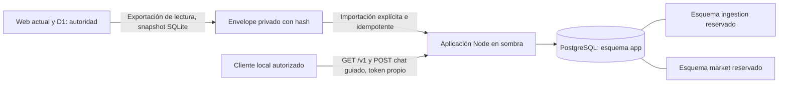

# Juanca: aplicación y PostgreSQL en sombra

Fecha: 9 de octubre de 2026. Estado: primer incremento de F3 funcionando en paralelo. La web actual y D1 siguen siendo la autoridad financiera. No se ha realizado el corte de F5.

## Resultado funcional

La nueva aplicación publica vistas de cartera desde una copia recibida de la información vigente. Permite consultar patrimonio, titulares y posiciones paginadas fijando una versión. La valoración usa decimales exactos y retorna cantidades, precios, cambio e importes monetarios como cadenas JSON. Falta de cambio produce importe BRL ausente y subtotal incompleto. Cuenta no identificada mantiene su incertidumbre; no se unen posiciones por ticker para decidir el impacto de una operación.

La API de sombra acepta consultas y mensajes del chat guiado propio. Las rutas financieras siguen siendo de solo lectura. Los comandos de aprobación existen como módulo transaccional y se prueban con datos sintéticos; no están expuestos a los datos familiares por HTTP. No se cambió la interfaz vigente, no se copiaron sus cookies y no se habilitó un segundo escritor financiero.

El historial de conversación se conserva como archivo de evidencia y se sirve desde la nueva aplicación junto con los mensajes nuevos que esta guarde en PostgreSQL. El chat guiado propio consulta la versión patrimonial de sombra y declara cuándo la valoración o la identidad son incompletas. No llama a Hermes. El chat guiado de F2 continúa en la web actual; la interfaz todavía no se conmutó. La IA libre sigue pendiente.

## Código, runtime y fronteras

Código independiente: `/home/jorge/juanca`. Datos privados: `/home/jorge/.local/share/juanca-shadow`, con acceso restringido al usuario local. El runtime desplegado no importa módulos de Hermes ni configura un agente.



Para F4 se agregó código inicial de mercado e ingesta, cada uno con migración, rol, esquema y contrato propios; ninguno está migrado ni activado. Mercado tiene API y worker. Ingesta tiene API privada de archivos, almacén local por hash con permisos restringidos, carga en dos pasos, validación de bytes y registro durable de trabajos; su worker de parseo aún no está implementado. El acceso de la aplicación a observaciones/documentos y el despacho de ambos outbox siguen pendientes. El diagrama no representa consultas ni referencias entre esquemas. `app.received_sources` es la copia de evidencia recibida para esta fase; no constituye el futuro repositorio propietario de documentos ni una integración durable de ingesta.

| Elemento | Implementación |
|---|---|
| Aplicación | Node 22.23.1, TypeScript ejecutado con eliminación nativa de tipos; dependencias fijadas en lockfile |
| PostgreSQL | 16.15, binarios Ubuntu extraídos en directorio privado, sin instalación de administrador |
| Cálculo | decimal.js, precisión intermedia 60 dígitos, política half-up al convertir importes a unidades menores |
| Persistencia exacta | Dominio PostgreSQL NUMERIC sin coerción de escala, CHECK de hasta 10 decimales y 18 dígitos enteros; BIGINT para unidades menores |
| Red de base | Sin listener TCP; socket Unix dentro de directorio 0700, limitado al usuario local |
| API | HTTP en 127.0.0.1:3050, token propio privado y modo `shadow`, `authoritative=false` |
| Procesos | systemd de usuario: `juanca-shadow-postgres`, `juanca-shadow-application` |
| Contratos | `packages/contracts/openapi.json` y `portfolio-v1.schema.json`, validados con Ajv |
| Migraciones | SQL ordenado con checksum, bloqueo de migrador y transacción; cambios posteriores usan otro archivo |

El socket utiliza autenticación trust exclusivamente dentro de un directorio inaccesible a otros usuarios; el usuario del sistema sigue pudiendo actuar como administrador de la instancia. Esta configuración sirve a la validación local. El despliegue definitivo con contenedores tendrá autenticación por servicio y secretos propios; no trasladar trust a una red TCP ni presentar esta instancia como una instalación endurecida o de alta disponibilidad.

Docker estaba instalado, pero este usuario no tenía acceso a su socket ni sudo sin contraseña. La extracción local permitió ejecutar PostgreSQL real y probar los bloqueos sin alterar permisos del equipo. `infra/postgres/local.sh bootstrap` descarga las versiones fijadas desde los repositorios configurados de Ubuntu; las herramientas deben revisarse y actualizarse deliberadamente antes del despliegue final.

## Modelo y reglas de integridad

El núcleo separa familia (`households`), actor (`actors`/`memberships`), titular (`owners`) y cuenta (`accounts`). La identidad compartida histórica se importa con atribución individual desconocida y permiso `legacy_shared`, sin facultad de aprobar. No se crean dos usuarios humanos ficticios a partir de los titulares.

Una cuenta sin evidencia explícita conserva ámbito de fuente/titular/institución y estado `unresolved`. Ese ámbito es una referencia pendiente, no una afirmación de que las posiciones pertenecen a una sola cuenta real. Las claves relacionales compuestas impiden mezclar familia, titular y cuenta en snapshots, propuestas o eventos.

Los registros brutos se preservan con texto y hash. El envelope canónico íntegro mantiene el contenido de origen recibido; la conversión de valores SQLite REAL utiliza su representación decimal disponible. No se recuperan dígitos que SQLite o el parser histórico ya hayan perdido. Valores fuera de escala o enteros inseguros se rechazan o señalan; no se truncan silenciosamente.

Los eventos importados son `evidence_only`: su copia no equivale a una nueva aprobación. Los snapshots mantienen fecha económica y fecha de conocimiento. La proyección considera esos límites, selecciona la base por fecha de referencia y excluye observaciones posteriores. No se reconstruye el historial completo de mercado: el origen solo conserva la última cotización por símbolo. Por ahora las consultas reproducibles son las versiones guardadas, no una serie histórica completa calculada a demanda.

`portfolio_versions` conserva el resultado, revisión de hechos, revisión de mercado, fecha económica, fecha de conocimiento, publicación y versión/fingerprint de cálculo. Publicar una consulta histórica no sustituye el puntero actual. La paginación lleva cursor firmado que fija familia, titular y versión; refrescar una cartera no mezcla las páginas anteriores.

El módulo de aprobación bloquea primero el estado familiar y después la propuesta. Comprueba membresía con facultad de aprobación, versión, hash del resumen, revisión de hechos, cuenta y cobertura de posición/caja. Confirma en una transacción la operación, tres partidas de posición/principal/comisiones, saldos, revisión, estado de propuesta, resultado idempotente y auditoría. No inventa liquidación. Una repetición con el mismo cuerpo recupera el resultado; cuerpo distinto con la misma clave produce conflicto. La identidad permanente del evento impide aplicar nuevamente la misma propuesta. Posición o caja desconocidas bloquean la aplicación. Todavía no se han inicializado saldos verificados reales para habilitar estos comandos.

## Migración y conciliación ejecutadas

Se exportaron en una transacción SQLite de lectura: 19 importaciones, 1.102 registros, 9 decisiones, 45 cotizaciones, 8 mensajes transaccionales, 2 propuestas, 1 revisión familiar y 1 observación FX; no había costos manuales ni aplicaciones nuevas. Se conservaron además cuatro mensajes archivados de conversación, leídos de su base independiente; no se afirma atomicidad entre la fotografía patrimonial y el archivo conversacional. La importación es transaccional e idempotente por hash del origen y conserva todas las filas recibidas. Los bytes R2 y las rutas documentales permanecen en la aplicación original: su traslado corresponde a F4.

Se reconstruyeron las 199 posiciones. La conciliación utiliza la misma exportación para ambos motores, sin consultar cotizaciones nuevas ni atribuir diferencias a momentos de carga distintos. Las cantidades, valoraciones por posición y total ahora coinciden exactamente en esa fotografía.

La diferencia inicial correspondía a la venta de SMAL11 de Jorge del 05/10/2026, recibida por chat sin cuenta de custodia. Jorge confirmó que fue en la misma cuenta identificada en la posición B3 importada. Después confirmó que el identificador del extracto Avenue de Jorge corresponde a la cuenta de custodia Avenue usada por sus confirmaciones; se vincularon tres registros mediante resolución auditable. También confirmó que la compra BAC del 28/08/2026, aunque la fuente la atribuye a Julia, pertenece a Jorge y a esa cuenta. La resolución específica conserva intacta la evidencia recibida. La revisión de hechos quedó en 3. No se alteraron documentos ni la base financiera vigente.

Tras esas resoluciones, las 199 posiciones concilian con igualdad exacta de cantidades, valoraciones y total: cero diferencias y cero incidencias. `identity_complete=false` porque 148 posiciones B3 aún no tienen identificador de cuenta (127 de Jorge y 21 de Julia), y queda una posición de previsión de Jorge sin cuenta. En los snapshots más recientes, el pendiente se compone de renta fija y Tesouro Direto: Jorge tiene 123 y 4 filas respectivamente; Julia, 20 y 1. Las hojas originales de esas categorías no contienen la columna `Conta`; las filas de acciones, BDR, ETF y fondos sí traen cuenta. Jorge confirmó que las posiciones de cada titular proceden de cuentas diferentes, pero esa confirmación no asigna cada título de renta fija/Tesouro a una cuenta específica. Se requiere extracto por cuenta o una asignación fiable por producto. La posición de previsión queda aparte. La paridad de esta fotografía no implica identidad completa ni autoriza a conmutar la web.

## Pruebas y operación

Tras registrar la evidencia B3 pasaron 19 pruebas de aplicación, incluidas PostgreSQL real y HTTP sobre bases temporales; también pasó TypeScript. La ingesta B3 se verificó además contra las dos hojas reales mediante recuentos, lectura de filas registradas y conciliación candidata. Esas 19 pruebas no cubren aún un flujo completo de publicación de los nuevos reportes. Las bases sintéticas tienen nombre aleatorio `juanca_test_*` y se eliminan al terminar; nunca se ejecutan aprobaciones contra `juanca_shadow` ni D1 real.

```bash
cd /home/jorge/juanca
npm ci --ignore-scripts
npm test
npm run typecheck
systemctl --user is-active juanca-shadow-postgres juanca-shadow-application
```

La API desplegada se verificó mediante lecturas autenticadas antes de las dos últimas resoluciones: 199 posiciones, revisión de hechos 1, importes como cadenas, paginación por versión y cuatro mensajes archivados visibles en el chat. La proyección sombra actual está en revisión 3. Salud y PostgreSQL respondieron correctamente. Acceso anónimo devuelve 401; las escrituras financieras autenticadas devuelven 405. `POST /v1/conversations/family/messages` guarda únicamente conversación guiada propia. Los servicios patrimoniales originales continúan activos.

Para cargar otra fotografía, exportar hacia un archivo privado nuevo con `infra/migration/export_sqlite.py`; importar con `services/application/src/cli.ts import`; publicar con `cli.ts publish` indicando hash, familia, fecha y límite de conocimiento. No hay sincronización automática ni doble escritura. `infra/migration/reconcile.ts` recibe la ubicación del módulo puro anterior solo para comparación; el servicio no depende de ese archivo durante su funcionamiento.

Las credenciales de sombra están en `application.json` dentro del directorio privado. No pegarlas en una terminal compartida, documentación ni mensajes. La API no se publica en Tailscale ni se añade a la web mientras no exista el adaptador autorizado y el corte validado.

El respaldo `infra/backup/verify_restore.ts` utiliza pg_dump/pg_restore sobre el esquema `app`, restaura en otra base temporal y compara exactamente todas sus tablas. La última restauración verificó 30 tablas y copió/verificó por SHA-256 los dos XLSX B3 nuevos. Incluye configuración privada y definición de roles. Su alcance todavía excluye los documentos R2 históricos y los futuros datos de ingesta/mercado; es una copia local y no protege frente a pérdida del disco. Para F5 se requiere respaldo coherente del conjunto y copia fuera del host.

```bash
node --experimental-strip-types infra/backup/verify_restore.ts /ruta/privada/nueva
systemctl --user restart juanca-shadow-postgres juanca-shadow-application
```

Para retirar la sombra: detener y deshabilitar ambos servicios `juanca-shadow-*`. La web y D1 no cambian. No restaurar una fotografía antigua sobre el origen financiero para deshacer una prueba de sombra.

## Pendientes para completar F3 y avanzar

1. Asignar las 148 posiciones B3 pendientes a sus cuentas concretas usando un extracto por cuenta o una asignación fiable por producto (las hojas originales de renta fija y Tesouro Direto no contienen `Conta`). Resolver por separado la identidad de la cuenta de previsión de Jorge. Son 149 posiciones pendientes en total.
2. Completar el núcleo normalizado y publicar desde saldos/cobertura verificados; por ahora el cálculo lee la copia recibida de fuentes.
3. Llevar acceso/BFF y la interfaz React al servicio independiente, conservando contratos e identidad autorizada. El chat guiado y su archivo ya funcionan en la API de sombra; falta la conmutación de la web.
4. Extender contratos/comandos para propuestas editables y versionadas, rechazo, revisiones y costo. La aprobación probada solo está disponible como módulo interno sintético.
5. Preparar adaptación React, jobs durables y validación continua en sombra. Rechazo y resolución de revisiones versionadas siguen pendientes.
6. F4: calificar frescura y cobertura de precios, reemplazar reintentos completos por reintentos de símbolos faltantes y diseñar valoración versionada antes de consumir mercado. Luego separar ingesta, mover documentos con manifest verificado y completar recuperación durable; no añadir consultas entre esquemas.
7. Hacer F5 únicamente después de la conciliación final y prueba de restauración completa, manteniendo un único escritor.

## Fuentes técnicas de las decisiones

[PostgreSQL: tipos numéricos](https://www.postgresql.org/docs/16/datatype-numeric.html) documenta la coerción de escala; por eso el dominio valida antes de admitir el valor. [node-postgres: transacciones](https://node-postgres.com/features/transactions) fundamenta utilizar un mismo cliente hasta commit/rollback. La política half-up y la precisión intermedia se implementan con [decimal.js](https://mikemcl.github.io/decimal.js/). Los contratos siguen [JSON Schema/Ajv](https://ajv.js.org/json-schema.html). La restauración utiliza [pg_restore](https://www.postgresql.org/docs/16/app-pgrestore.html).

## Ajuste de modelo pendiente — custodia y fuentes

Jorge aclaró que B3 es el sistema donde las instituciones reportan posiciones, no una institución de custodia. El custodio (por ejemplo, BTG, Itaú, Avenue o el proveedor de previsión) y su cuenta son la identidad patrimonial; B3, un extracto del custodio, una foto o un mensaje son fuentes de evidencia distintas. Los reportes de posiciones y movimientos B3 deben modelarse como snapshot fechado y movimientos históricos, conciliados por titular, custodio, cuenta e instrumento. Una carga corregida crea otra versión de evidencia y proyección, sin duplicar movimientos ni borrar el reporte anterior.

Las cuentas usadas actualmente en la proyección F3 se derivan temporalmente del ámbito de la fuente y sirven para evitar mezclar filas no identificadas. No prueban la cuenta real de custodia. Antes de cualquier corte hay que mapearlas al modelo titular → institución de custodia → cuenta y reconciliar los movimientos entre snapshots. Fotos y movimientos escritos deben archivarse desde su recepción, aunque su identidad o extracción quede pendiente.

Los reportes `movimentacao-2026-10-09-19-28-45.xlsx` y `posicao-2026-10-09-19-28-14.xlsx` se recibieron después. Jorge confirmó ambos como propios y una cuenta por institución. Sus bytes originales están archivados por hash con permisos privados en `~/.local/share/juanca-shadow/evidence/b3/`; se retiraron las copias de la carpeta `home` del perfil después de verificar los hashes. Las migraciones `007_custody_evidence.sql` y `008_source_interpretations.sql` añadieron custodios, cuentas, documentos, filas originales e interpretaciones versionadas en PostgreSQL de sombra.

Se registraron 146 posiciones B3 con corte declarado 09/10/2026 y 412 movimientos entre 08/10/2025 y 08/10/2026. Las posiciones se asignaron a cuentas internas de Itaú Corretora (94), BTG (48) e Itaú Unibanco (4), separando las dos instituciones de Itaú. Solo la cuenta de Itaú Corretora tiene referencia externa observada en este XLSX; para BTG e Itaú Unibanco la identidad interna se basa en la confirmación de unicidad de Jorge. Un movimiento histórico de XP mantiene su cuenta pendiente. La interpretación determinística v3 dejó 83 filas para revisión de significado, contraparte de traslado o identidad XP; todos los códigos de instrumento de estas filas se pudieron extraer o vincular con el ISIN único del snapshot. Repetir la carga exacta no creó nuevas filas (`new_rows=0`).

El informe privado `b3-2026-10-09-candidate-comparison.json` compara el snapshot anterior de Jorge (149 filas) con el nuevo (146): una alta, cuatro ausencias y un cambio de cantidad. El débito B3 de liquidación SMAL11 del 07/10 tiene la misma cantidad que la venta manual del 05/10; es un vínculo candidato, no una segunda venta ni un traslado de custodia. Dos CDB desaparecen del snapshot nuevo aunque sus últimos rescates B3 figuran el 18/09, antes del snapshot anterior del 19/09 que todavía los incluía: requieren revisión del corte económico/latencia del reporte. Los reportes permanecen como evidencia en sombra: no se publicó una nueva cartera ni se modificó la aplicación financiera vigente. La API de foto/texto y el conciliador que aplica correcciones siguen pendientes.

## Incrementos F4 preparados — mercado e ingesta

Se agregó `services/market` independiente con proveedores B3 COTAHIST, NASDAQ público y PTAX/BCB, tablas propietarias en el esquema `market`, jobs reclamados con lease, reintentos acotados, idempotencia y outbox. El contrato está en `packages/contracts/market-v1.openapi.json`; las migraciones y unidades de servicio son separadas de la aplicación. El servicio recibe símbolos por contrato y no conoce titulares, cuentas ni posiciones.

Estado inicial reemplazado por la actualización operativa al final de este documento: la migración, captura y puente de mercado ya están activos en sombra. La aplicación aún no usa estas observaciones para calcular ni publicar valoraciones.

Ingesta recibe una intención de carga antes de aceptar bytes, valida asignación y tamaño, calcula SHA-256 mientras escribe un temporal privado y publica el objeto mediante enlace atómico dentro del mismo volumen. Solo después crea el documento, su asignación, el trabajo de parseo y el evento `DocumentStored` en una transacción. Descarga requiere una asignación de la familia solicitada. Una repetición de carga verifica los bytes contra el hash esperado; el mismo archivo puede tener asignaciones distintas y produce advertencia para revisión.

El servicio de ingesta también es código preparado, no desplegado. No se migraron los objetos actuales de R2, no existe todavía worker de parsers ni consumidor del outbox, y no se verificó respaldo/restore del volumen de objetos. Antes de activarlo hay que configurar el secreto privado, enlazar el BFF autorizado, poner en marcha reconciliación de temporales/objetos huérfanos y agregar el volumen al backup probado.

La comprobación TypeScript cubrió el código F4, pero sus servicios todavía no se han probado en ejecución ni activado. Los 19 casos corresponden al servicio F3 de aplicación; la restauración cubre su esquema y los dos documentos B3 registrados, con las exclusiones indicadas.

## Actualización operativa — entrada manual y fotos (10/10/2026)

La aplicación de sombra dispone ahora de `POST /v1/evidence/text` y `GET /v1/evidence/text/{id}`. Guarda el texto original con titular y fecha declarada opcional en `app.manual_intakes`, estado `awaiting_review` y clave idempotente. Las transacciones escritas en el chat guiado crean también esta entrada cuando el titular se puede identificar; el mensaje de conversación se conserva aun si falta titular. Registrar evidencia no aplica operaciones ni incrementa `facts_revision`.

La ingesta está activada en `127.0.0.1:3052` con secreto privado separado. El BFF de aplicación (`127.0.0.1:3050`) expone `POST /v1/evidence/photos`, `PUT /v1/evidence/photos/{id}/content` y `GET /v1/evidence/photos/{id}`; valida el titular dentro de la familia configurada y construye internamente la asignación. Una imagen JPEG, PNG, WebP o HEIC de hasta 20 MB se conserva por SHA-256 como documento `manual_evidence`, con trabajo de parser pendiente. El servicio interno de ingesta mantiene un límite general de 30 MB para sus otros documentos. Ni foto ni texto se incorporan automáticamente a posiciones o movimientos; faltan parser, conciliador y enlace con la UI vigente/Hermes.

La migración `009_manual_intake.sql` se aplicó al esquema de aplicación y `006_ingestion.sql` al de ingesta. Los tres servicios `juanca-shadow-postgres`, `juanca-shadow-application` y `juanca-shadow-ingestion` están activos en el usuario local. Las pruebas de texto/chat usaron PostgreSQL temporal; una prueba independiente subió una imagen sintética a una base y volumen aislados, comprobó objeto/hash/ámbito y eliminó la base al terminar. El respaldo `infra/backup/verify_restore.ts` ahora restaura y compara ambos esquemas, copia los objetos de ingesta registrados con verificación SHA-256 y sigue incluyendo los XLSX B3. Una ejecución restauró 31 tablas `app`, 8 `ingestion` y dos XLSX. Los objetos R2 históricos y el estado del servicio de mercado siguen fuera de ese alcance; no hay copia fuera del host. La UI y la aplicación financiera vigente siguen sin conmutar.

## Actualización operativa — web e ingesta B3 (10/10/2026)

El gateway autenticado `integration/server.py` de la web vigente ahora encamina únicamente rutas de evidencia hacia la aplicación en sombra. El navegador nunca recibe el token del servicio. `TransactionChat.tsx` registra el texto y la foto antes de enviar al Worker financiero vigente; mantiene la misma clave si se reintenta. `InteractiveWorkspace.tsx` registra XLSX B3 y PDF Avenue/previsión del mismo modo, y permite comprobar la fecha de corte de posiciones B3. Los anexos PDF/TXT/CSV que se envían solo desde Transacciones continúan en R2. Nada de esto conmuta la autoridad financiera: la web/Worker/D1 actuales siguen procesando importaciones y aprobaciones.

Ingesta acepta esos documentos mediante `POST /v1/evidence/documents` y `PUT .../content` del BFF. El worker `juanca-shadow-ingestion-worker` procesa solo B3, conserva fila, hoja y JSON original, y deja el lote `awaiting_review`; otros tipos esperan parser. La migración `007_ingestion_raw_sheet.sql` incorporó la hoja a la identidad de fila. La migración `008_ingestion_reference_date_correction.sql` corrigió la fecha de referencia en el resultado de un parseo previo y emitió un evento de corrección; las filas originales y el evento inicial se conservaron.

El worker `juanca-shadow-application-ingestion-worker` lista lotes B3 parseados mediante la API privada de ingesta y los registra idempotentemente en aplicación, con interpretaciones versionadas y recibo `app.ingested_import_jobs` de la migración `010_ingestion_bridge.sql`. Los dos XLSX B3 de Jorge ya pasaron por el recorrido: 558 filas en ingesta y 558 correspondencias exactas con la evidencia anterior; cero filas duplicadas en aplicación y 83 interpretaciones para revisión. `facts_revision` continúa en 3. No existe publicación automática de correcciones ni acceso directo entre esquemas de servicios.

El gateway se probó con foto y B3 sintéticos contra un servidor simulado; el parser se probó con hojas duplicando número de fila y fechas de movimientos. La suite de aplicación/ingesta pasó 23 pruebas, TypeScript pasó y el build de la web terminó correctamente. El respaldo posterior restauró y comparó 32 tablas `app`, 8 `ingestion`, los dos XLSX originales y los dos objetos registrados en ingesta. Se mantienen pendientes la migración de R2 histórico, el parser de Avenue/previsión/fotos, el conciliador de correcciones B3, el servicio de mercado y una copia fuera del host. Envíos directamente a Hermes, fuera de la web, no se replican a la nueva ingesta.

## Actualización operativa — mercado en sombra y puente durable (10/10/2026)

El servicio privado `juanca-shadow-market-api` y su worker de recolección ya están desplegados. Se aplicaron las migraciones del esquema `market` y la aplicación no consulta directamente ese esquema: el puente `services/application/src/market-worker.ts` consume el endpoint autenticado de outbox, registra cada evento en `app.market_inbox` con hash/idempotencia, guarda observaciones de precios y FX y avanza el cursor dentro de una transacción. `juanca-shadow-application-market-worker` está habilitado y activo como unidad de usuario systemd; la configuración y el token están en `market.json` privado.

El cursor de la aplicación llegó al evento 6: se recibieron 6 eventos, 227 observaciones de cotización y 6 de USD/BRL. Los cinco eventos parciales de la actualización amplia llevan cada uno 45 símbolos y FX; el evento de humo lleva dos símbolos y FX. La captura amplia solicitó 26 símbolos B3 y 24 estadounidenses; logró 22 y 23, respectivamente. B3 falló para cuatro símbolos y Nasdaq para uno. La política actual reintenta hasta cinco veces, pero guarda cada resultado parcial como evento nuevo. Esto mantiene trazabilidad e idempotencia, aunque genera revisiones repetidas que conviene reducir con frescura por símbolo y reintento solo de faltantes.

Se corrigió la conversión del nombre diario del ZIP COTAHIST (`D<dd><mm><yyyy>`) a la fecha de negociación (`yyyymmdd`), validada con una lectura B3. La última captura disponible fue B3/PTAX del 09/10/2026 y Nasdaq del 08/10/2026. La integración demuestra transporte y conservación de observaciones, no calidad suficiente para valoración: frescura, cobertura y semántica del endpoint público de Nasdaq aún no están calificadas. Las observaciones de mercado no incrementan `facts_revision`, no recalculan ni publican cartera; las cinco versiones patrimoniales existentes no se modificaron.

Esta fase registra cotizaciones candidatas, sin aplicarlas a posiciones; B3 COTAHIST es histórico diario, BCB publica PTAX, y el endpoint web Nasdaq utilizado requiere evaluación de estabilidad y licencia antes de dependencia productiva. La aplicación sigue en sombra y D1/Worker continúan como única autoridad publicada. No se ejecutaron pruebas adicionales durante este incremento; la verificación operativa fue el estado activo de systemd y los contadores/cursor de PostgreSQL.

Queda pendiente decidir una política de cobertura/frescura por mercado, evitar repetir símbolos exitosos en reintentos parciales, calificar o sustituir el proveedor estadounidense, y construir el cálculo de valoración que consuma observaciones explícitamente aprobadas. El respaldo anterior a la migración y a estas observaciones fue reemplazado el 10/10/2026 por `backups/full-shadow-after-market-20261010`; ver el apartado de respaldo al final. Los documentos R2 históricos y una copia fuera del host siguen pendientes.


## Captura estructurada de movimientos escritos en sombra (10/10/2026)

`POST /v1/evidence/text` conserva el texto original y, en la misma transacción, añade una interpretación versionada `manual-trade-v1`. El parser local reconoce expresiones inequívocas en español/portugués con lado, ticker, cantidad, precio con moneda y fecha. Los campos faltantes, formatos ambiguos como separadores de miles sin coma, o formas no reconocidas quedan señalados como `needs_manual_review`; los textos que no parecen operación se marcan `not_detected`. Incluso una interpretación completa queda en `parsed_review`: requiere confirmación y no crea evento, movimiento ni saldo.

`GET /v1/evidence/text/{id}` devuelve evidencia e interpretación; `GET /v1/evidence/text?limit=50` enumera hasta 100 entradas recientes para revisión. La API de entrada incluye la interpretación en la respuesta y respeta la idempotencia original. La web muestra inmediatamente los campos reconocidos y los motivos de revisión, y la nueva bandeja persistente «Evidencia recibida» en Revisiones vuelve a presentarlos junto con el texto original y titular. La tabla nueva `app.manual_trade_interpretations` conserva versión, campos y razones de revisión, vinculada a la entrada inmutable. La bandeja es de solo lectura: no se conecta todavía con el panel de propuestas de D1 ni publica hechos; esa integración debe conservar revisión humana, cuenta/custodio y deduplicación con liquidaciones. El contrato OpenAPI subió a 0.9.0.

La migración `012_manual_trade_interpretations.sql` se aplicó y la API de sombra se reinició con el código actualizado. El respaldo privado `backups/full-shadow-written-intake-20261010` restauró y comparó 37 tablas `app`, 8 `ingestion` y 6 `market`, junto con los cuatro XLSX B3 y los dos objetos de ingesta. No se ejecutaron pruebas funcionales en este incremento.

## Sugerencias de relación entre texto y movimiento B3 (10/10/2026)

La nueva ruta `GET /v1/reconciliation/manual-b3/candidates` genera sugerencias de solo lectura entre textos ya estructurados y filas de movimiento B3. Exige mismo titular, código de activo y cantidad exacta, con diferencia de fechas de hasta siete días; restringe la búsqueda a negociación, liquidación y transferencia. Presenta todas las filas coincidentes, su custodio, tipo, fecha y crédito/débito. El sentido y tipo B3 se conservan para evaluación humana: no se asumen equivalentes a compra/venta ni se fusiona la negociación con su liquidación.

La web muestra esos grupos en «Coincidencias escritas ↔ B3», separados por entrada manual y rotulados como sugerencias. No se escribe vínculo, no cambia el estado de las fuentes ni se altera la cartera. La comparación usa aritmética decimal exacta para evitar redondeos; no se ejecutaron pruebas funcionales en este incremento.

## Decisiones humanas auditadas para enlaces de evidencia (10/10/2026)

La bandeja ahora permite marcar cada fila B3 como relacionada o no relacionada con el texto original. `POST /v1/reconciliation/manual-b3/decisions` vuelve a comprobar que la sugerencia siga cumpliendo los criterios y exige membresía `reviewer`, `owner` o `approver`. La identidad autenticada por la web se reenvía desde el gateway, y la cuenta local recibió únicamente rol `reviewer`. La migración `013_manual_b3_review_decisions.sql` guarda decisiones append-only con revisión, actor, clave idempotente y referencia a la decisión anterior; cada cambio produce una entrada de auditoría. La consulta devuelve la decisión más reciente.

Una decisión `related` solo expresa correspondencia de evidencia. No crea ni modifica eventos, efectivo, posiciones, cuentas o `facts_revision`; un clic repetido es idempotente. El build web terminó, API/gateway/web se reiniciaron y el respaldo restaurado quedó en `backups/full-shadow-evidence-decisions-20261010`. El contrato OpenAPI subió a 0.11.0. No se ejecutaron pruebas funcionales en este incremento.

## Bandeja persistente y vista privada de fotos (10/10/2026)

La ingesta expone `GET /v1/manual-evidence/photos?limit=50`, acotado por `X-Household-Ref`, y la aplicación lo consume por su API privada; el esquema de ingesta nunca se consulta directamente desde la aplicación ni el navegador. La pestaña «Revisiones» muestra titular, nombre, fecha, tamaño y estado de cada foto recibida y permite abrir el original.

La vista se entrega desde la aplicación tras verificar que el upload pertenece a la familia, que está almacenado y que tamaño y SHA-256 coinciden. La credencial de ingesta permanece en servidor. Al momento de este despliegue todavía no había OCR local instalado.

## OCR local de comprobantes fotográficos (10/10/2026)

Se instaló Tesseract 5.3.4 con modelos `por` y `eng` bajo `~/.local/opt/juanca-tesseract`, sin modificar paquetes del sistema ni depender de Hermes. Un worker de ingesta independiente consume solo `manual_evidence`; reconoce JPEG, PNG y WebP. HEIC se conserva y aparece como formato pendiente de OCR, sin bloquear la bandeja ni alterar el archivo original.

El texto se guarda como resultado versionado en `ingestion.import_jobs.result` y como registro de interpretación con hash en `ingestion.raw_records` (`source_sheet=OCR`). La API de fotos devuelve el estado y texto para el titular/familia. La aplicación reutiliza `manual-trade-v1` para proponer tipo de operación, ticker, cantidad, precio, moneda y fecha; estos campos se calculan para mostrar y aún no se persisten como decisión. La interfaz los presenta junto al texto y al original, con razones pendientes. No crea hechos, no publica eventos y no cambia posiciones, efectivo ni revisión patrimonial. El servicio `juanca-shadow-ingestion-manual-ocr-worker.service` está habilitado y activo; también están activos ingesta, aplicación y web. Se verificó que Tesseract enumera los modelos `eng` y `por`, y el build web terminó. El typecheck global continúa bloqueado por dos errores ajenos al cambio en `b3-reconciliation.ts` y `manual-b3-candidates.ts`. No hay fotos en la base para verificar una lectura real de punta a punta; no se ejecutaron pruebas funcionales. Contratos: aplicación 0.15.0 e ingesta 0.4.0.

## Respaldo completo de la sombra (10/10/2026)

Se creó `/home/jorge/.local/share/juanca-shadow/backups/full-shadow-after-market-20261010` mediante `infra/backup/verify_restore.ts`. La restauración temporal comparó íntegramente 36 tablas `app`, 8 `ingestion` y 6 `market`; verificó SHA-256 de los dos XLSX B3 y de los dos objetos de ingesta. La configuración privada incluida mantiene permisos restrictivos. La ejecución terminó correctamente.

La recuperación cubre los esquemas y la evidencia registrada localmente; excluye R2 histórico y no es una copia fuera del equipo. Los tres esquemas se exportan secuencialmente y se comparan/restauran por separado, así que no representa una instantánea distribuida atómica entre workers concurrentes. Para activar uso patrimonial amplio, resta respaldar R2, definir copia externa cifrada y establecer una pausa/coordinación de workers o una estrategia de snapshot común con cursor/outbox reconciliable.

## Baseline B3 y conciliación candidata automática (10/10/2026)

Se localizó en el archivo histórico privado el XLSX B3 de posiciones del 19/09/2026 y su reporte de movimientos asociado. Ambos se registraron como evidencia original en sombra, con hash, hoja y fila: 149 posiciones y 28 movimientos. La identidad se asignó a la cuenta de custodia existente para Jorge; esto no modifica el patrimonio publicado. Ahora están disponibles dos snapshots B3 registrados (19/09 y 09/10) y los movimientos de ambos períodos.

La comparación ejecutada detecta seis diferencias entre snapshots. Para dos productos de renta fija, las cantidades de aplicaciones menos rescates coinciden exactamente con la variación observada. En acciones con actualización corporativa y ETF con liquidación, la semántica de movimiento no permite calcular variación de unidades con seguridad y quedan como candidatos. Dos CDB desaparecen del snapshot sin movimiento posterior al corte anterior. La cobertura del reporte de movimientos termina el 08/10 mientras que el nuevo snapshot es del 09/10; la comparación marca el intervalo incompleto. El resultado está en `migration/b3-2026-09-19-to-2026-10-09-reconciliation-candidate.json`, con detalles y razones de revisión; no se aplica ni publica.

`b3-reconciliation.ts` ahora conserva cada movimiento candidato y calcula un rollforward de unidades solo para adquisiciones con crédito y rescates con débito; excluye renta y deja acciones corporativas, operaciones, liquidaciones y transferencias como inconclusas. El worker de puente genera/actualiza automáticamente una comparación privada para cada par cronológico de snapshots B3 tras procesar los lotes listos. El artefacto se escribe atómicamente por pareja de documentos y no entra en la UI: la revisión todavía es operativa/manual. El worker de ingesta fue reiniciado con este comportamiento y generó el informe vigente.

Después de registrar el baseline se creó `backups/full-shadow-b3-reconciliation-20261010`. La restauración temporal comparó 36 tablas `app`, 8 `ingestion` y 6 `market`, verificó los cuatro XLSX B3 y los dos objetos de ingesta. Los informes candidatos derivados no se copian; son regenerables desde las fuentes registradas. Continúan pendientes una interfaz de revisión/aprobación de diferencias, la cobertura del 09/10, la resolución de los CDB ausentes, copia cifrada fuera del host y recuperación de R2 histórico.

## API de revisión B3 de solo lectura (10/10/2026)

La aplicación de sombra expone `GET /v1/reconciliation/b3/candidates?limit=50` con bearer token. Devuelve hasta 100 informes de la familia configurada, ordenados por fecha del snapshot, con `mode=shadow`, `authoritative=false` y `apply_enabled=false`. No agrega endpoint de escritura ni decisión de aprobación; el gateway actual no expone esta ruta todavía. El contrato OpenAPI subió a 0.7.0. Para activar la ruta se reinició la API local; no se hicieron pruebas funcionales nuevas en este incremento.

## Bandeja B3 visible en la web vigente (10/10/2026)

La pestaña «Revisiones» ahora incorpora la comparación B3 de sombra bajo el panel de revisiones D1 existente. El navegador solicita únicamente `GET /api/shadow/reconciliation/b3/candidates`; el gateway autenticado añade el token de servicio y limita el reenvío a esa ruta GET. La pantalla muestra snapshots comparados, cobertura, diferencias, rollforward y motivos de revisión. Está rotulada como sombra y no incluye botones de aceptar, corregir o publicar.

El build de la web terminó correctamente y se reiniciaron el Worker web local y el gateway para cargar el cambio. Los endpoints financieros existentes, D1 y su flujo de aprobación siguen como estaban; la nueva sección es informativa. La bandeja no sustituye la revisión manual de las seis diferencias actuales.

## Reintentos selectivos del servicio de mercado (10/10/2026)

El worker `services/market/src/service.ts` ahora identifica por símbolo las respuestas B3 ausentes y errores estadounidenses individuales; si falla PTAX conserva solo esa tarea en espera. Cuando reintenta (límite actual de cinco intentos y espera exponencial), reduce el trabajo a esos símbolos/FX pendientes. El outbox publica las nuevas observaciones de cada intento una sola vez y el resultado del job acumula las cotizaciones exitosas previas junto con `pending_symbols` y `pending_fx`. El consumidor de aplicación sigue idempotente por evento.

No había jobs en cola al desplegar el cambio (quedaban un job parcial antiguo y uno exitoso); no se repitieron consultas externas. Se reinició el worker y quedó activo. Los eventos parciales y duplicados históricos siguen intactos como evidencia; la mejora aplica a futuras solicitudes. El contrato de mercado cambió a 0.2.0. No se ejecutaron pruebas funcionales en este incremento.
