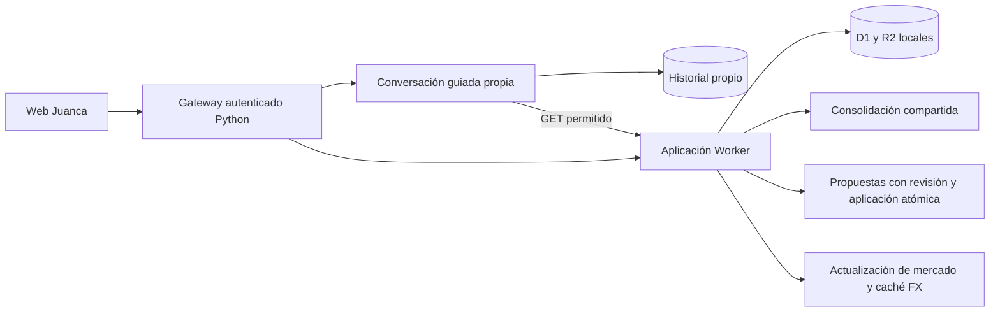

# Juanca: primer hito de implementación

Fecha: 9 de octubre de 2026. Alcance: respaldo y restauración, consistencia patrimonial y conversación propia sobre la aplicación vigente. Complementa [la especificación funcional y técnica](ESPECIFICACIONES_JUANCA_MICROSERVICIOS.md). No equivale a completar la extracción de microservicios.

## Comportamiento implementado

- Dashboard y posiciones comparten una consolidación. Las bases se seleccionan por fecha de referencia, no por el orden de carga. La respuesta incluye revisión de hechos y versión de cartera.
- Los valores USD se conservan en moneda original. La conversión utiliza una observación PTAX persistida; sin ella se presenta un subtotal incompleto, nunca un cero inventado. Las consultas no llaman al proveedor cambiario. La actualización de mercado registra la observación y evita sustituir una cotización nueva por otra anterior.
- Las operaciones sin base suficiente, cantidades negativas y ambigüedades se señalan para revisión. Se conserva el documento original; no se corrige un hecho financiero automáticamente.
- Aprobar una propuesta usa una transacción D1 y una comparación de revisión de hechos. Dos ventas concurrentes sobre la misma posición no pueden aprobarse utilizando la misma revisión. Repetir una aprobación aplicada devuelve su importación anterior. El rechazo exige estado pendiente.
- Cada propuesta nueva conserva el vínculo explícito al mensaje y adjunto que la originó. Las propuestas históricas sin ese vínculo no reciben una asociación inferida. No se inventa fecha de liquidación. Texto de transacción requiere fecha y moneda explícitas; acepta compras y ventas en español y portugués.
- Una posible operación similar requiere confirmación expresa en la interfaz. No se descarta automáticamente como duplicada ni se registra sin aprobación.
- El chat principal usa `/api/juanca/chat`, con historial SQLite propio, aislamiento por familia, envío idempotente y exclusión de solicitudes concurrentes. Consulta solamente vistas autorizadas. Una petición de registrar o aprobar conduce al flujo existente de propuestas y revisión; el chat general no escribe operaciones.
- El chat funciona en modo guiado sin Hermes. La IA de conversación libre no está configurada en este hito. El adaptador histórico `/api/hermes/chat` permanece disponible como transición; la interfaz principal no lo utiliza. Telegram conserva su integración anterior.
- El historial de la sesión web de Hermes puede archivarse como texto identificado de solo lectura, sin herramientas, sin otros canales y sin reproducir acciones.
- El simulador utiliza el valor disponible de cartera o pide un monto cuando la valoración está incompleta. Se eliminan valores, fecha y puntaje de calidad ficticios de la interfaz.

## Arquitectura transitoria



Se mantiene la identidad familiar compartida y los controles de sesión/origen. La base D1 sigue siendo la fuente patrimonial; no hay PostgreSQL ni nuevos servicios de ingestión o mercado desplegados todavía. La migración `0004_juanca_foundation.sql` es aditiva y no reescribe documentos históricos. El importe monetario continúa usando la representación numérica existente; la aritmética decimal exacta, las cuentas explícitas y los contratos completos corresponden a F3.

## Validación y operación

Las pruebas de escritura usan exclusivamente una base temporal con datos sintéticos. La conciliación con la cartera real se hace en una copia privada y mediante consultas de lectura: debe conservar cantidad, posiciones y valoración con el mismo conjunto de cotizaciones y FX. Un problema histórico antes oculto puede volver incompleta la cobertura sin cambiar cantidades ni importes documentados.

Comandos desde la raíz de la aplicación:

```bash
cd apps/web
npm run test
npx tsc --noEmit
cd ../..
python3 -m unittest discover -s integration -p 'test_juanca_chat.py' -v
python3 -m unittest discover -s integration -p 'test_browser_sessions.py' -v
python3 integration/run_foundation_tests.py
```

El último comando crea estado temporal, aplica migraciones y arranca un Worker en un puerto libre de loopback; nunca usa los puertos de producción ni el estado patrimonial vigente. `npm run test` también construye la aplicación. Lint se comprueba sobre archivos modificados; no se atribuye a este hito la limpieza de problemas históricos del repositorio.

`integration/backup_restore.py` crea un respaldo privado verificable con hashes, integridad SQLite y recuentos. Detiene y reanuda los servicios patrimoniales para copiar su estado coherentemente. El historial Hermes tiene su propio snapshot SQLite; no se afirma atomicidad entre canales. La restauración solo permite un directorio nuevo y no activa credenciales ni servicios.

Los respaldos y las copias de conciliación se guardan fuera del código en `workspace/juanca-modernization`, accesibles únicamente al usuario local. No publicar ese directorio: incluye documentos y configuración privada. El respaldo previo a activación permite recuperar el código y estudiar el estado anterior. Si hay escrituras posteriores, no sustituir la base vigente por el respaldo; conciliar primero en una copia. La migración aditiva permite volver al código anterior conservando las tablas nuevas.

`integration/build-local.sh` pausa los servicios activos antes de reconstruir y aplicar migraciones y los reanuda al finalizar. Crear y verificar un respaldo antes de usarlo en producción. La activación de este hito copia un bundle ya validado con los servicios detenidos, aplica migraciones y vuelve a iniciarlos.

## Trabajo siguiente

F3: aplicación con PostgreSQL en sombra, esquema por dominio, importes exactos, titular/cuenta/actor separados, auditoría y contratos versionados; conciliar sin doble escritura de autoridad. F4: extracción de ingestión y mercado con trabajos durables y bandejas de salida/entrada. F5: corte controlado de los recorridos prioritarios. F6: conversación libre con modelo directo acotado, calidad conversacional evaluada, simulación persistida y mejoras de experiencia. No reemplazar el modo guiado por un agente con acceso financiero irrestricto.


## Resultado de activación

Primer hito activado el 9 de octubre de 2026 en la web vigente. Ambos servicios están activos. Pasaron 29 pruebas web, 7 de chat propio, 6 de sesiones y 7 HTTP sintéticas; compilación y TypeScript sin errores. Lint de archivos modificados: cero errores y cuatro avisos de imágenes. No se realizó una prueba visual con navegador automatizado; se verificó el HTML servido y las APIs autenticadas.

La conciliación previa en copia conserva las 199 posiciones, cantidades y total con las mismas cotizaciones y FX. Después de activar, posiciones y dashboard mantienen revisión/versionado y total coherentes. Los registros originales de importaciones, propuestas, mensajes transaccionales, decisiones y costos se verifican contra el respaldo; no se aprobaron ni importaron operaciones reales. Se inicializó la caché FX mediante la API de actualización de mercado, que también actualizó cotizaciones públicas. Por ese motivo el total posterior puede variar respecto a la fotografía previa sin que cambien las cantidades.

Se archivaron cuatro mensajes de la sesión web anterior de Hermes, sin ejecutar acciones. La autenticación sigue rechazando acceso anónimo al chat. Permanece un aviso `missing_base` sobre una operación histórica; no se considera una cartera plenamente conciliada hasta resolverlo a partir de evidencia. La conversación libre con IA y F3–F6 siguen pendientes.

Respaldo inmediato previo: `workspace/juanca-modernization/backup-before-activation-f2`. Los informes privados `activation-verification.json` y `reconciliation-private.json` contienen la verificación y conciliación; el segundo incluye información patrimonial y no debe publicarse.


Continuación F3: se desplegó el primer incremento de aplicación/PostgreSQL en sombra. Consulte [IMPLEMENTACION_JUANCA_F3_SOMBRA.md](IMPLEMENTACION_JUANCA_F3_SOMBRA.md). La web permanece sobre D1; una diferencia de cuenta impide afirmar paridad de cantidades y total en la sombra.
